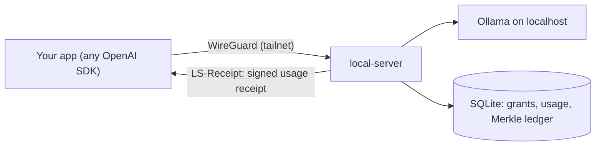

# local-server

**Turn a computer that can run AI models into a private, metered AI server for the people and apps you trust.**

local-server is a single Go binary. A **host** installs it next to [Ollama](https://ollama.com), decides how much of the machine to share, and invites **consumers**. Consumers call it with any OpenAI SDK over an encrypted [Tailscale](https://tailscale.com) network. Every call is admitted fairly, metered, and returned with a **signed usage receipt** backed by a tamper-evident Merkle-tree ledger.

> **Status:** Phase 1 is under construction. Parts of what is described below exist and parts are planned; the [roadmap](ROADMAP.md) says which. Licence: [Apache-2.0](LICENSE).



## Why

- **Use the hardware you already own.** A Mac mini or gaming PC that idles most of the day can serve friends and side projects.
- **Stay in control.** Per-consumer grants (models, context length, quotas, concurrency), pause and quiet hours, and requests for more that you approve or reject.
- **Keep it private.** Prompts and responses are not logged or stored by default; the only content kept is a queued background job and its result, encrypted, and deleted when the job ends or once a fetch has delivered its result whole (a fetch cut off midway can be repeated), and it is left out of backups unless you choose to keep it. Nothing admin-facing is ever public.
- **Trust the bill.** Receipts and inclusion proofs let a consumer verify usage independently. It is the same transparency-log idea that secures Certificate Transparency.

## Highlights for engineers

| Area | Design | Read more |
|---|---|---|
| Architecture | Modular monolith with ports and adapters; CI-enforced module boundaries | [HLD §6.1](docs/design_docs/hld.md#61-one-binary-many-swappable-parts-d-21) |
| API | Spec-first OpenAPI 3.1; OpenAI surfaces unchanged; extensions in headers | [HLD §7](docs/design_docs/hld.md#7-api-design-d-32-d-33) |
| Scheduling | Two-class priority queue with aging, memory admission, load shedding with `Retry-After`, idempotent async jobs | [HLD §6.5](docs/design_docs/hld.md#65-admission-control-and-scheduling-d-26) |
| Integrity | RFC 6962 Merkle ledger, C2SP signed checkpoints, Ed25519 JWS receipts, rotating key hierarchy | [HLD §6.7](docs/design_docs/hld.md#67-verifiable-usage-ledger-and-receipts-d-16-d-27-d-51-d-52) |
| Storage | Pure-Go SQLite, WAL, a single writer goroutine, unit of work, data classification on every column | [LLD §3](docs/design_docs/lld.md#3-data-model-d-37-as-superseded-by-d-42-and-d-44-plus-d-53) |
| Reliability | Transactional outbox, at-least-once webhooks, terminal states that never reopen | [HLD §8.3](docs/design_docs/hld.md#83-reliability-and-failure-modes) |
| Security | Zero-trust transport, least-privilege keys, fuzzed parsers, race detector, govulncheck, SLSA provenance | [HLD §8.1](docs/design_docs/hld.md#81-security-threat-model-abridged) |
| Data | Decentralised by default; envelope-encrypted backups to your own bucket (R2 or Google Cloud Storage) | [HLD §6.10](docs/design_docs/hld.md#610-off-host-backups-and-data-sharing-decentralised-by-default-d-41-d-43-d-59) |

## Documentation

| For | Document |
|---|---|
| Hosts and consumers | [User guide](docs/user-guide.md) |
| App developers and contributors | [Developer guide](docs/developer-guide.md) |
| System design | [High-level design](docs/design_docs/hld.md) · [Low-level design](docs/design_docs/lld.md) |
| Why each decision was made | [ADRs](docs/adr/) · [decisions log](docs/tracks/platform/phase_1/requirements/req_001.decisions.md) |
| Terms | [Glossary](docs/glossary.md) |
| Legal | [Licence, terms and privacy](docs/legal/README.md) |

## Install

Installers ship with the first release (batch B8). The steps will be in the [user guide](docs/user-guide.md#host-setup). To build from source once the code lands:

```bash
git clone https://github.com/inCoderKaka/local-server && cd local-server
CGO_ENABLED=0 go build ./cmd/local-server
```

## Licence

[Apache-2.0](LICENSE).
