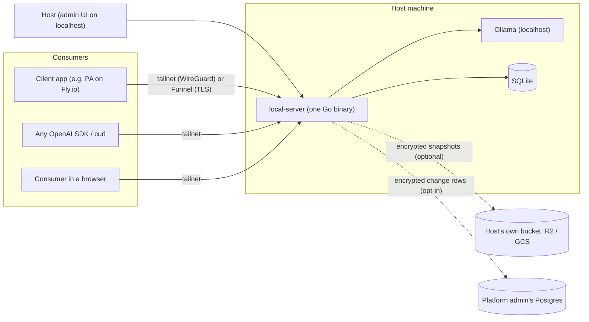
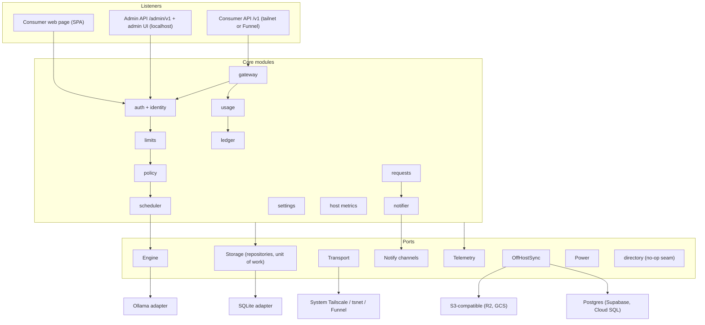
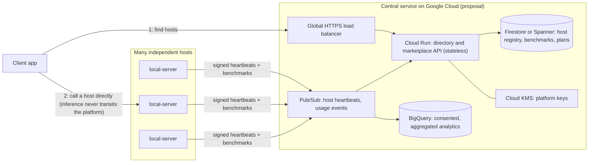

# local-server — high-level design

| | |
|---|---|
| **Status** | Design complete, implementation starting. Nothing below is built yet unless the [roadmap](../../ROADMAP.md) says so. |
| **Scope** | Phase 1 (requirement req_001) |
| **Companion** | [Low-level design](lld.md): modules, schema, state machines, call flows |
| **Source of truth** | The decisions log [`req_001.decisions.md`](../tracks/platform/phase_1/requirements/req_001.decisions.md). Every `D-NN` below is a row there; ADRs [0001](../adr/0001-req001-scope-and-product-decisions.md)–[0005](../adr/0005-req001-pre-implementation-additions.md) summarise them. Terms follow the [glossary](../glossary.md). |
| **Labels** | **Judgement** marks a reasoned call with no external source. **Unsourced** marks a claim still to verify. **Estimate** marks back-of-envelope arithmetic. |

---

## 1. Context and scope

Many people own a machine that can run a capable open model through Ollama: a Mac mini, a gaming PC, a workstation. Most of the day it sits idle. Their friends and their own apps pay a cloud provider instead.

**local-server** turns that machine into a small, private inference server. The owner (the **host**) installs one binary, decides how much of the machine to share, and invites people or apps (**consumers**). Consumers call it with any OpenAI-compatible SDK, over an encrypted network, within the limits the host grants. Every call is metered and comes back with a **signed usage receipt** that the consumer can verify later.

The first real client app is a personal-assistant app (PA). It uses a friend's Mac mini through local-server and falls back to a cloud provider when the host is offline or busy (D-03).

**Actors** ([glossary](../glossary.md#people-and-roles)): the **host** owns the machine. A **consumer** is a person or an application with access keys. A **client app** is software a consumer uses (PA). The **platform admin** runs the optional platform services and sees host data only through sharing grants the host approves.

## 2. Goals and non-goals

**Goals (Phase 1)**

| # | Goal | Why it matters |
|---|---|---|
| G1 | **Light:** one static binary per OS, no runtime, no external database | A host installs it with one command and forgets it (D-09, D-21) |
| G2 | **Secure by default:** encrypted transport, nothing admin-facing on the public internet, least-privilege keys | Hosts open their personal machine to others (D-10, D-24) |
| G3 | **Private by default:** prompts and responses are not logged or stored by default; the only content at rest is queued background-job content and its result, encrypted and deleted at completion or on fetch (§8.2) | The host must not become a data processor by accident (D-31, D-40) |
| G4 | **Compatible:** standard OpenAI surfaces, unmodified | Every existing SDK and app works without a custom client (D-32) |
| G5 | **Fair and controllable:** per-consumer grants, quotas, context caps, priorities, pause and quiet hours | The host stays in charge of their own machine (D-25, D-26, D-06) |
| G6 | **Verifiable usage:** a tamper-evident ledger and a signed receipt for every response | Future billing disputes are settled with proofs, not trust (D-16, D-27) |
| G7 | **Extensible:** every external dependency behind a port, every value a runtime setting | New engines, transports, stores and channels slot in without rewrites (D-21, D-54) |
| G8 | **Portable:** macOS, Windows and Linux on amd64 and arm64 | Hosts run all three (D-04, D-09) |

**Non-goals (Phase 1)**, designed as seams but not built (D-02, D-04, D-45): a marketplace or host discovery, our own relay, billing and payments, multi-host failover inside local-server, non-inference resources (storage, GPU jobs), email and Telegram notifications, brew and winget packages, auto-update, and running models itself (Ollama does that).

## 3. Requirements in brief

| Kind | Requirement | Design answer |
|---|---|---|
| Functional | Host tunes how much of the machine is shared and sees other apps' usage on every page | Share budget + `HostMetrics` port (§6.5, §6.11) |
| Functional | Host issues keys, sets models, context length and output caps per consumer | Grants with immutable versions + policy rules (§6.4) |
| Functional | Consumers ask for more; host approves or rejects, with comments | Resource requests (§6.4, LLD F3) |
| Functional | Usage over time at useful granularity | Immutable usage records + minute/hour/day rollups (§6.7) |
| Non-functional | Gateway adds negligible latency to inference | SLOs measured on a fake engine, then approved (D-55) |
| Non-functional | Survives restarts and crashes without double-billing | Single-writer transactions, idempotency keys, terminal states never reopened (§6.8) |
| Non-functional | Legal traceability | ADRs, decision logs and consent records (D-45) |

## 4. Back-of-envelope estimates

The binding constraint is the GPU and memory of one machine, not the software. These numbers size the design. They are **Estimates**, and PLT-F-018 replaces them with measurements (D-55).

| Quantity | Arithmetic | Result |
|---|---|---|
| KV-cache memory per token, 8B model (32 layers, 8 KV heads, head dim 128, fp16) | 2 (K and V) × 32 × 8 × 128 × 2 B | 128 KiB per token |
| KV cache for one 8 k-token context | 8,192 × 128 KiB | ≈ 1 GiB, on top of ≈ 5 GB of Q4 weights |
| Decode speed, one stream on a recent Apple Silicon machine | assumption, to be measured | ≈ 30–60 tokens/s |
| Time for a 500-token answer | 500 ÷ ~50 tok/s | ≈ 10 s |
| Sustained throughput per host (2–4 parallel slots) | 2–4 ÷ 10 s | ≈ 0.2–0.4 requests/s, ≤ 35 k/day |
| SQLite write load | 1 batched transaction per request | ≪ 1 % of a single WAL writer's capacity |
| Ledger growth | ~300 B usage row + ~64 B tree hashes per leaf | ≈ 130 MB/year at 1 k requests/day |
| Inclusion-proof size at 10 M leaves | ⌈log₂ 10⁷⌉ = 24 hashes × 32 B | ≈ 768 B |
| Receipt signing (Ed25519) | tens of µs per signature | negligible next to inference |
| Binary size | Go + pure-Go SQLite; embedded tsnet adds ≈ 25 MB ([gauger #11](https://github.com/mach4-braai/gauger/issues/11)) | ≈ 10 MB default, ≈ 35 MB with tsnet |

Three consequences follow:
- **Memory decides admission.** A request is admitted only if its model's loaded size plus its estimated KV cache fits the host's share budget (§6.5). The KV formula is why the context cap is a per-grant setting.
- **The database never limits throughput.** One writer goroutine is enough, which buys simple, strict consistency (§6.8).
- **Scale is horizontal across hosts, not vertical in one.** The design keeps hosts independent, so adding hosts adds capacity with no shared bottleneck (§9).

## 5. Architecture overview

local-server is a **modular monolith built as ports and adapters** (hexagonal architecture, D-21). The core modules hold the domain logic and depend only on interfaces (ports). Adapters implement those ports for Ollama, Tailscale, SQLite, the OS and the network. CI enforces the boundaries with forbidden-import checks (`tools/archcheck`).

**One request, end to end.** A consumer sends `POST /v1/chat/completions` with `Authorization: Bearer ls_<prefix>_<secret>`.
1. **Auth** finds the key by its prefix, compares hashes in constant time, and loads the consumer's current grant from a cache.
2. **Limits and policy** check quotas, rate, size and the grant's rules.
3. **The scheduler** admits the request when a slot and enough memory are free, or rejects it at once with `Retry-After`.
4. **The Engine adapter** calls Ollama's native API with an explicit context size and streams the answer back as OpenAI server-sent events.
5. **Metering:** one database transaction appends the usage record and its ledger leaf.
6. **The receipt:** a signed receipt goes back in a header or the final stream event.

## 6. Feature walk-through

Each feature names what it does, how it works, the engineering ideas it rests on, and what was rejected. The [concept index](#11-concept-index) at the end maps each idea back here.

### 6.1 One binary, many swappable parts (D-21)

- **What:** a single process with the gateway, control plane, scheduler, ledger, notifier and host metrics, plus three listeners: the consumer API, the consumer web page and the admin UI.
- **How:** core modules import only ports. Adapters are chosen at startup from settings, or compiled in or out with build tags. Embedded Tailscale and desktop notifications are optional builds. The web UIs are single-page apps embedded with `go:embed`, and they call the same versioned HTTP API as everyone else. So a hosted website can replace them later without touching the core.
- **Ideas in play:** hexagonal architecture; the **dependency inversion principle** (the core owns the interfaces, so details depend on policy, not the reverse); **interface segregation** (small, role-specific ports); one shared **contract test suite per port** that every adapter must pass. Boundaries are checked by a machine, not by convention.
- **Rejected:** microservices or several processes. They add install weight, IPC and failure modes, with no benefit on one machine. Per-request panic recovery contains the blast radius instead (**Judgement**). The only extra process is that notification helper in the optional system-service mode (§6.13).

### 6.2 Inference gateway and the Engine port (D-22, D-32, D-33, D-48)

- **What:** consumers speak the OpenAI API. local-server translates it to Ollama's native API.
- **How:** an `Engine` port (`Chat`, `Embed`, `ListModels`, `ModelInfo`, `Load`, `Unload`, `Loaded`) with an Ollama adapter.
  - **Why the native API:** it is the only one that sets `num_ctx` per request, and per-grant context caps need that ([OpenAI compatibility](https://docs.ollama.com/api/openai-compatibility), [context length](https://docs.ollama.com/context-length)).
  - **Model lifecycle:** local-server owns preload, keep-alive and unload.
  - **Context overflow:** Ollama silently drops old messages when a prompt is too long. local-server refuses instead by default; `on_context_overflow` is a per-grant setting (F-09).
- **Ideas in play:** the **adapter pattern** and an **anti-corruption layer**, so engine quirks never leak into the domain. The **open/closed principle**: standard surfaces are implemented as published and never modified. local-server features are added as separate endpoints or as `LS-*` headers, so the body stays pure OpenAI. Unsupported fields such as `n` are **rejected explicitly**, never dropped silently.
- **Rejected:** proxying Ollama's OpenAI-compatible layer, because it cannot enforce context caps. Putting extensions in the request body was also rejected, because SDKs may drop unknown fields.
- **Later:** llama.cpp and MLX adapters behind the same port.

### 6.3 Encrypted transport without opening ports (D-10, D-23, D-24)

- **What:** consumers reach the host over Tailscale (WireGuard). Nothing on the host is exposed to the public internet unless the host turns on **public mode**.
- **How:**
  - **System Tailscale (default):** local-server listens on the host's tailnet address. It uses Tailscale's WhoIs to optionally bind a key to a device, and `*.ts.net` HTTPS certificates.
  - **Embedded tsnet:** an optional build for a single-install host.
  - **Public mode (opt-in):** Tailscale Funnel, with TLS ending on the host, so the relay never sees plaintext. Turning it on forces rate limits, brute-force lockout, and request size and time limits.
  - **Admin UI:** localhost by default. A tailnet listener behind a login is optional. It is never public.
- **Ideas in play:** **zero-trust networking**, the idea behind Google's BeyondCorp: identity is checked per request, and being on the network grants nothing by itself. **Defence in depth:** the network layer and the application layer each authenticate. **Secure defaults:** public exposure is opt-in and refuses to start without its protections.
- **Rejected:** Cloudflare's HTTP proxy, because it terminates TLS. Port forwarding, because it exposes the home IP and needs router access.
- **Kept as a seam:** Cloudflare Tunnel plus our own end-to-end encryption.
- **Known limits:**
  - Funnel is beta, and Tailscale's free plan is non-commercial (F-06). Both matter once billing arrives (§10).
  - Funnel serves only ports 443, 8443 and 10000 on `*.ts.net` names, with bandwidth that can't be configured (D-24, F-06).
  - Tagged nodes from another tailnet cannot reach shared machines, so a client app hosted elsewhere (e.g. PA on Fly) must be a user-owned node, or its consumer is invited as a Tailscale user (6 on the free plan), unless the host uses public mode (D-23).
  - `*.ts.net` machine names appear in public Certificate Transparency logs (D-23).
  - The passkey RP ID is bound to the host's hostname, so renaming the machine breaks consumers' passkeys (D-23).
  - Embedded tsnet's streaming-stall issue ([tailscale#21577](https://github.com/tailscale/tailscale/issues/21577)) must be re-checked before tsnet serves streamed responses (D-23).

### 6.4 Identity, keys, grants and policy (D-13, D-25, D-42, D-53)

- **What:** who may call, which models, how much, and when.
- **How:**
  - **Principals:** every actor is a principal (`idn_principal`): host admin, consumer, platform admin, and future kinds. Per-type tables point to it 1:1 (table-per-type inheritance, D-53), so adding a user type never alters the principal table.
  - **Consumers:** a consumer has zero or more **access keys**: `ls_<prefix>_<secret>`, shown once, stored as a fast hash plus the visible prefix. Consumers who use the web page log in with a password (argon2id) or a passkey (WebAuthn), and join through one-time invites.
  - **Grants:** each consumer has one **grant**, the allowed models, quotas, context cap, output cap, concurrency, expiry and allowed request properties. Each change creates a new **immutable grant version**, and usage rows record which version they ran under. A key can narrow its consumer's grant but never widen it.
  - **Policy rules:** a versioned declarative format behind a `Policy` port, for request properties, background-work hours and priority class.
- **Ideas in play:**
  - **Least privilege** and capability-style keys.
  - A **fast hash for high-entropy secrets** versus a slow, memory-hard hash for human passwords (**Judgement**, following [OWASP](https://cheatsheetseries.owasp.org/cheatsheets/Password_Storage_Cheat_Sheet.html)).
  - **Immutable versioned records,** so audit and billing history never changes under you.
  - **Separating the policy decision point from the enforcement point:** `Policy.Evaluate` decides, and the gateway enforces. The **strategy pattern** behind `Policy` lets an expression language replace the rule engine later.
  - **UUIDv7 ids** sort by time and merge across hosts without coordination.
- **Rejected:** CEL or Rego in Phase 1, because of unmeasured binary-size cost and a learning curve for hosts. Forms over a small rule format cover the need.

### 6.5 Admission control and scheduling (D-26)

- **What:** the host's machine is shared fairly and never overloaded.
- **How:**
  - **Two priority classes:** interactive ahead of background, with background requests **aging** upward so they are never starved.
  - **Concurrency limits:** per grant, with the total kept at or below Ollama's `OLLAMA_NUM_PARALLEL`.
  - **Memory admission:** the loaded model size from `/api/ps` plus the estimated context must fit the share budget (the §4 KV formula).
  - **A bounded queue:** when it is full, the request fails fast with `queue_full` and `Retry-After`, so Ollama's own queue never fills. A running request is never interrupted.
  - **Background jobs:** they can use the async jobs API, `POST /v1/jobs` with an `Idempotency-Key`. Results are encrypted, kept briefly, and deleted on fetch.
- **Ideas in play:**
  - A **priority queue** (a binary heap, `container/heap`) with **aging** to prevent starvation.
  - **Admission control and load shedding:** reject early and cheaply instead of queueing without bound, the overload advice of Google's SRE book.
  - **Back-pressure** through `Retry-After`.
  - **Idempotency keys,** so a client retry after a timeout never runs or bills twice.
  - **Async request-reply,** so the client's timeout doesn't depend on the host's load.
- **Rejected:** relying on Ollama's internal queue, which is unbounded from our side and blind to priorities.

### 6.6 Limits and abuse protection (D-24, PLT-F-017)

- **What:** token quotas per key and grant, a requests-per-window rate limit, a maximum body size, and lockout after repeated failed key attempts. A `quota.near_limit` event warns the consumer early.
- **Ideas in play:** the **token-bucket** rate limiter, separate quota accounting from rate, and brute-force lockout. Each threshold is a runtime setting (D-54).

### 6.7 Verifiable usage: ledger and receipts (D-16, D-27, D-51, D-52)

- **What:** every response carries a signed receipt. The host's usage history is a tamper-evident log, so a consumer can later prove that the host recorded their call.
- **How:**
  - **The record and its leaf:** at request end, one transaction appends an immutable usage record and its leaf in a **Merkle-tree log** (RFC 6962 math via [`x/mod/sumdb/tlog`](https://pkg.go.dev/golang.org/x/mod/sumdb/tlog)).
  - **The receipt:** a JWS signed with Ed25519 ([RFC 9864](https://www.rfc-editor.org/rfc/rfc9864.html)). It carries the leaf index and the tree size, and goes in the `LS-Receipt` header or the final stream event.
  - **Checkpoints:** a background worker periodically signs one in the [C2SP format](https://c2sp.org/tlog-checkpoint). Consumers fetch inclusion proofs (my call is in the log) and consistency proofs (the log only grew) later.
  - **Keys:** a long-lived host identity key signs rotating receipt-signing subkeys.
  - **Metering failure:** if the metering write keeps failing, the answer is still returned, with a signed receipt marked `unmetered`.
- **Ideas in play:**
  - **Transparency logs:** the same structure as Certificate Transparency and Go's checksum database, both designed at Google.
  - **Merkle trees** give O(log n) proofs.
  - An **append-only log** with **signed tree heads.**
  - A **key hierarchy** with rotation, which limits a leaked key's damage without changing the host's identity.
  - **Asynchronous checkpoints** keep signing off the request path.
- **Rejected:**
  - A plain hash chain: it detects tampering only when someone audits it and keeps old heads ([Crosby & Wallach](https://www.usenix.org/legacy/event/sec09/tech/full_papers/crosby.pdf)).
  - [Trillian](https://github.com/google/trillian): in maintenance mode, and needs MySQL.
  - [Tessera](https://github.com/transparency-dev/tessera): needs other storage.
  - A checkpoint per request: it adds latency to every call (D-52).

### 6.8 Storage: one writer, strict consistency (D-28, D-44)

- **What:** all state lives in one SQLite file. It is pure Go ([modernc](https://pkg.go.dev/modernc.org/sqlite)), so `CGO_ENABLED=0` cross-compiles for every OS.
- **How:**
  - **Concurrency:** WAL mode, one writer goroutine running batched `BEGIN IMMEDIATE` transactions, and a small read pool.
  - **Ownership:** each module owns its tables (short prefixes such as `idn_`, `ldg_`) behind its own repository interface.
  - **Unit of work:** cross-module writes join one transaction. For example, approving a resource request writes the grant version, audit event, notification event and sync change together.
  - **Migrations:** forward-only, built in. Destructive changes go expand → backfill → contract.
  - **Data catalog:** every table and column carries a plain-language comment, a classification (`public` … `content`) and a `billable` flag, collected into a data catalog at startup.
- **Ideas in play:**
  - The **single-writer principle:** serialising writes removes lock contention and gives linearizable writes at this load (§4).
  - The **repository** and **unit-of-work** patterns.
  - **Expand/contract migrations** for zero-downtime schema change.
  - **Data classification by design,** so privacy, retention and future billing are queries, not projects.
- **Rejected:** a cgo SQLite driver, because it makes the 6-target release matrix expensive. An embedded key-value store was rejected because the data is relational and needs SQL rollups.

### 6.9 Notifications that never get lost (D-29)

- **What:** in-app notifications pushed over SSE, signed webhooks ([Standard Webhooks](https://www.standardwebhooks.com/)), and desktop notifications for the host.
- **How:**
  - **Routing:** domain events (a request decided, a quota near its limit, a job done, the host paused) pass through per-principal preferences to channels.
  - **Webhooks:** an outbox row is written **in the same transaction** as the event. A worker delivers it with exponential backoff, and receivers de-duplicate by `webhook-id`. A `410` response disables the endpoint.
- **Ideas in play:**
  - **Publish/subscribe** (the **observer** pattern).
  - The **transactional outbox,** which solves the dual-write problem.
  - **At-least-once delivery plus idempotent receivers,** which gives effectively-once processing.
  - **Exponential backoff.**
  - **HMAC request signing.**

### 6.10 Off-host backups and data sharing, decentralised by default (D-41, D-43, D-59)

- **What:** the host's data stays on the host. Backups go to storage the host owns. Sharing with anyone else needs an explicit, time-boxed, revocable grant.
- **How:**
  - **Backups:** encrypted whole-database snapshots (`VACUUM INTO` → compress → encrypt) go to a local folder or the host's own S3-compatible bucket: Cloudflare R2 by default, or **Google Cloud Storage** through its XML API.
  - **Platform sync (opt-in):** encrypted change rows go to the platform admin's Postgres, through a **generic Postgres adapter**. Supabase is the default configuration, and Cloud SQL or AlloyDB works by configuration.
  - **Dataset keys:** each dataset (usage, audit, consumer directory) has its own key. A sharing grant **wraps** that key to the grantee's X25519 public key, and revoking or expiring the grant rotates the key.
  - **What goes into a backup is the host's choice, per table (D-64):** each table is either *minimized* (its rows are removed from the snapshot copy) or *kept as is*. By default, job content and login sessions are minimized and everything else is kept, so a fetched job result is gone from future backups too.
  - **What never leaves the host unencrypted:** prompts, job content, sessions, credentials and private keys. Platform sync never carries them at all.
- **Ideas in play:**
  - **Envelope encryption:** data keys wrapped by key-encryption keys, the model Cloud KMS uses.
  - **Client-side encryption,** so the server only ever holds ciphertext.
  - **Key rotation** on revocation.
  - **Change data capture** through a `syn_change` table written in the same transaction as each change.
  - **Privacy by design** and data minimisation.
- **Rejected:** central sync by default (D-35 was superseded by D-41), and a vendor-specific sync adapter (D-59).

### 6.11 Observability and host metrics (D-31, D-55)

- **What:**
  - Structured JSON logs (`log/slog`), Prometheus metrics on the admin listener, and a request id that ties signals together.
  - A `HostMetrics` port (gopsutil) that splits the machine into three parts: local-server plus Ollama plus loaded models (the share-budget slice), other apps, and an "unattributed" remainder. Each value is labelled with how it was measured.
- **How:**
  - **Telemetry port:** modules call a thin `Telemetry` port, and an OpenTelemetry adapter can be switched in later. That includes exporting to Google Cloud's operations suite, with no module change.
  - **Redaction:** typed (`LogValuer`), so a prompt cannot reach a log by accident.
- **Ideas in play:**
  - **SLIs and SLOs:** gateway overhead, admission latency and receipt-signing time. They are measured on a fake engine first, then approved (D-55).
  - **Redaction by type,** not by convention.
  - **Honest measurement:** values local-server can't read are labelled "unattributed", not guessed.

### 6.12 Everything is a setting, owned by one party (D-54)

Every time, retention, TTL, retry and threshold value is a stored setting with a default. Each setting has one owner, who can change it at runtime:
- the **platform admin** owns the platform sync targets;
- the **host** owns the host's data;
- the **consumer** owns their own preferences.

Nothing is hard-coded. There is no bounds hierarchy: each party sets its own values freely. This is **configuration as data**, and it keeps operational tuning out of the release cycle.

### 6.13 Packaging and OS integration (D-30, D-49, D-62)

- **Service:** a per-user login service by default (LaunchAgent, `systemd --user`, Windows logon task), which needs no admin rights and runs next to Ollama. A system service that starts at boot is optional, and comes with a small user-session helper that shows desktop notifications (D-30).
- **Installers:** `curl … | sh` and PowerShell. They verify the SHA-256 checksum, install into a user folder, register the service, and offer to install Ollama and Tailscale; they never install either silently.
- **Sleep lock:** held only while sharing is on.
- **Releases:**
  - Pure-Go binaries for 3 OSes × 2 CPUs.
  - **SLSA build provenance** through GitHub artifact attestations, so anyone can verify where a binary was built.
  - Darwin binaries are never altered after the build (F-07).

## 7. API design (D-32, D-33)

- **Spec-first:** OpenAPI 3.1 is the source of truth. Server interfaces are generated from it (ogen, D-57), and client apps test against it.
- **Standard surfaces, as published:** `/v1/chat/completions` (with streaming), `/v1/embeddings`, `/v1/models`, Standard Webhooks, JWS receipts and C2SP checkpoints.
- **Additive local-server contracts:** `/v1/health`, `/v1/capabilities`, `/v1/jobs`, `/v1/resource-requests`, `/v1/usage`, `/v1/keys`, `/v1/ledger/checkpoint`, `/v1/usage/{id}/proof`, notification preferences and webhook endpoints. The admin API `/admin/v1` is on the admin listener only.
- **Errors:** the OpenAI error envelope plus typed codes: `quota_exceeded`, `host_paused`, `model_not_granted`, `context_too_long`, `queue_full`, `engine_unavailable`. Each comes with `Retry-After` where a retry makes sense (D-32; `engine_unavailable` from D-39).
- **Evolution:** the major version is in the URL, and changes within a major are additive only. Deprecations use `Deprecation`/`Sunset` headers, and golden tests guard compatibility.

The [developer guide](../developer-guide.md) shows these from a client app's side.

## 8. Cross-cutting concerns

### 8.1 Security (threat model, abridged)

| Threat | Mitigation |
|---|---|
| Stolen access key | Shown once, stored hashed, scoped by grant, expiry and revocation, optional device binding through WhoIs, lockout on guessing |
| Brute force on keys or logins | Lockout and rate limits, mandatory in public mode; argon2id for passwords |
| Network eavesdropping | WireGuard on the tailnet; TLS ending on the host in public mode |
| Remote admin takeover | Admin listener on localhost by default, never public, behind a login when on the tailnet |
| Host inflates a bill | Merkle ledger with consumer-held receipts; consistency proofs reveal rewrites |
| Malformed or hostile input | Explicit field rejection, size limits, typed parsers with **fuzz tests** on every untrusted input (D-60) |
| A consumer's webhook used to reach the host's network (SSRF) | http(s) URLs only; the resolved IP is checked at dial time, so DNS rebinding cannot bypass it; loopback, link-local, unspecified, multicast and the host machine's own addresses are refused; private and tailnet targets are refused unless the host allows them (D-66); redirects are not followed |
| A web page driving the admin or consumer UI (DNS rebinding, CSRF) | The admin listener accepts only a loopback or configured tailnet Host header, and cookie-authenticated writes need a same-origin Origin header (PLT-F-024, PLT-F-027) |
| Script injection through consumer-written text | Both web UIs are served with a strict Content-Security-Policy, and comments and names are rendered as text, never as HTML (PLT-F-032) |
| Supply-chain tampering | Checksums, SLSA provenance, `govulncheck` in CI (D-62) |
| Secret theft at rest | Secrets sealed with a master key in the OS keychain (file fallback on headless Linux) |
| Data races corrupting metering | `go test -race` in CI over the concurrent modules (D-61) |

### 8.2 Privacy

- **Content:** prompts and responses are never written to disk or logs. Queued job content and job results are the only content at rest. Both are encrypted, and both are deleted at completion or on fetch.
- **Personal fields:** erased when a consumer is deleted. The row stays, so ledger references remain valid.
- **Consent and classification:** consent records (`idn_consent`) and data classification exist from day one (D-40, D-44, D-45).

### 8.3 Reliability and failure modes

| Failure | Behaviour |
|---|---|
| Ollama down | `503 engine_unavailable`. Client apps fall back to their cloud provider (D-03, D-11) |
| Host offline or paused | `/v1/health` tells clients quickly. Interactive calls fall back, and background work waits in the client's retry queue |
| Overload | Bounded queue, `queue_full` + `Retry-After`. Running requests are never interrupted |
| Client disconnects mid-stream | The engine call is cancelled, and the tokens generated so far are metered |
| Crash or restart | Running jobs become `failed(host_restart)` (Ollama can't resume a generation, **Judgement**). Terminal states never reopen, and idempotency keys prevent double runs |
| Metering write fails repeatedly | The answer is still returned with an `unmetered` signed receipt. The failure is logged, counted and alerted (D-51) |
| Webhook receiver down | Exponential backoff from the outbox. The endpoint is disabled after `410` or N failures |
| Disk loss | Restore from encrypted snapshots with the recovery code |

### 8.4 Scalability

- **Per host (vertical):** bounded by memory and GPU. The scheduler exists to use those well, not to raise them.
- **Across hosts (horizontal):** each host is independent, with its own identity key, data and ledger. UUIDv7 ids and per-host keys mean data from many hosts can merge later without coordination. Client-side failover across hosts (D-08) and a central directory (§9) build on that without changing the host.
- **Storage:** the §4 numbers leave SQLite with orders of magnitude of headroom. The repository interfaces leave room for a Postgres adapter.

### 8.5 Maintainability and testing

- **Architecture checks:** module boundaries are checked in CI, and each module has an architecture note.
- **Port contracts:** one contract test suite per port, plus a fake engine.
- **API compatibility:** golden tests for the OpenAI-compatible contract.
- **Fuzzing:** fuzz targets on untrusted input, with seed corpora run on every CI run.
- **Races and vulnerabilities:** the race detector and `govulncheck` in CI.
- **Platforms:** CI on macOS, Windows and Linux.
- **Performance:** benchmarks that turn the §4 estimates into the measured SLOs.

## 9. Future: scale-out and the central service (proposal, not decided)

Phase 1 ships only the seams for this: the `directory` port (a no-op), host identity keys, `plan_id` and category tags on principals, benchmark fields in `/v1/capabilities`, and sharing grants (D-02, D-45). How the central service is built is decided in its own phase's design. The sketch below is the current proposal, using Google Cloud where it fits (D-59).

The design principles carry over:
- **Inference never transits the platform.** The central service is a control plane only, so its cost and load scale with the number of hosts, not with tokens.
- **Stateless serving** on Cloud Run, which scales to zero when idle.
- **A globally consistent registry,** if multi-region strong consistency is needed (Spanner), or a document store otherwise (Firestore).
- **Event ingestion** through Pub/Sub.
- **Analytics** only over data hosts have shared through sharing grants.
- **Host selection** can start client-side, using latency, benchmarks and remaining quota, and move server-side later.

## 10. Risks and open items for later phases

| Risk | When it matters | Planned response |
|---|---|---|
| Tailscale's free plan is non-commercial, and Funnel is beta (F-06) | When hosts are paid | The transport port's other options: Cloudflare Tunnel with our own end-to-end encryption, or our own relay (D-24) |
| Model licences vary for commercial hosting | When hosts are paid | Discussed in that phase's legal review, per the legal-scope rule (D-45) |
| macOS LaunchAgent behaviour for an unsigned binary on macOS 15/26 is **Unsourced** | First release | Smoke test in the release checklist (PLT-C-003) |
| ogen's OpenAPI 3.1 coverage is **Unsourced** | First build | Spike in PLT-F-001, which stops and reports if it falls short (D-57) |

## 11. Concept index

Each idea, and the one place it does real work.

| Concept | Where |
|---|---|
| Hexagonal architecture, dependency inversion, interface segregation | §6.1 |
| Adapter pattern, anti-corruption layer, open/closed principle | §6.2 |
| Zero-trust networking (BeyondCorp), defence in depth, secure defaults | §6.3 |
| Least privilege, table-per-type inheritance, immutable versioning, strategy pattern, PDP/PEP split, UUIDv7 | §6.4 |
| Priority queue (heap) with aging, admission control, load shedding, back-pressure, idempotency keys, async request-reply | §6.5 |
| Token bucket rate limiting, brute-force lockout | §6.6 |
| Merkle trees, transparency logs (Certificate Transparency, Go sumdb), digital signatures, key hierarchy and rotation | §6.7 |
| Single-writer principle, repository and unit of work, expand/contract migrations, data classification | §6.8 |
| Publish/subscribe (observer), transactional outbox, at-least-once + idempotent receivers, exponential backoff, HMAC signing | §6.9 |
| Envelope encryption, client-side encryption, change data capture, privacy by design | §6.10 |
| SLIs/SLOs, typed redaction | §6.11 |
| Configuration as data | §6.12 |
| Supply-chain security (SLSA provenance, govulncheck), fuzzing, race detection | §6.13, §8 |
| Back-of-envelope capacity estimation | §4 |
| Stateless control plane, scale-to-zero, horizontal scale-out | §9 |

## 12. Tech stack

| Layer | Choice | Decision |
|---|---|---|
| Language | Go, `CGO_ENABLED=0`, one static binary per OS | D-09 |
| Inference engine | Ollama native API, behind `Engine` | D-22 |
| Transport | Tailscale (system or tsnet), Funnel for public mode | D-23, D-24 |
| Database | SQLite via `modernc.org/sqlite`, WAL, single writer | D-28 |
| API | OpenAPI 3.1, ogen (server code), vacuum (lint) | D-32, D-57 |
| Crypto | Ed25519 (`crypto/ed25519`), JWS receipts, C2SP checkpoints, `x/mod/sumdb/tlog`, argon2id, X25519 key wrapping, AEAD | D-25, D-27, D-43 |
| Auth | Access keys, password (argon2id), passkeys (go-webauthn) | D-13, D-25 |
| Observability | `log/slog`, lumberjack rotation, Prometheus, gopsutil; OpenTelemetry later | D-31, D-58 |
| Notifications | SSE, Standard Webhooks (HMAC-SHA256), beeep | D-29 |
| Secrets | OS keychain via `zalando/go-keyring`, file fallback | D-40, F-08 |
| OS service | kardianos/service | D-30 |
| Off-host | S3-compatible (R2, Google Cloud Storage), Postgres (Supabase, Cloud SQL) | D-41, D-59 |
| CI and release | GitHub Actions on 3 OSes, race detector, fuzzing, govulncheck, SLSA attestations | D-31, D-60..D-62 |
| Web UIs | Embedded SPAs with a generated TypeScript client | D-21, PLT-F-032 |
