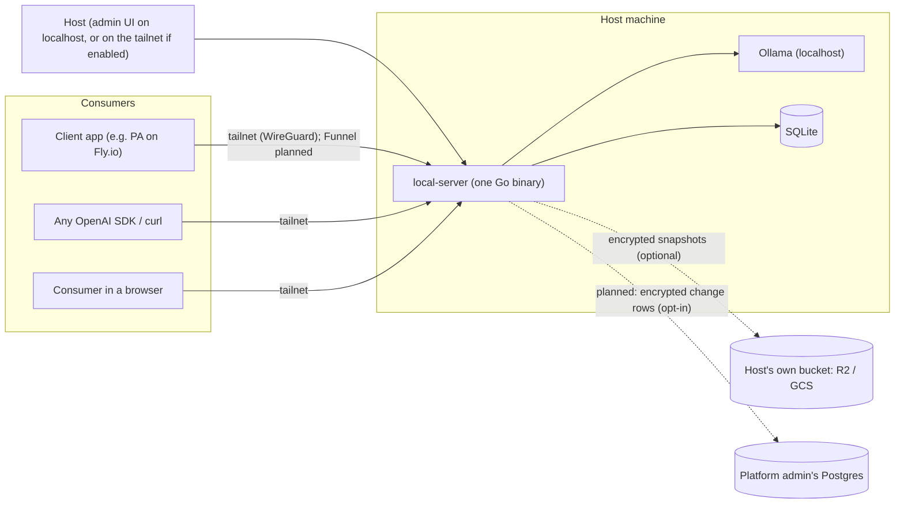
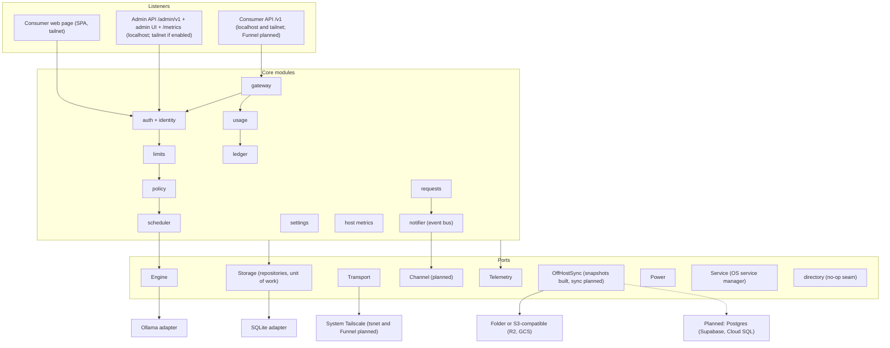
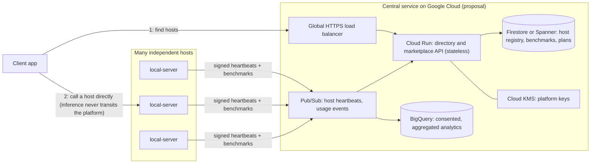

# local-server — high-level design

| | |
|---|---|
| **Status** | Phase 1 is built as described below, except the parts marked *planned* (phase 2): notifications (in-app, webhooks, desktop), public mode (Funnel), embedded tsnet, signed export and import (bundles), platform sync and sharing grants, and everything from req_002. [§2](#built-and-planned-at-a-glance) lists what is built and what is planned. The [roadmap](../../ROADMAP.md) says which built parts have not yet run on a real machine. |
| **Scope** | Phase 1 (requirement req_001). Parts designed for it and not built are marked *planned*. Additions from requirement req_002 (client options, capability discovery, the portal integration) are marked *planned* and are built in phase 2 |
| **req_002 log** | [`req_002.decisions.md`](../tracks/platform/phase_1/requirements/req_002.decisions.md) holds the req_002 rows (HLD D-20..D-25, LLD D-26..D-30), summarised in [ADR 0007](../adr/0007-req002-system-design.md) |
| **Companion** | [Low-level design](lld.md): modules, schema, state machines, call flows |
| **Source of truth** | The decisions log [`req_001.decisions.md`](../tracks/platform/phase_1/requirements/req_001.decisions.md). Every `D-NN` below is a row there; ADRs [0001](../adr/0001-req001-scope-and-product-decisions.md)–[0005](../adr/0005-req001-pre-implementation-additions.md) summarise them. Terms follow the [glossary](../glossary.md). |
| **Labels** | **Judgement** marks a reasoned call with no external source. **Unsourced** marks a claim still to verify. **Estimate** marks back-of-envelope arithmetic. |

---

## 1. Context and scope

Many people own a machine that can run a capable open model through Ollama: a Mac mini, a gaming PC, a workstation. Most of the day it sits idle. Their friends and their own apps pay a cloud provider instead.

**local-server** turns that machine into a small, private inference server. The owner (the **host**) installs one binary, decides how much of the machine to share, and invites people or apps (**consumers**). Consumers call it with any OpenAI-compatible SDK, over an encrypted network, within the limits the host grants. Every call is metered and comes back with a **signed usage receipt** that the consumer can verify later.

The first real client app is a personal-assistant app (PA). It uses a friend's Mac mini through local-server and falls back to a cloud provider when the host is offline or busy (D-03).

**Actors** ([glossary](../glossary.md#people-and-roles)): the **host** owns the machine. A **consumer** is a person or an application with access keys. A **client app** is software a consumer uses (PA). The **platform admin** runs the optional platform services (planned) and sees host data only through sharing grants the host approves (planned).

## 2. Goals and non-goals

**Goals (Phase 1)**

| # | Goal | Why it matters |
|---|---|---|
| G1 | **Light:** one static binary per OS, no runtime, no external database | A host installs it with one command and forgets it (D-09, D-21) |
| G2 | **Secure by default:** encrypted transport, nothing admin-facing on the public internet, least-privilege keys | Hosts open their personal machine to others (D-10, D-24) |
| G3 | **Private by default:** prompts and responses are not logged or stored by default; the only content at rest is queued background-job content and its result, encrypted and deleted at completion or on fetch, and left out of backups by default (§8.2) | The host must not become a data processor by accident (D-31, D-40) |
| G4 | **Compatible:** standard OpenAI surfaces, unmodified | Every existing SDK and app works without a custom client (D-32) |
| G5 | **Fair and controllable:** per-consumer grants, quotas, context caps, priorities, pause and quiet hours | The host stays in charge of their own machine (D-25, D-26, D-06) |
| G6 | **Verifiable usage:** a tamper-evident ledger and a signed receipt for every response | Future billing disputes are settled with proofs, not trust (D-16, D-27) |
| G7 | **Extensible:** every external dependency behind a port, every value a runtime setting | New engines, transports, stores and channels slot in without rewrites (D-21, D-54) |
| G8 | **Portable:** macOS, Windows and Linux on amd64 and arm64 | Hosts run all three (D-04, D-09) |

**Non-goals (Phase 1)**, designed as seams but not built (D-02, D-04, D-45): a marketplace or host discovery, our own relay, billing and payments, multi-host failover inside local-server, non-inference resources (storage, GPU jobs), email and Telegram notifications, brew and winget packages, auto-update, and running models itself (Ollama does that).

Designed for Phase 1 and **planned** for phase 2, so not built: in-app notifications, signed webhooks and desktop notifications (§6.9); public mode and embedded tsnet (§6.3); signed export and import (bundles), platform sync and sharing grants (§6.10); and the req_002 additions (§6.14, §6.15).

### Built and planned at a glance

| Area | Built | Planned (phase 2) |
|---|---|---|
| Gateway and engine | `POST /v1/chat/completions` (streamed and not), `/v1/embeddings`, `/v1/models`, `/v1/health`, `/v1/capabilities`; the Ollama adapter with model preload, keep-alive and unload; the async jobs API | llama.cpp and MLX adapters; client engine options, discovery of them, task names and the portal integration (§6.14) |
| Identity and access | Principals, consumers, one-time invites, access keys (optionally bound to a tailnet node), grants with immutable versions, policy rules, quotas, rate limits and lockout, consumer sign-up and login with password or passkey, resource requests | Platform admin accounts |
| Admission | Scheduler with two priority classes, memory admission and a bounded queue; pause sharing and quiet hours | |
| Verifiable usage | Usage records, minute, hour and day rollups, the Merkle ledger, signed receipts, checkpoints, inclusion and consistency proofs, host keys | |
| Transport | System Tailscale: localhost listeners, and HTTPS listeners on the host's tailnet address; keys bound to a tailnet node | Public mode (Funnel); embedded tsnet |
| Web UIs | The admin UI and the consumer web page, embedded in the binary | Notification, webhook and data-sharing pages |
| Notifications | Domain events written with the change, handed to in-process subscribers | In-app notifications (SSE), webhooks with an outbox, desktop notifications |
| Off-host data | Encrypted snapshot backups to a folder or an S3-compatible bucket, and offline restore | Platform sync, sharing grants, signed export and import |
| Operation | `doctor`, the background service (user or system mode), the sleep lock, installers for macOS, Linux and Windows, the release workflow | The user-session helper (only its definition exists) |

## 3. Requirements in brief

| Kind | Requirement | Design answer |
|---|---|---|
| Functional | Host tunes how much of the machine is shared and sees other apps' usage on every page | Share budget + `HostMetrics` port (§6.5, §6.11) |
| Functional | Host issues keys, sets models, context length and output caps per consumer | Grants with immutable versions + policy rules (§6.4) |
| Functional | Consumers ask for more; host approves or rejects, with comments | Resource requests (§6.4, LLD F3) |
| Functional | Usage over time at useful granularity | Immutable usage records + minute/hour/day rollups (§6.7) |
| Non-functional | Gateway adds negligible latency to inference | Targets for gateway overhead, admission and receipt signing, measured on a fake engine and held as host settings (D-55, §6.11) |
| Non-functional | Survives restarts and crashes without double-billing | Single-writer transactions, idempotency keys, terminal states never reopened (§6.8) |
| Non-functional | Legal traceability | ADRs, decision logs and consent records (D-45) |

## 4. Back-of-envelope estimates

The binding constraint is the GPU and memory of one machine, not the software. These numbers size the design. They are **Estimates**, except the binary size, which is measured. The gateway's own time is measured separately on a fake engine: the targets for overhead, admission and receipt signing are host settings, held by benchmarks and tests (D-55, §6.11). The decode-speed and throughput rows stay unmeasured.

| Quantity | Arithmetic | Result |
|---|---|---|
| KV-cache memory per token, 8B model (32 layers, 8 KV heads, head dim 128, fp16) | 2 (K and V) × 32 × 8 × 128 × 2 B | 128 KiB per token |
| KV cache for one 8 k-token context | 8,192 × 128 KiB | ≈ 1 GiB, on top of ≈ 5 GB of Q4 weights |
| Decode speed, one stream on a recent Apple Silicon machine | assumption, to be measured | ≈ 30–60 tokens/s |
| Time for a 500-token answer | 500 ÷ ~50 tok/s | ≈ 10 s |
| Sustained throughput per host (2–4 parallel slots) | 2–4 ÷ 10 s | ≈ 0.2–0.4 requests/s, ≤ 35 k/day |
| SQLite write load | 1 batched transaction per request | ≪ 1 % of a single WAL writer's capacity |
| Ledger growth | ~300 B usage row + ~64 B tree hashes per leaf | ≈ 130 MB/year at 1 k requests/day |
| Inclusion-proof size at 10 M leaves | ⌈log₂ 10⁷⌉ = 24 hashes × 32 B | ≈ 768 B |
| Receipt signing (Ed25519) | tens of µs per signature | negligible next to inference |
| Binary size | Go + pure-Go SQLite, the Tailscale local-API client, the S3 SDK and both web UIs inside. Measured on the six release binaries built locally. Embedded tsnet (planned) adds more: ≈ 25 MB **Estimate** ([gauger #11](https://github.com/mach4-braai/gauger/issues/11)) | Measured 36.6–39.6 MB per binary; the first estimate of ≈ 10 MB did not hold |

Three consequences follow:
- **Memory decides admission.** A request is admitted only if its model's loaded size plus its estimated KV cache fits the host's share budget (§6.5). The KV formula is why the context cap is a per-grant setting.
- **The database never limits throughput.** One writer goroutine is enough, which buys simple, strict consistency (§6.8).
- **Scale is horizontal across hosts, not vertical in one.** The design keeps hosts independent, so adding hosts adds capacity with no shared bottleneck (§9).

## 5. Architecture overview

local-server is a **modular monolith built as ports and adapters** (hexagonal architecture, D-21). The core modules hold the domain logic and depend only on interfaces (ports). Adapters implement those ports for Ollama, Tailscale, SQLite, the OS and the network. Only `cmd/local-server` imports an adapter and wires it to its port. CI enforces the boundaries with forbidden-import checks (`tools/archcheck`), and every module has an architecture note in `docs/modules/`.

**One request, end to end.** A consumer sends `POST /v1/chat/completions` with `Authorization: Bearer ls_<prefix>_<secret>`.
1. **Auth** finds the key by its prefix, compares hashes in constant time, and loads the consumer's current grant from a cache.
2. **Limits and policy** check quotas, rate, size and the grant's rules.
3. **The scheduler** admits the request when a slot and enough memory are free, or rejects it at once with `Retry-After`.
4. **The Engine adapter** calls Ollama's native API with an explicit context size and streams the answer back as OpenAI server-sent events.
5. **Metering:** one database transaction appends the usage record, its ledger leaf and a sync change row.
6. **The receipt:** a signed receipt goes back in the `LS-Receipt` header, or for a streamed answer as a `: ls-receipt` comment line just before `data: [DONE]`.

## 6. Feature walk-through

Each feature names what it does, how it works, the engineering ideas it rests on, and what was rejected. The [concept index](#11-concept-index) at the end maps each idea back here.

### 6.1 One binary, many swappable parts (D-21)

- **What:** a single process with the gateway, control plane, scheduler, ledger, notifier (the domain-event bus) and host metrics, plus three listeners: the consumer API, the consumer web page and the admin listener (admin API, admin UI and metrics). A worker supervisor restarts any background worker that fails. The binary has subcommands: `serve`, `doctor`, `recovery-code`, `restore`, `backup-credentials` and `service` (§6.13).
- **How:** core modules import only ports. Adapters are wired in one place, `cmd/local-server`. The operating-system adapters (sleep lock, background service) are chosen by build constraint, and others from settings (the backup target) or a flag (the engine). Embedded Tailscale and desktop notifications are *planned* optional builds. The web UIs are single-page apps (React, built with Vite) embedded with `go:embed`, and they call the same versioned HTTP API as everyone else, through a client generated from `api/openapi.yaml`. So a hosted website can replace them later without touching the core. A plain `go build` needs no Node toolchain: it embeds a one-page stub for each UI, and `make build` builds the real ones first (D-152).
- **Ideas in play:** hexagonal architecture; the **dependency inversion principle** (the core owns the interfaces, so details depend on policy, not the reverse); **interface segregation** (small, role-specific ports); a shared **contract test suite** for the Engine port that the Ollama adapter and the fake engine both pass, and fakes for the other ports' tests. Boundaries are checked by a machine, not by convention.
- **Rejected:** microservices or several processes. They add install weight, IPC and failure modes, with no benefit on one machine. Per-request panic recovery contains the blast radius instead (**Judgement**). The only extra process is the *planned* notification helper in the optional system-service mode (§6.13).

### 6.2 Inference gateway and the Engine port (D-22, D-32, D-33, D-48)

- **What:** consumers speak the OpenAI API. local-server translates it to Ollama's native API.
- **How:** an `Engine` port (`Chat`, `Embed`, `ListModels`, `ModelInfo`, `Load`, `Unload`, `Loaded`) with an Ollama adapter, and a fake engine for tests and for `serve --engine fake`.
  - **Why the native API:** it is the only one that sets `num_ctx` per request, and per-grant context caps need that ([OpenAI compatibility](https://docs.ollama.com/api/openai-compatibility), [context length](https://docs.ollama.com/context-length)).
  - **Model lifecycle:** local-server owns preload, keep-alive and unload.
  - **Context overflow:** Ollama silently drops old messages when a prompt is too long. local-server refuses instead by default; `on_context_overflow` is a per-grant setting (F-09).
  - **Startup check:** local-server refuses to start against an Ollama older than the minimum version the context guarantee needs (D-48). An Ollama that cannot be reached is not fatal: calls answer `engine_unavailable` until it is up.
  - **Fields:** `temperature`, `top_p`, `seed` and `stop` are passed through to the engine (D-113). The penalties, tools, images and a `response_format` other than text are refused with `unsupported_parameter` until the engine port can carry them.
- **Ideas in play:** the **adapter pattern** and an **anti-corruption layer**, so engine quirks never leak into the domain. The **open/closed principle**: standard surfaces are implemented as published and never modified. local-server features are added as separate endpoints or as `LS-*` headers, so the body stays pure OpenAI. Unsupported fields such as `n` are **rejected explicitly**, never dropped silently.
- **Rejected:** proxying Ollama's OpenAI-compatible layer, because it cannot enforce context caps. Putting extensions in the request body was also rejected, because SDKs may drop unknown fields.
  - **Narrowed for req_002 (planned, [ADR 0007](../adr/0007-req002-system-design.md), D-25):** the evidence does not bear out "SDKs may drop unknown fields". The cost of a body extension is ergonomic, not data loss: openai-node needs `@ts-expect-error` and has no `extra_body` planned ([openai-node](https://raw.githubusercontent.com/openai/openai-node/master/README.md), [issue 924](https://github.com/openai/openai-node/issues/924)), while openai-python has `extra_body` ([openai-python](https://github.com/openai/openai-python)). So engine options that the OpenAI API lacks travel in one namespaced body object (req_001 D-162), and the TypeScript library in §6.14 removes the ergonomic cost.
- **Later:** llama.cpp and MLX adapters behind the same port.

### 6.3 Encrypted transport without opening ports (D-10, D-23, D-24)

- **What:** consumers reach the host over Tailscale (WireGuard). Nothing on the host is exposed to the public internet. A host will be able to turn on **public mode** (planned).
- **How:**
  - **System Tailscale (built, the default):** the host's own Tailscale app carries the traffic. local-server asks Tailscale's local API (the official `tailscale.com/client/local` package, D-147) for its state, for the node behind a connection (WhoIs) and for the `*.ts.net` certificate; it embeds no Tailscale. It is built and tested against the standalone Tailscale app on macOS, and `doctor` detects and reports other variants.
  - **Three tailnet listeners (D-148):** the consumer API (default port 8484), the consumer web page (8485) and, only when the host enables it, the remote admin listener (8486). Each serves HTTPS with the host's `*.ts.net` certificate, binds only to the host's tailnet address (never a wildcard or loopback), and has its port as a host setting. The consumer API takes access keys only: it ignores cookies and sends no CORS headers. The consumer page serves its own `/v1` account routes at its own origin, with the session cookie. Each tailnet request is logged with the peer's node ID and machine name, never a body or a header (D-146).
  - **Localhost listeners:** the consumer API (127.0.0.1:8484) and the admin listener (127.0.0.1:8485) are always up. The consumer web page is on the tailnet only.
  - **Tailscale not ready:** when Tailscale is missing, stopped, logged out or the tailnet has no HTTPS certificates, local-server still starts, serves on localhost only, and says why and how to fix it in its log, `doctor` and the admin UI (D-148).
  - **Embedded tsnet (planned):** an optional build for a single-install host.
  - **Public mode (planned, opt-in):** Tailscale Funnel, with TLS ending on the host, so the relay never sees plaintext. Turning it on will force rate limits, brute-force lockout, and request size and time limits.
  - **Admin UI:** localhost by default. A tailnet listener behind a login (HTTPS, with a `Secure` session cookie, D-86) is optional and off by default. It is never public.
- **Ideas in play:** **zero-trust networking**, the idea behind Google's BeyondCorp: identity is checked per request, and being on the network grants nothing by itself. **Defence in depth:** the network layer and the application layer each authenticate. **Secure defaults:** public exposure is opt-in and refuses to start without its protections.
- **Rejected:** Cloudflare's HTTP proxy, because it terminates TLS. Port forwarding, because it exposes the home IP and needs router access. One shared consumer port, CORS on the API port and port 443 (D-148).
- **Kept as a seam:** Cloudflare Tunnel plus our own end-to-end encryption.
- **Known limits:**
  - Funnel (planned) is beta, and Tailscale's free plan is non-commercial (F-06). Both matter once billing arrives (§10).
  - Funnel serves only ports 443, 8443 and 10000 on `*.ts.net` names, with bandwidth that can't be configured (D-24, F-06).
  - Tagged nodes from another tailnet cannot reach shared machines, so a client app hosted elsewhere (e.g. PA on Fly) must be a user-owned node, or its consumer is invited as a Tailscale user (6 on the free plan), unless the host uses public mode (D-23).
  - `*.ts.net` machine names appear in public Certificate Transparency logs (D-23).
  - The passkey RP ID is bound to the host's hostname, so renaming the machine breaks consumers' passkeys (D-23).
  - Embedded tsnet's streaming-stall issue ([tailscale#21577](https://github.com/tailscale/tailscale/issues/21577)) must be re-checked before tsnet (planned) serves streamed responses (D-23).

### 6.4 Identity, keys, grants and policy (D-13, D-25, D-42, D-53)

- **What:** who may call, which models, how much, and when.
- **How:**
  - **Principals:** every actor is a principal (`idn_principal`): host admin, consumer, platform admin (planned), and future kinds. Per-type tables point to it 1:1 (table-per-type inheritance, D-53), so adding a user type never alters the principal table.
  - **Consumers:** a consumer has zero or more **access keys**: `ls_<prefix>_<secret>`, shown once, stored as a fast hash plus the visible prefix. A key can be bound to a tailnet node, which the gateway checks with WhoIs on each call; the binding stores the node ID and the machine name (D-159). Consumers who use the web page join through one-time invites, accept the terms and privacy notice (a consent record), and log in with a password (argon2id) or a passkey (WebAuthn). They can change their password and add a passkey on the page. A consumer who signs up has no grant until the host sets one or approves a resource request (D-150). A suspended consumer can still log in, read-only (D-155).
  - **Grants:** each consumer has one **grant**, the allowed models, quotas, context cap, output cap, concurrency, expiry and allowed request properties. Each change creates a new **immutable grant version**, and usage rows record which version they ran under. A key can narrow its consumer's grant but never widen it. A consumer asks for more with a **resource request** and comments on it; the host approves it, which makes the new grant version in the same unit of work, or rejects it. A request expires after a host-owned time (D-157).
  - **Policy rules:** a versioned declarative format behind a `Policy` port, for request properties, background-work hours and priority class. A rule that fails to parse fails the request closed, and a broken rule that does not deny is switched off after a host-owned number of failures (D-73).
- **Ideas in play:**
  - **Least privilege** and capability-style keys.
  - A **fast hash for high-entropy secrets** versus a slow, memory-hard hash for human passwords (**Judgement**, following [OWASP](https://cheatsheetseries.owasp.org/cheatsheets/Password_Storage_Cheat_Sheet.html)).
  - **Immutable versioned records,** so audit and billing history never changes under you.
  - **Separating the policy decision point from the enforcement point:** `Policy.Evaluate` decides, and the gateway enforces. The **strategy pattern** behind `Policy` lets an expression language replace the rule engine later.
  - **UUIDv7 ids** sort by time and merge across hosts without coordination.
- **Rejected:** CEL or Rego in Phase 1, because of unmeasured binary-size cost and a learning curve for hosts. Forms over a small rule format cover the need.

### 6.5 Admission control and scheduling (D-26)

- **What:** the host's machine is shared fairly and never overloaded.
- **How:**
  - **Two priority classes:** interactive ahead of background, with background requests **aging** upward so they are never starved.
  - **Concurrency limits:** per grant, with the total kept at or below Ollama's `OLLAMA_NUM_PARALLEL`.
  - **Memory admission:** the loaded model size from `/api/ps` plus the estimated context must fit the share budget (the §4 KV formula). Idle models that are not preloaded are unloaded to make room. A request that can never fit is refused at once with `over_budget` (D-93).
  - **A bounded queue:** when it is full, or a request waits past the queue-wait limit, it fails fast with `queue_full` and `Retry-After`, so Ollama's own queue never fills. An interactive request that finds the queue full takes the place of the newest waiting background request. A running request is never interrupted.
  - **Pause and quiet hours:** the host can pause sharing or set quiet hours. Synchronous calls then fail with `host_paused`, and background jobs stay queued until sharing resumes.
  - **Background jobs:** they can use the async jobs API, `POST /v1/jobs` with an `Idempotency-Key`. Results are encrypted, kept briefly, and deleted once a fetch has written them whole (D-85).
- **Ideas in play:**
  - A **priority queue** (a binary heap, `container/heap`) with **aging** to prevent starvation.
  - **Admission control and load shedding:** reject early and cheaply instead of queueing without bound, the overload advice of Google's SRE book.
  - **Back-pressure** through `Retry-After`.
  - **Idempotency keys,** so a client retry after a timeout never runs or bills twice.
  - **Async request-reply,** so the client's timeout doesn't depend on the host's load.
- **Rejected:** relying on Ollama's internal queue, which is unbounded from our side and blind to priorities.

### 6.6 Limits and abuse protection (D-24, PLT-F-017)

- **What:** windowed token and request quotas per key and per grant (each entry has its own fixed window, and a key's quotas count that key's use while the grant's count all the consumer's keys), a requests-per-window rate limit per key, a maximum body size, and lockout after repeated failed key attempts, by address and by key prefix. A `quota.near_limit` domain event is raised when use nears a limit; delivering it to the consumer is a notification feature (§6.9, planned). Consumer logins are locked out the same way.
- **Ideas in play:** the **token-bucket** rate limiter, separate quota accounting from rate, and brute-force lockout. Each threshold is a runtime setting (D-54).

### 6.7 Verifiable usage: ledger and receipts (D-16, D-27, D-51, D-52)

- **What:** every response carries a signed receipt. The host's usage history is a tamper-evident log, so a consumer can later prove that the host recorded their call.
- **How:**
  - **The record and its leaf:** at request end, one transaction appends an immutable usage record and its leaf in a **Merkle-tree log** (RFC 6962 math via [`x/mod/sumdb/tlog`](https://pkg.go.dev/golang.org/x/mod/sumdb/tlog)).
  - **The receipt:** a JWS signed with Ed25519 ([RFC 9864](https://www.rfc-editor.org/rfc/rfc9864.html)). It carries the leaf index and the tree size, and goes in the `LS-Receipt` header, or for a streamed answer in a `: ls-receipt` comment line before `data: [DONE]`. The canonical leaf is a fixed, versioned JSON form (RFC 8785) with no prompt or response in it, so a consumer can rebuild it from the receipt.
  - **Checkpoints:** a background worker signs one in the [C2SP format](https://c2sp.org/tlog-checkpoint) once enough new leaves exist, or once a host-owned interval has passed with at least one new leaf. Consumers fetch inclusion proofs (my call is in the log, `GET /v1/usage/{id}/proof`, which answers `409` with `Retry-After` until a checkpoint covers the leaf) and consistency proofs (the log only grew, `GET /v1/ledger/checkpoint`) later.
  - **Keys:** a long-lived host identity key signs rotating receipt-signing subkeys and a separate, rarely rotated checkpoint-signing key (D-65). All are published as a JWK Set at `GET /v1/keys`, with the checkpoint verifier key; a retired key stays published for verification.
  - **Metering failure:** if the metering write keeps failing, the answer is still returned, with a signed receipt marked `unmetered`.
- **Ideas in play:**
  - **Transparency logs:** the same structure as Certificate Transparency and Go's checksum database, both designed at Google.
  - **Merkle trees** give O(log n) proofs.
  - An **append-only log** with **signed tree heads.**
  - A **key hierarchy** with rotation, which limits a leaked key's damage without changing the host's identity.
  - **Asynchronous checkpoints** keep signing off the request path.
- **Rejected:**
  - A plain hash chain: it detects tampering only when someone audits it and keeps old heads ([Crosby & Wallach](https://www.usenix.org/legacy/event/sec09/tech/full_papers/crosby.pdf)).
  - [Trillian](https://github.com/google/trillian): in maintenance mode, and needs MySQL.
  - [Tessera](https://github.com/transparency-dev/tessera): needs other storage.
  - A checkpoint per request: it adds latency to every call (D-52).

### 6.8 Storage: one writer, strict consistency (D-28, D-44)

- **What:** all state lives in one SQLite file. It is pure Go ([modernc](https://pkg.go.dev/modernc.org/sqlite)), so `CGO_ENABLED=0` cross-compiles for every OS.
- **How:**
  - **Concurrency:** WAL mode, one writer goroutine running batched `BEGIN IMMEDIATE` transactions, and a small read pool. Durability is `synchronous=FULL` by default, so a power loss cannot drop a batch whose signed receipts consumers already hold; the host may relax it (D-76).
  - **Ownership:** each module owns its tables (short prefixes such as `idn_`, `ldg_`) behind its own repository interface.
  - **Unit of work:** cross-module writes join one transaction. For example, approving a resource request writes the grant version, audit event, domain event and sync change together.
  - **Change capture:** a write to a usage record, a consumer row or a resource request also writes a `syn_change` row in the same transaction. Nothing ships them yet: platform sync (planned, §6.10) will. A host-owned retention prunes the ones that are never acknowledged (D-77).
  - **Retention:** a registry of tables, their time columns and a host-owned retention setting each; a worker prunes the expired rows on a host-owned interval.
  - **Migrations:** forward-only, built in; an applied migration that changes or goes missing stops startup. Destructive changes go expand → backfill → contract.
  - **Data catalog:** every table and column carries a plain-language comment, a classification (`public` … `content`) and a `billable` flag, collected into a data catalog at startup.
- **Ideas in play:**
  - The **single-writer principle:** serialising writes removes lock contention and gives linearizable writes at this load (§4).
  - The **repository** and **unit-of-work** patterns.
  - **Expand/contract migrations** for zero-downtime schema change.
  - **Data classification by design,** so privacy, retention and future billing are queries, not projects.
- **Rejected:** a cgo SQLite driver, because it makes the 6-target release matrix expensive. An embedded key-value store was rejected because the data is relational and needs SQL rollups.

### 6.9 Notifications that never get lost (D-29)

Built: the domain events. Planned (phase 2): every channel that delivers them.

- **What:** in-app notifications pushed over SSE, signed webhooks ([Standard Webhooks](https://www.standardwebhooks.com/)), and desktop notifications for the host (all *planned*).
- **Built, domain events:** the `Notifier` is an in-process event bus. A module emits an event inside the unit of work that makes the change, so the event row (`ntf_event`) commits or rolls back with it. After the commit the bus hands the event to in-process subscribers (for example, the key cache clears itself when a grant changes). Dispatch to subscribers is at most once: an event whose process dies between commit and dispatch keeps its row and is not redelivered. The events are `host.paused`, `quota.near_limit`, `resource_request.created`, `resource_request.decided`, `job.done`, `metering.failed`, `access_key.revoked`, `grant.changed`, `policy.rule_invalid` and `backup.failed`. A payload holds ids and counters only, and the bus refuses a payload key that names a prompt, a response or a secret.
- **Built, in the admin UI:** a count of pending resource requests, polled on a host-owned interval (D-157). It is not a live notification.
- **How (planned):**
  - **Routing:** domain events pass through per-principal preferences to `Channel` adapters. `/v1/notification-preferences`, `/v1/webhook-endpoints` and the admin twins are in the API contract and answer `501` until the channels exist.
  - **Webhooks:** an outbox row is written **in the same transaction** as the event. A worker delivers it with exponential backoff, and receivers de-duplicate by `webhook-id`. A `410` response disables the endpoint.
- **Ideas in play:**
  - **Publish/subscribe** (the **observer** pattern).
  - The **transactional outbox,** which solves the dual-write problem.
  - **At-least-once delivery plus idempotent receivers,** which gives effectively-once processing.
  - **Exponential backoff.**
  - **HMAC request signing.**

### 6.10 Off-host backups and data sharing, decentralised by default (D-41, D-43, D-59)

Built: encrypted backups to the host's own storage, and offline restore. Planned (phase 2): platform sync, sharing grants and signed export and import (bundles).

- **What:** the host's data stays on the host. Backups go to storage the host owns. Sharing with anyone else will need an explicit, time-boxed, revocable grant (planned).
- **How, built:**
  - **Backups:** a worker takes encrypted database snapshots on a host-owned schedule (off by default): `VACUUM INTO` → remove the minimized tables' rows → compress → encrypt in framed chunks with the host data key → store. The target is a local folder or the host's own S3-compatible bucket: Cloudflare R2 by default, or **Google Cloud Storage** through its XML API. A host-owned count and age prune old snapshots. A failed run raises a `backup.failed` event.
  - **Restore:** `local-server restore`, run while the host is stopped, decrypts a snapshot with the recovery code, checks it against the size and SHA-256 sealed inside it, and replaces the database, keeping the old file aside. Jobs that were queued or running and whose content was left out come back `failed(payload_minimized)` (D-68, D-72).
  - **Keys:** a snapshot never carries the machine's master key (D-138). The recovery code restores the data on the same machine, or where the master key (the OS keychain entry or `master.key`) survives. After a total loss without it, a restore gives the host a new identity, with new signing keys that consumers must trust again. The bucket's access key is stored sealed with the master key.
  - **What goes into a backup is the host's choice, per table (D-64):** each table is either *minimized* (its rows are removed from the snapshot copy) or *kept as is*. By default, job content, job results and login sessions are minimized and everything else is kept, so a fetched job result is gone from future backups too. A table can be minimized only when every table that references it is minimized too (D-69), and the host table, the host keys and the migration record are always kept (D-139).
- **How, planned:**
  - **Platform sync (opt-in):** encrypted change rows (the `syn_change` rows already captured, §6.8) go to the platform admin's Postgres, through a **generic Postgres adapter**. Supabase is the default configuration, and Cloud SQL or AlloyDB works by configuration.
  - **Dataset keys:** each dataset (usage, audit, consumer directory) has its own key. A sharing grant **wraps** that key to the grantee's X25519 public key, and revoking or expiring the grant rotates the key.
  - **Signed export and import (bundles):** the host exports and imports its data as signed bundles.
  - **What never leaves the host unencrypted:** prompts, job content, sessions, credentials and private keys. Platform sync will never carry them at all.
- **Ideas in play:**
  - **Envelope encryption:** data keys wrapped by key-encryption keys, the model Cloud KMS uses.
  - **Client-side encryption,** so the server only ever holds ciphertext.
  - **Key rotation** on revocation.
  - **Change data capture** through a `syn_change` table written in the same transaction as each change.
  - **Privacy by design** and data minimisation.
- **Rejected:** central sync by default (D-35 was superseded by D-41), and a vendor-specific sync adapter (D-59).

### 6.11 Observability and host metrics (D-31, D-55)

- **What:**
  - Structured JSON logs (`log/slog`) in a rotating file in the OS user log folder (size, age and level are host settings), Prometheus metrics at `/metrics` on the admin listener behind the same guard, and a request id that ties signals together.
  - A `HostMetrics` sampler (gopsutil) that splits the machine into the share-budget slice (local-server, Ollama and the loaded models), other apps (host use minus the slice), and a count of "unattributed" processes whose use the OS would not report. Each value is labelled with how it was measured. It keeps the latest reading in memory, sets gauges, and writes one row a minute for usage over time. Accelerator (GPU) memory is reported as unavailable with the reason; the memory of loaded models on it is in the slice.
- **How:**
  - **Telemetry port:** modules call a thin `Telemetry` port. The one adapter (`slogprom`) writes the log file and serves Prometheus. An OpenTelemetry adapter (planned) can be switched in later, including exporting to Google Cloud's operations suite, with no module change.
  - **Redaction:** typed (`LogValuer`), so a prompt cannot reach a log by accident.
- **Ideas in play:**
  - **SLIs and SLOs:** gateway overhead, admission latency and receipt-signing time. Their targets are host settings (`gateway.slo_*`), measured on a fake engine by benchmarks that the tests hold the gateway to; the gateway counts each call that misses a target (D-55).
  - **Redaction by type,** not by convention.
  - **Honest measurement:** values local-server can't read are labelled "unattributed", not guessed.

### 6.12 Everything is a setting, owned by one party (D-54)

Every time, retention, TTL, retry and threshold value is a stored setting with a default. Each setting has one owner, who can change it at runtime:
- the **platform admin** owns the platform sync targets (planned);
- the **host** owns the host's data and every limit, time and listener value;
- the **consumer** owns their own preferences (the consumer settings page).

Nothing is hard-coded. There is no bounds hierarchy: each party sets its own values freely. A definition lives in code with its default, owner and plain-language description, and only a value the owner changed is stored. Most values are read when they are used and apply at once; the few that shape startup (listener addresses and ports, log rotation, SQLite durability) apply at the next start. This is **configuration as data**, and it keeps operational tuning out of the release cycle.

### 6.13 Packaging and OS integration (D-30, D-49, D-62)

- **Service:** `local-server service install|uninstall|start|stop|status`. A per-user login service is the default (LaunchAgent, `systemd --user` with login lingering, Windows logon task), which needs no admin rights and runs next to Ollama. A system service that starts at boot is optional (`--mode system`). The service definitions are rendered by local-server itself and installed through a service adapter; `kardianos/service` is used only for the Windows system service (D-137). System mode comes with the definition of a small user-session helper that will show desktop notifications; the helper command itself is *planned* (D-30).
- **Installers:** `curl … | sh` (macOS and Linux) and PowerShell (Windows). They verify the SHA-256 checksum, install into a user folder, offer to register the service, and offer to install Ollama and Tailscale; they never install either without a yes. They also upgrade and uninstall.
- **Sleep lock:** held only while sharing is on (not paused, not in quiet hours), with one adapter per OS. It cannot stop sleep when a laptop's lid is closed.
- **Releases:**
  - Pure-Go binaries for 3 OSes × 2 CPUs, built by a release workflow when a version tag is pushed, with a `SHA256SUMS` file.
  - **SLSA build provenance** through GitHub artifact attestations, so anyone can verify where a binary was built.
  - Darwin binaries are never altered after the build (F-07).

### 6.14 Client options, capability discovery and the portal (planned, req_002 D-20..D-25)

Planned, built in phase 2 after `v0.1.0` (req_001 D-161). Recorded in [ADR 0007](../adr/0007-req002-system-design.md); the discussion that set the scope is [ADR 0006](../adr/0006-req002-discussion.md).

- **What:** clients can set more engine options and OpenAI fields per request, discover what each model and grant allows, name the task behind a call, and see what actually ran. The interactive-learning-portal (the portal) can use this host for text and vision tasks.
- **Where options are resolved (D-20):** by extending the decision and enforcement split of §6.4. Grants and policy rules own the per-option defaults, forced values and resource caps, and `policy.Evaluate` merges them into its `Decision` (smallest cap wins, as for today's caps). The gateway's planner combines the client's values, that decision and the model's capabilities from the `Engine` port's `ModelInfo` into the effective options, refuses an option the model cannot carry (`unsupported_parameter`) and writes the effective-options header. The engine adapter only maps the neutral names to its engine's options.
  - **Why:** one enforcement point means the header can never disagree with what ran, and a second engine adapter repeats no cap logic. Repo: [`internal/policy/policy.go`](../../internal/policy/policy.go), [`internal/gateway/validate.go`](../../internal/gateway/validate.go), [`internal/engine/engine.go`](../../internal/engine/engine.go), §6.4 above.
  - **Judgement:** resolving in the adapter would leak grants into the anti-corruption layer, and a separate options module would duplicate policy's merge rules.
  - **Rejected:** resolution inside the engine adapter; a new options module.
- **Task names (D-21):** free-form and bounded. A client chooses a short token (a length limit and a fixed character set), and a host-owned setting caps the distinct task values per consumer per rollup window; values past the cap are recorded as `other` (req_001 D-38). **Judgement:** a host-registered list would fail every new portal task until the host adds it, and an unbounded field would let one client bloat the rollups (the label-cardinality problem of metrics systems). **Rejected:** a host-registered list per grant; free-form unbounded.
- **Capability discovery in both places (D-23):** `GET /v1/capabilities` is the full per-caller answer (per model, the supported standard fields and options, the grant's defaults, forced values and resource caps). `GET /v1/models` also gains an OpenRouter-style `supported_parameters` name list per model, with no caller-specific value. Both come from one source in the code and a test checks they agree. A contributor-facing consistency checklist (what every later change must keep consistent across the API, the spec, the TypeScript library and the client requirement files) is written into the docs.
  - **Sources:** [OpenRouter models API](https://openrouter.ai/docs/api-reference/models/get-models), [OpenRouter models guide](https://openrouter.ai/docs/guides/overview/models), [LiteLLM model discovery](https://docs.litellm.ai/docs/proxy/model_discovery), [llama.cpp server README](https://raw.githubusercontent.com/ggml-org/llama.cpp/HEAD/tools/server/README.md), [openai-python response models](https://raw.githubusercontent.com/openai/openai-python/main/src/openai/_models.py), [Ollama show-model details](https://docs.ollama.com/api-reference/show-model-details). Repo: [`api/openapi.yaml`](../../api/openapi.yaml), [`internal/gateway/status.go`](../../internal/gateway/status.go).
  - **Rejected:** `/v1/capabilities` only; `/v1/models` only.
- **Thinking (D-24):** when thinking is on, its text is returned in a `reasoning` field on the message and on stream deltas. Thinking tokens count as output tokens: against `max_tokens`, the quotas and the receipt's completion count. `completion_tokens_details.reasoning_tokens` is reported only when the engine gives a count, never estimated, because receipts are signed records. Thinking text is content and is never logged or stored (§8.2).
  - **Sources:** [Ollama thinking](https://docs.ollama.com/capabilities/thinking), [Ollama OpenAI layer](https://raw.githubusercontent.com/ollama/ollama/main/openai/openai.go), [Ollama OpenAI compatibility](https://docs.ollama.com/api/openai-compatibility), [vLLM reasoning outputs](https://docs.vllm.ai/en/stable/features/reasoning_outputs/), [OpenRouter reasoning tokens](https://openrouter.ai/docs/use-cases/reasoning-tokens), [DeepSeek thinking mode](https://api-docs.deepseek.com/guides/thinking_mode), [OpenAI reasoning guide](https://developers.openai.com/api/docs/guides/reasoning). **Unsourced:** an official Ollama statement that `eval_count` includes thinking tokens.
  - **Rejected:** not returning thinking text; the `reasoning_content` name.
- **TypeScript client library (D-25):** it lives in this repo (for example `clients/ts/`). Its types are generated from `api/openapi.yaml` in the same commit as any spec change, CI checks they match, and it is published to npm with trusted publishing and provenance, versioned with semver against the API. It wraps discovery, the options object, the task tag and the effective-options header, so callers need no `@ts-expect-error`.
  - **Sources:** [openapi-typescript](https://openapi-ts.dev/introduction), [npm trusted publishing](https://docs.npmjs.com/trusted-publishers), [npm git dependencies](https://docs.npmjs.com/cli/v11/configuring-npm/package-json), [Semantic Versioning](https://semver.org/), [Vercel AI SDK](https://github.com/vercel/ai/blob/main/packages/openai-compatible/src/chat/openai-compatible-chat-language-model.ts), [vLLM `extra_body`](https://docs.vllm.ai/en/latest/serving/online_serving/openai_compatible_server/). Noted for later: `openapi-fetch`, which the web UIs use (req_001 D-151), is [entering maintenance mode](https://github.com/openapi-ts/openapi-typescript/discussions/2559).
  - **Rejected:** a git dependency; the library in the portal repo.
- **The portal's Vercel route (D-22):** the portal's deployment reaches the host from inside its server-side function, with the userspace-networking pattern Tailscale documents for AWS Lambda: `tailscaled --tun=userspace-networking` with a local proxy, joined with a tagged, ephemeral auth key held as a Vercel secret, the tag's grant reaching only the host's consumer API port. This is the portal repo's build (req_002 D-17). No relay and no spike-then-fallback: if the pattern does not work on Vercel, the hosted portal has no `local` provider until public mode (§6.3). See the risk in §10.
  - **Sources:** [Tailscale serverless integrations](https://tailscale.com/docs/integration-serverless-apps) (Vercel not listed), [Tailscale on AWS Lambda](https://tailscale.com/docs/install/cloud/aws/aws-lambda), [userspace networking](https://tailscale.com/docs/concepts/userspace-networking), [ephemeral nodes](https://tailscale.com/docs/features/ephemeral-nodes), [auth keys](https://tailscale.com/docs/features/access-control/auth-keys), [Vercel function limits](https://vercel.com/docs/functions/limitations), [Vercel runtimes](https://vercel.com/docs/functions/runtimes). **Unsourced:** that `tailscaled` runs inside a Vercel function at all, its cold-start cost, and whether userspace mode resolves MagicDNS names.
  - **Rejected:** a spike with a Fly.io relay fallback; a relay from the start.
- **Low-level design:** the state machines, call flows, data paths, schema and relationships are in the [LLD](lld.md), marked planned.

### 6.15 AI traceability, trust boundary and thinking tokens (planned, req_002 D-31..D-38)

Planned, built in phase 2 after `v0.1.0`. Recorded in [ADR 0008](../adr/0008-req002-ai-architecture.md). The host adds no prompt, agent or graph of its own: it serves one model call per request for client apps (the interactive-learning-portal and personal-assistant), so this section covers how those calls are traced, saved and trusted.

- **Run and model identity (D-32):** the run id is the completion id and the signed receipt (§6.7). The gateway returns the model's digest as `system_fingerprint` in the answer and every stream chunk, and stores it in `use_record.model_digest`, outside the canonical leaf and the receipt. The digest comes from the engine's model list and can lag a pull by the model-info time-to-live. A client's own trace should use OpenTelemetry GenAI attribute names.
  - **Why:** a tag name does not identify weights, because a tag can move when the host pulls the model. **Sources:** [Ollama `/api/tags`](https://docs.ollama.com/api/tags), [Ollama OpenAPI schema](https://docs.ollama.com/openapi.yaml), [Ollama OpenAI layer](https://raw.githubusercontent.com/ollama/ollama/main/openai/openai.go), [OpenAI cookbook](https://developers.openai.com/cookbook/examples/reproducible_outputs_with_the_seed_parameter), [vLLM fingerprint modes](https://docs.vllm.ai/en/stable/api/vllm/entrypoints/serve/utils/fingerprint/), [OpenTelemetry GenAI inference attributes](https://raw.githubusercontent.com/open-telemetry/semantic-conventions-genai/main/docs/gen-ai/client-inference.md) (Development stability). **Unsourced:** that `/api/tags` and `/api/ps` return the same digest for one model on a live server.
- **Atomic, tunable steps (D-33):** the host's call is one atomic step with client-tunable, echoed parameters. Client apps own tunable and comparable steps and must require per-step parameters and prompt version, change and re-run, and side-by-side comparison; the host builds no compare or replay tool. **Sources:** [LangSmith compare](https://docs.langchain.com/langsmith/compare-experiment-results.md), [Langfuse compare](https://langfuse.com/docs/evaluation/experiments/compare-experiments). **Rejected:** a replay or compare tool in the admin UI.
- **Everything saved (D-34):** client apps persist every AI request, response and feedback, not sampled, with the effective options, prompt version, model and fingerprint, task, usage id, latency, finish reason, token counts, regeneration link and error. The host stays content-free by default (§8.2) except the existing sealed job content. Optional host-side persistence on the client's explicit consent is accepted in principle, off by default; its mechanism is deferred (Q-25, blocks a phase-2 slice only). **Rejected:** a host content log as the default; a waiver.
- **Trust boundary (D-35):** pass-through. The host serves exactly the requested model and options or a typed error; it substitutes no model, has no fallback, and validates or repairs no JSON, because constrained decoding guarantees syntax and not meaning and a repair would hide engine faults from the client's trace. The client validates its schema and owns fallback. **Sources:** [Ollama structured outputs](https://docs.ollama.com/capabilities/structured-outputs), [Ollama thinking](https://docs.ollama.com/capabilities/thinking), [Ollama issue 14645](https://github.com/ollama/ollama/issues/14645) (an issue thread). **Rejected:** host-side retry on invalid JSON; a host-side fallback model.
- **Prompt (D-36):** the host changes no prompt text. The prompt version is the client's trace field, and the effective-options header states the overflow policy in force (`refuse` or `truncate`), so a trace can mark a prompt that may have been cut. **Rejected:** a `prompt_version` property sent to the host.
- **Thinking tokens (D-38):** the output cap covers thinking (OpenAI semantics). The host adds no headroom, reports `finish_reason: length` honestly, and the TypeScript library raises a typed thinking-exhausted signal. A grant default `reasoning_effort` can protect small caps, a contract test pins that Ollama counts thinking tokens in `num_predict`, and a numeric thinking budget is a future engine option. **Sources:** [OpenAI reasoning guide](https://developers.openai.com/api/docs/guides/reasoning), [OpenRouter reasoning tokens](https://openrouter.ai/docs/use-cases/reasoning-tokens), [Ollama thinking](https://docs.ollama.com/capabilities/thinking), [Ollama issue 17561](https://github.com/ollama/ollama/issues/17561), [Anthropic extended thinking](https://platform.claude.com/docs/en/build-with-claude/extended-thinking), [Gemini thinking](https://docs.cloud.google.com/vertex-ai/generative-ai/docs/thinking), [vLLM reasoning outputs](https://docs.vllm.ai/en/stable/features/reasoning_outputs/). **Unsourced:** an official Ollama statement that `num_predict` includes thinking tokens. **Rejected:** the host adding headroom.
- **The pipeline graph (D-37):** the chat pipeline is a named-node graph in this repo; see the [LLD](lld.md).

## 7. API design (D-32, D-33)

- **Spec-first:** OpenAPI 3.1 is the source of truth. Server interfaces are generated from it (ogen, D-57), CI lints it (vacuum) and checks that the generated code matches it, and the web UIs' client is generated from it too. A type ogen cannot generate (the policy rule document) stays free-form and is pinned by a schema file and a test (D-110). Client apps test against it.
- **Standard surfaces, as published:** `/v1/chat/completions` (with streaming), `/v1/embeddings`, `/v1/models`, JWS receipts and C2SP checkpoints. Standard Webhooks follow when webhooks are built (planned).
- **Additive local-server contracts:** `/v1/health`, `/v1/capabilities`, `/v1/jobs`, `/v1/resource-requests`, `/v1/usage`, `/v1/keys`, `/v1/ledger/checkpoint`, `/v1/usage/{id}/proof`, and the consumer account routes (`/v1/invite-redemptions/*`, `/v1/session*`, `/v1/me*`) that the consumer web page uses. The notification-preference and webhook-endpoint routes are in the contract and answer `501` until the notification channels are built (planned). The admin API `/admin/v1` is on the admin listener only. Planned (req_002, [ADR 0007](../adr/0007-req002-system-design.md)): `/v1/capabilities` also answers, per model, the supported options with the grant's defaults, forced values and caps, and `/v1/models` gains a `supported_parameters` name list per model (§6.14).
- **Errors:** the OpenAI error envelope plus typed codes, among them `quota_exceeded`, `host_paused`, `model_not_granted`, `context_too_long`, `queue_full`, `engine_unavailable` and `over_budget` (D-93); the full table, with the policy codes of D-79, is in the LLD's error model and `api/openapi.yaml`. Each comes with `Retry-After` where a retry makes sense (D-32; `engine_unavailable` from D-39).
- **Evolution:** the major version is in the URL, and changes within a major are additive only. A deprecation would use `Deprecation`/`Sunset` headers (none exists yet), and golden tests guard the OpenAI-compatible bodies, stream chunks and receipts.

The [developer guide](../developer-guide.md) shows these from a client app's side.

## 8. Cross-cutting concerns

### 8.1 Security (threat model, abridged)

| Threat | Mitigation |
|---|---|
| Stolen access key | Shown once, stored hashed, scoped by grant, expiry and revocation, optional device binding through WhoIs, lockout on guessing |
| Brute force on keys or logins | Lockout and rate limits (they will be mandatory in public mode, planned); argon2id for passwords |
| Network eavesdropping | WireGuard on the tailnet, and HTTPS with the host's `*.ts.net` certificate on every tailnet listener; in public mode (planned) TLS ends on the host |
| Remote admin takeover | Admin listener on localhost by default, never public, behind a login when on the tailnet |
| Host inflates a bill | Merkle ledger with consumer-held receipts; consistency proofs reveal rewrites |
| Malformed or hostile input | Explicit field rejection, size limits, typed parsers with **fuzz tests** on every untrusted input (D-60) |
| A consumer's webhook used to reach the host's network (SSRF), *planned* with webhooks | http(s) URLs only; the resolved IP is checked at dial time, so DNS rebinding cannot bypass it; loopback, link-local, unspecified, multicast and the host machine's own addresses are refused; private and tailnet targets are refused unless the host allows them (D-66); redirects are not followed |
| A web page driving the admin or consumer UI (DNS rebinding, CSRF) | The admin listener accepts only a loopback or configured tailnet Host header, the consumer page only the host's own tailnet names, and cookie-authenticated writes need a same-origin Origin header. The consumer API takes no cookie and sends no CORS header, so a page on another site cannot ride a login (PLT-F-024, PLT-F-027, D-148) |
| Script injection through consumer-written text | Both web UIs are served with a strict Content-Security-Policy, and comments and names are rendered as text, never as HTML (PLT-F-032) |
| Supply-chain tampering | Checksums, SLSA provenance, `govulncheck` in CI (D-62) |
| Secret theft at rest | Private keys, the host data key and job content sealed with a master key kept in the OS keychain (a file readable only by the host's user when the keychain cannot be used); backups never carry the master key (D-138) |
| Data races corrupting metering | `go test -race` in CI on Linux and macOS (D-61) |

### 8.2 Privacy

- **Content:** prompts and responses are never written to disk or logs. Queued job content and job results are the only content at rest. Both are encrypted, and queued job content is deleted at the terminal state and a result once a fetch has written it whole (D-85). Backups leave both out by default. A host who sets them to *keep as is* keeps a copy in each snapshot until that snapshot is pruned (D-64).
- **Consumer-written text:** a resource request's message and its comments are text a consumer and the host write to each other, not prompts. They are stored and shown through the API, and they never go into a log, an audit detail, an event payload or a sync change row (D-31, D-40).
- **Personal fields:** a deleted consumer is soft-deleted. After a host-owned retention (90 days by default) a purge removes everything personal or credential-bearing: the consent records and their evidence (including the IP address and browser user agent noted at sign-up), credentials, sessions and access keys. The already-erased consumer and principal rows stay as a tombstone, so audit and ledger references remain valid (D-106, D-134, D-136).
- **Consent and classification:** consent records (`idn_consent`) and data classification exist from day one (D-40, D-44, D-45). A consumer accepts the versioned terms and privacy notice when signing up (D-153).

### 8.3 Reliability and failure modes

| Failure | Behaviour |
|---|---|
| Ollama down | `503 engine_unavailable`. Client apps fall back to their cloud provider (D-03, D-11) |
| Host offline or paused | `/v1/health` tells clients quickly. Interactive calls fall back, and background work waits in the client's retry queue |
| Overload | Bounded queue, `queue_full` + `Retry-After`. Running requests are never interrupted |
| Client disconnects mid-stream | The engine call is cancelled, and the tokens generated so far are metered with an estimated prompt count |
| Crash or restart | Running jobs become `failed(host_restart)` (Ollama can't resume a generation, **Judgement**). Terminal states never reopen, and idempotency keys prevent double runs |
| Metering write fails repeatedly | The answer is still returned with an `unmetered` signed receipt. The failure is logged, counted and raised as a `metering.failed` event; an in-app alert from it is planned (D-51) |
| Webhook receiver down (planned, with webhooks) | Exponential backoff from the outbox. The endpoint is disabled after `410` or N failures |
| Platform sync keeps failing (planned, with platform sync; e.g. a paused Supabase project) | Retries continue with backoff. Past a host-owned threshold the host admin gets an in-app notification with no content, and `doctor` and the admin UI show the last successful sync (D-67) |
| Disk loss | Restore from encrypted snapshots with the recovery code. Where the master key did not survive, the restore gives the host a new identity (D-138). Jobs that had not finished (queued or running) whose payload was left out of the backup come back `failed(payload_minimized)` (D-68) |
| Tailscale missing, stopped or logged out | local-server starts anyway and serves on localhost only; the log, `doctor` and the admin UI name the fix (D-148) |
| A background worker fails or panics | The worker supervisor restarts it after a host-owned delay and counts the restart |

### 8.4 Scalability

- **Per host (vertical):** bounded by memory and GPU. The scheduler exists to use those well, not to raise them.
- **Across hosts (horizontal):** each host is independent, with its own identity key, data and ledger. UUIDv7 ids and per-host keys mean data from many hosts can merge later without coordination. Client-side failover across hosts (D-08) and a central directory (§9) build on that without changing the host.
- **Storage:** the §4 numbers leave SQLite with orders of magnitude of headroom. The repository interfaces leave room for a Postgres adapter.

### 8.5 Maintainability and testing

- **Architecture checks:** module boundaries are checked in CI (`tools/archcheck`), and each module has an architecture note.
- **Port contracts:** a contract test suite for the Engine port that the Ollama adapter and the fake engine pass, and a fake engine for the gateway's tests. A real-bucket contract test for the S3 backup target exists behind a build tag and is not part of CI.
- **API compatibility:** golden tests for the OpenAI-compatible contract.
- **Fuzzing:** fuzz targets on untrusted input (access-key header, request properties, policy rules, request decoding, checkpoint notes and receipts), with seed corpora run on every CI run and timed fuzzing on a weekly schedule.
- **Races and vulnerabilities:** the race detector (Linux and macOS) and `govulncheck` in CI.
- **Platforms:** CI builds and tests on macOS, Windows and Linux, runs the install-script tests (bats and Pester), and runs browser end-to-end tests of both web UIs against a binary with the fake engine.
- **Performance:** benchmarks of the gateway's own time, admission and receipt signing, which the SLO tests hold to the host-set targets (D-55).

### 8.6 Things to ensure when the client contract changes (planned, req_002 D-23)

A checklist for every later change, so that later changes keep these consistent. It carries the rule of [req_002 D-23](../tracks/platform/phase_1/requirements/req_002.decisions.md) and the decided rows it points to; it adds no new decision. Recorded in [ADR 0007](../adr/0007-req002-system-design.md). A change to any item below changes all the places listed in that item, in the same change.

1. **A new option or standard field** (D-03, D-11, D-12): the spec (`api/openapi.yaml`), the one option table in the engine port, `validateChat`, the engine adapter's mapping, the capability builder that feeds `GET /v1/capabilities` and the `supported_parameters` names on `GET /v1/models`, the admin API's validation, the effective-options header, a contract test, and the glossary.
2. **A spec change** (D-25): the TypeScript library's generated types are regenerated in the same commit, CI checks they match, and the library's semver is bumped against the API. The developer guide is updated and marks a planned feature as planned.
3. **Discovery must agree with enforcement** (D-20, D-23): `planChat`, `/v1/capabilities` and `/v1/models` read one builder, and the test that checks they agree must keep passing. Anything a client can be refused for appears in discovery first.
4. **Client requirement files** (req_002 D-17, D-18; req_001 D-145): the portal's and personal-assistant's requirement files are rewritten whenever the contract changes, and are never committed from this repo.
5. **Cost and caps** (D-14, req_001 D-38): an option that costs host memory or time is a resource option with a cap, and every time, size or threshold it needs is a host-owned setting, never a constant.
6. **Content stays out** (D-24, req_001 D-31, D-40): prompts, responses, thinking text, response schemas and images are never logged or stored by default, and a new field must not carry content into a log, a usage record or a receipt.
7. **Usage dimensions** (D-15, D-21): a new dimension on usage needs a migration, a rollup change, the usage API and pages, and a bound on how many distinct values it can take. The canonical leaf and the receipt change only with a version bump.
8. **Engine claims** (D-27, D-24): a field mapping or counting rule that rests on an **Unsourced** claim about the engine is pinned by a contract test against a real engine.

## 9. Future: scale-out and the central service (proposal, not decided)

Phase 1 ships only the seams for this: the `directory` port (a no-op), host identity keys, `plan_id` and category tags on principals (the plan is always empty), benchmark fields in `/v1/capabilities` (reserved, always null), and the `plt_` table prefix reserved for sharing grants, which are planned (D-02, D-45). How the central service is built is decided in its own phase's design. The sketch below is the current proposal, using Google Cloud where it fits (D-59).

The design principles carry over:
- **Inference never transits the platform.** The central service is a control plane only, so its cost and load scale with the number of hosts, not with tokens.
- **Stateless serving** on Cloud Run, which scales to zero when idle.
- **A globally consistent registry,** if multi-region strong consistency is needed (Spanner), or a document store otherwise (Firestore).
- **Event ingestion** through Pub/Sub.
- **Analytics** only over data hosts have shared through sharing grants.
- **Host selection** can start client-side, using latency, benchmarks and remaining quota, and move server-side later.

## 10. Risks and open items for later phases

| Risk | When it matters | Planned response |
|---|---|---|
| Tailscale's free plan is non-commercial, and Funnel is beta (F-06) | When hosts are paid | The transport port's other options: Cloudflare Tunnel with our own end-to-end encryption, or our own relay (D-24) |
| Model licences vary for commercial hosting | When hosts are paid | Discussed in that phase's legal review, per the legal-scope rule (D-45) |
| macOS LaunchAgent behaviour for an unsigned binary on macOS 15/26 is **Unsourced** | First release | Smoke test in the release checklist |
| The Windows and Linux service adapters and installers have not yet run on a real Windows or Linux machine, and the S3 backup target has not yet run against a live bucket (CI uses fakes and runners) | First use on those systems | Run them on a real machine and a real bucket (the real-bucket contract test is behind the `bucket` build tag) |
| The tailnet listeners are built and tested against the standalone Tailscale app on macOS (D-147) | A host on another Tailscale variant | `doctor` detects and reports other variants |
| ogen's OpenAPI 3.1 coverage | Spec changes | Resolved for the spec as built: ogen 1.24 generates the server and CI checks the output matches. Two generated-type requests are not feasible with it, so those types stay golden-tested or free-form (D-110) |
| Planned (req_002): a Vercel function joining a tailnet from inside the function is **Unsourced** (D-22) | When the hosted portal uses a local host | No fallback was chosen: if it fails, the hosted portal has no `local` provider until public mode (req_002 D-10, D-22) |

## 11. Concept index

Each idea, and the one place it does real work.

| Concept | Where |
|---|---|
| Hexagonal architecture, dependency inversion, interface segregation | §6.1 |
| Adapter pattern, anti-corruption layer, open/closed principle | §6.2 |
| Zero-trust networking (BeyondCorp), defence in depth, secure defaults | §6.3 |
| Least privilege, table-per-type inheritance, immutable versioning, strategy pattern, PDP/PEP split, UUIDv7 | §6.4 |
| Priority queue (heap) with aging, admission control, load shedding, back-pressure, idempotency keys, async request-reply | §6.5 |
| Token bucket rate limiting, brute-force lockout | §6.6 |
| Merkle trees, transparency logs (Certificate Transparency, Go sumdb), digital signatures, key hierarchy and rotation | §6.7 |
| Single-writer principle, repository and unit of work, expand/contract migrations, data classification | §6.8 |
| Publish/subscribe (observer) built; transactional outbox, at-least-once + idempotent receivers, exponential backoff, HMAC signing planned | §6.9 |
| Envelope encryption (the data key sealed under the master key built; wrapping to a grantee planned), client-side encryption of backups, change data capture (captured, shipping planned), privacy by design | §6.8, §6.10 |
| SLIs/SLOs, typed redaction | §6.11 |
| Configuration as data | §6.12 |
| Supply-chain security (SLSA provenance, govulncheck), fuzzing, race detection | §6.13, §8 |
| Back-of-envelope capacity estimation | §4 |
| Stateless control plane, scale-to-zero, horizontal scale-out | §9 |

## 12. Tech stack

| Layer | Choice | Decision |
|---|---|---|
| Language | Go, `CGO_ENABLED=0`, one static binary per OS | D-09 |
| Inference engine | Ollama native API, behind `Engine` | D-22 |
| Transport | System Tailscale through its local API (`tailscale.com/client/local`); tsnet and Funnel (public mode) planned | D-23, D-24, D-147 |
| Database | SQLite via `modernc.org/sqlite`, WAL, single writer | D-28 |
| API | OpenAPI 3.1, ogen (server code), vacuum (lint) | D-32, D-57 |
| Client library (planned, req_002) | TypeScript in this repo, types generated from the spec with openapi-typescript, published to npm with provenance | req_002 D-25 |
| Crypto | Ed25519 (`crypto/ed25519`), JWS receipts, C2SP checkpoints, `x/mod/sumdb/tlog`, argon2id, AES-256-GCM sealing; X25519 key wrapping planned | D-25, D-27, D-43 |
| Auth | Access keys, password (argon2id), passkeys (go-webauthn) | D-13, D-25, D-135 |
| Observability | `log/slog`, lumberjack rotation, Prometheus, gopsutil; OpenTelemetry planned | D-31, D-58 |
| Notifications | In-process event bus built; SSE, Standard Webhooks (HMAC-SHA256) and beeep planned | D-29 |
| Secrets | OS keychain via `zalando/go-keyring`, file fallback | D-40, F-08 |
| OS service | Own rendering of the LaunchAgent, systemd and logon-task definitions; `kardianos/service` for the Windows system service | D-30, D-137 |
| Off-host | Folder and S3-compatible (R2, Google Cloud Storage) through the AWS SDK for Go v2; Postgres (Supabase, Cloud SQL) planned | D-41, D-59, D-103 |
| CI and release | GitHub Actions on 3 OSes, race detector (Linux, macOS), fuzzing, govulncheck, SLSA attestations, actions pinned to commit SHAs | D-31, D-60..D-62, D-88 |
| Web UIs | Embedded SPAs: React, Vite, TypeScript and Tailwind, a client generated with openapi-typescript and openapi-fetch, uPlot for usage charts, Vitest and Playwright for tests; Node 24 and npm workspaces under `web/` | D-21, D-151, D-152 |
