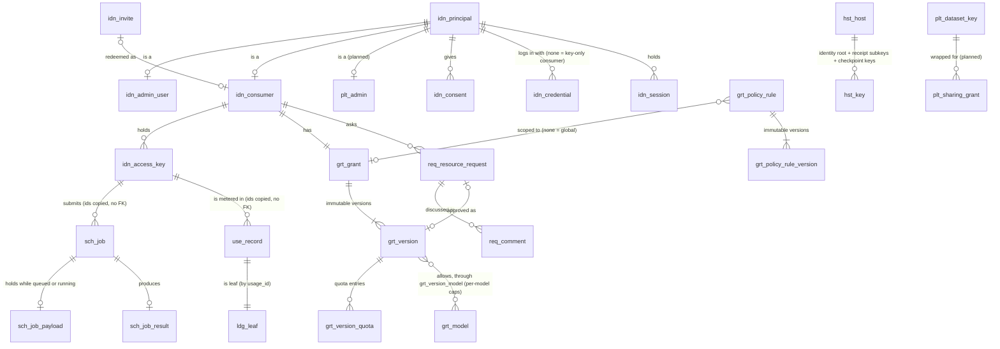
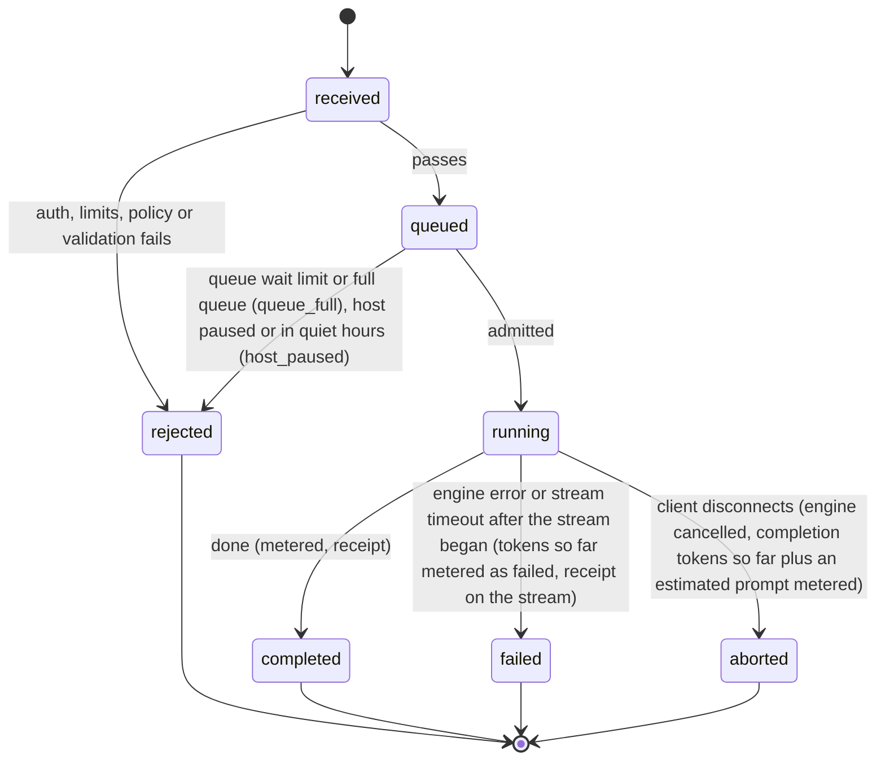
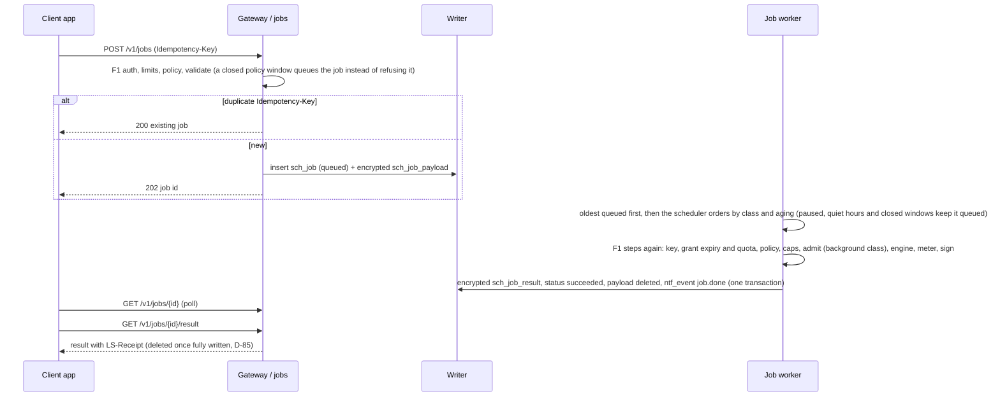
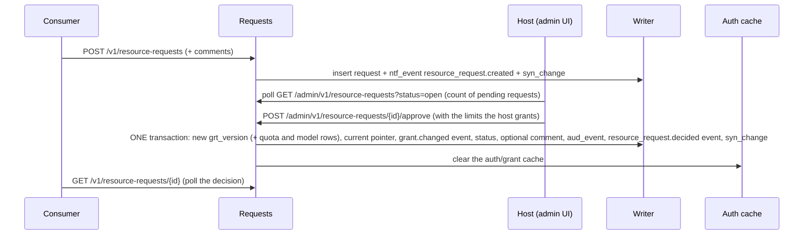
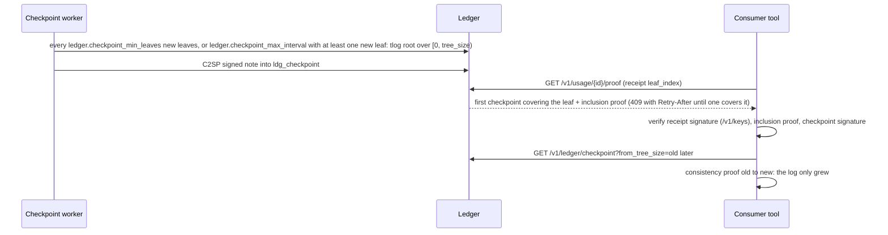
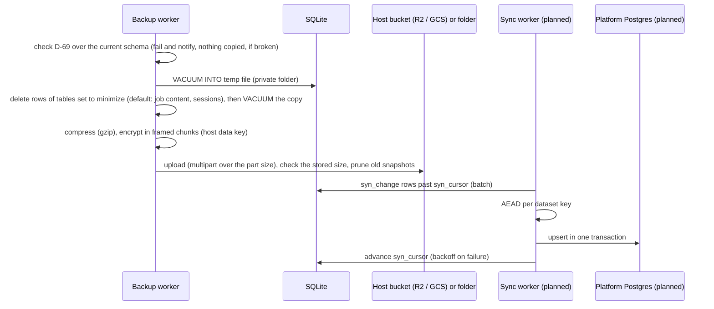
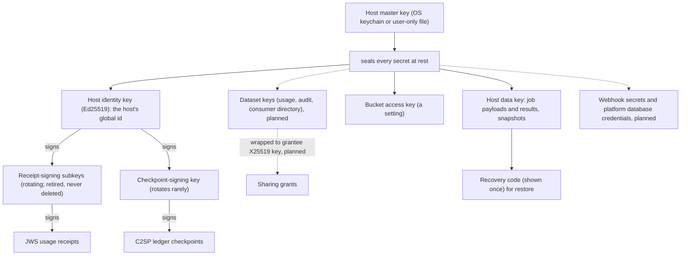

# local-server — low-level design

| | |
|---|---|
| **Status** | Reconciled with the code as built in phase 1. The code, the migrations and `api/openapi.yaml` are the source for anything they define, and this document is kept in step by the docs sync. A part that is designed but not built is marked *planned* (phase 2): notifications, webhooks and the desktop channel, public mode (Funnel), embedded Tailscale (tsnet), bundles, platform sync and sharing grants, and the req_002 additions. |
| **Read first** | [High-level design](hld.md) |
| **Source of truth** | [`req_001.decisions.md`](../tracks/platform/phase_1/requirements/req_001.decisions.md) (`D-NN` rows). The LLD rows are D-39, D-40, D-42..D-44, D-48, D-51..D-55 and D-57..D-62; later rows that changed the built design are cited where they apply. |
| **req_002 additions** | The *planned* subsections marked req_002 come from [`req_002.decisions.md`](../tracks/platform/phase_1/requirements/req_002.decisions.md), LLD rows D-26..D-30 ([ADR 0007](../adr/0007-req002-system-design.md)). They are built in phase 2 |
| **Labels** | **Judgement**, **Unsourced** and **Illustrative** (a sketch that the code settles) |

---

## 1. Module map

Each module owns its package, its tables (by prefix), and its port where it has one. Core modules import ports, never adapters (D-21). `tools/archcheck` enforces the map in CI with forbidden-import checks: every package under `internal/` belongs to one module, an adapter is imported only by `cmd/` or from inside that adapter, drivers only in their owning module, no import cycles between modules, and nothing under `internal/` imports `cmd/` or `tools/`; a violation fails the build. Its configuration (`tools/archcheck/config.go`) holds the same 29 modules as the table below, and every module has an architecture note in [`docs/modules/`](../modules/).

| Module (note) | Package | Owns tables | Port it defines | Status |
|---|---|---|---|---|
| [storage](../modules/storage.md) | `internal/storage/` | `ops_schema_migrations`, `ops_migration_run`, `ops_data_catalog`, `syn_change` | unit of work (`DB.Write` on the single writer, `Tx.Capture`), read pool | Built |
| [settings](../modules/settings.md) | `internal/settings/` | `hst_setting` | settings owner model (`Store`, `Def`, retention rules) | Built |
| [telemetry](../modules/telemetry.md) | `internal/telemetry/` | none | `Telemetry`; adapter `internal/telemetry/slogprom` (slog to a rotated file, Prometheus) | Built |
| [host](../modules/host.md) | `internal/host/`, `internal/hostkeys/`, `internal/hostmetrics/` | `hst_host`, `hst_key`, `hst_metric_minute` | `HostMetrics`; host sharing state (`SharingState`); key custody (`hostkeys`) | Built |
| [engine](../modules/engine.md) | `internal/engine/` | none | `Engine`; adapters `engine/ollama` and `engine/fake`; contract suite `engine/enginetest` | Built |
| [identity](../modules/identity.md) | `internal/identity/` | `idn_*` | `ContentCapture` (defined, no adapter) | Built |
| [grants](../modules/grants.md) | `internal/grants/` | `grt_*` | none | Built |
| [audit](../modules/audit.md) | `internal/audit/` | `aud_event` | none | Built |
| [events](../modules/events.md) | `internal/notifier/events/` | `ntf_event` | `Notifier` (the domain-event bus: `Emit`, `Write`, `Subscribe`) | Built |
| [auth](../modules/auth.md) | `internal/auth/` (with `auth/credential`) | none (reads `idn_access_key` and `idn_session` through identity) | none | Built |
| [policy](../modules/policy.md) | `internal/policy/` | none (reads `grt_policy_rule` through grants by a `RuleSource`) | `Policy` | Built |
| [scheduler](../modules/scheduler.md) | `internal/scheduler/`, `internal/jobs/` | `sch_job`, `sch_job_payload`, `sch_job_result` | none; admission and model lifecycle (`Scheduler.Admit`, `Ticket`), and the job service and worker, which call the gateway's `jobs.Executor` | Built |
| [usage](../modules/usage.md) | `internal/usage/` | `use_record`, `use_rollup`, `use_rollup_state`, `use_request_counter` | none | Built |
| [ledger](../modules/ledger.md) | `internal/ledger/` (with `ledger/checkpoint`) | `ldg_leaf`, `ldg_hash`, `ldg_checkpoint` | receipt `Signer` | Built |
| [limits](../modules/limits.md) | `internal/limits/` | none (writes `use_request_counter` through usage) | none | Built |
| [gateway](../modules/gateway.md) | `internal/gateway/` (with `gateway/stream`) | none | none; serves the consumer API | Built |
| [requests](../modules/requests.md) | `internal/requests/` | `req_resource_request`, `req_comment` | none | Built |
| [notifier](../modules/notifier.md) | `internal/notifier/` | `ntf_notification`, `ntf_pref`, `ntf_webhook_endpoint`, `ntf_outbox_delivery` | `Channel` | *Planned (phase 2)*: in-app, webhook and desktop channels. Only the `events` bus above is built |
| [transport](../modules/transport.md) | `internal/transport/` | none | `Transport`; adapter `transport/tailscale` (the host's own Tailscale) | Built. Adapters `transport/tsnet` and `transport/funnel` are *planned (phase 2)* |
| [offhost](../modules/offhost.md) | `internal/offhost/` | none built (`syn_cursor` and `plt_dataset_key` are *planned*) | `Compressor` and `Target` of the snapshot adapter `offhost/snapshot` (sub-packages `folder`, `s3`, `gzipcodec`, `s3fake` for tests); `OffHostSync` for platform sync | Backup and restore built. Platform sync *planned (phase 2)* |
| [admin](../modules/admin.md) | `internal/admin/` (with `admin/grants`, `admin/consumers`) | none (writes through the owning modules) | none; serves the admin API and `/metrics` | Built. Notification preference and webhook endpoint operations answer 501 until their module is built |
| [consumerauth](../modules/consumerauth.md) | `internal/consumerauth/` | none (uses `idn_*` through identity) | `Adapter` (password and passkey adapters) | Built |
| [bundle](../modules/bundle.md) | `internal/bundle/` | none | none yet | *Planned (phase 2)*: an empty package |
| [sharing](../modules/sharing.md) | `internal/sharing/` | `plt_admin`, `plt_sharing_grant` | none yet | *Planned (phase 2)*: an empty package |
| [power](../modules/power.md) | `internal/power/` | none | `Power` (one adapter per OS) | Built |
| [service](../modules/service.md) | `internal/service/` (with `service/osadapter`) | none | `Manager` (the OS service manager) | Built |
| [directory](../modules/directory.md) | `internal/directory/` | none | `Directory` (the no-op adapter is the only one) | Built as a seam, no behaviour |
| [api](../modules/api.md) | `internal/api/` (generated by ogen, with `api/ignored`) | none | server interfaces | Built |
| [webui](../modules/webui.md) | `internal/webui/` | none | none | Built |

**webui** serves a built single-page web UI from an `fs.FS` (the admin UI or the consumer web page): `webui.Handler(Config{Files})` returns an `http.Handler` that answers GET and HEAD only, serves a file by its cleaned path, answers a path with no extension that is not a file with `index.html` so a client-side route loads, and puts the same strict Content Security Policy, `nosniff`, no-referrer and same-origin resource policy on every answer (D-10, D-151). Files carry `Cache-Control: no-cache` and an ETag, so a browser revalidates. With no built UI (a plain `go build` without npm embeds only `.gitkeep`) it answers a committed one-page stub (D-152). It imports only the standard library. It consumes no other module and is consumed by `cmd/local-server`, which passes `web/admin` (`adminui.Files()`) into `admin.Config.UI` and `web/consumer` (`consumerui.Files()`) into `consumerauth.Config.UI`. The two single-page apps and their shared client code are in `web/admin`, `web/consumer` and `web/shared`.

**Listeners.** `cmd/local-server` is the only place that wires adapters to ports and binds listeners (D-10, D-148). Loopback: the consumer API (`serve.consumer_listen`, default `127.0.0.1:8484`) and the admin listener (`serve.admin_listen`, default `127.0.0.1:8485`: admin API, `/metrics`, admin UI). Tailnet, bound only to the host's tailnet address over HTTPS with the `*.ts.net` certificate, and only while Tailscale is ready: the consumer API, the consumer web page with its account routes, and, only when the host switches it on, a remote admin listener. The consumer API accepts access keys only; the account routes of the consumer web page take the session cookie.

## 2. Ports (signatures as built, trimmed)

The signatures below are those in the code, with the parts a reader does not need left out. The code is the source for the rest.

```go
// Engine — D-22. Ollama is the first adapter (internal/engine/ollama); the fake engine
// (internal/engine/fake) answers without Ollama. llama.cpp and MLX come later.
type Engine interface {
    Chat(ctx context.Context, req ChatRequest) (ChatStream, error) // native /api/chat, NumCtx and NumPredict mandatory
    Embed(ctx context.Context, req EmbedRequest) (EmbedResult, error)
    ListModels(ctx context.Context) ([]Model, error)
    ModelInfo(ctx context.Context, name string) (ModelInfo, error) // family, size, context length, capabilities
    Load(ctx context.Context, name string, keepAlive time.Duration) error // negative keepAlive: until unloaded
    Unload(ctx context.Context, name string) error
    Loaded(ctx context.Context) ([]LoadedModel, error) // /api/ps: memory per loaded model
}
// ChatRequest also carries the grant's OnContextOverflow, the per-call first-token and idle
// timeouts, and the optional temperature, top_p, seed and stop.

// Policy — D-25, D-39 step 3. Decides only; the gateway enforces.
type Policy interface {
    Evaluate(ctx context.Context, in Input) (Decision, error) // properties, model, time, grant (after key narrowing)
}
type Decision struct {
    Priority PriorityClass // interactive | background
    Caps     Caps          // ContextCap, MaxOutputTokens, MaxConcurrency (nil: no limit set)
}

// Telemetry — D-31. slog plus Prometheus; the spans are no-ops in phase 1.
type Telemetry interface {
    Logger() *slog.Logger
    Counter(name string, labelNames ...string) Counter
    Gauge(name string, labelNames ...string) Gauge
    Histogram(name string, labelNames ...string) Histogram
    StartSpan(ctx context.Context, name string) (context.Context, Span)
}

// Snapshot adapter of the off-host port (internal/offhost/snapshot) — D-41, D-59, D-64, D-103.
// Backup and restore are built as functions of the adapter, behind two small ports:
type Compressor interface { Name() string; NewWriter(io.Writer) (io.WriteCloser, error); NewReader(io.Reader) (io.ReadCloser, error) }
type Target interface { // a host-chosen folder, or an S3-compatible bucket (R2, GCS)
    Put(ctx, name string, r io.Reader, size int64) error
    Stat(ctx, name string) (Object, error)
    Open(ctx, name string) (io.ReadCloser, error)
    List(ctx) ([]Object, error)
    Delete(ctx, name string) error
}
func (r *Runner) Backup(ctx context.Context) (Result, error) // Result lists the tables it minimized (D-64)
func Restore(ctx context.Context, opts RestoreOptions) (Report, error) // Report lists them and counts the jobs it failed (D-68)

// OffHostSync — planned (phase 2): the platform-sync port. Platform sync: generic Postgres
// (Supabase, Cloud SQL, AlloyDB). Not built; there is no such interface in the code yet.
```

The other built ports follow the same rule, each small and role-specific:

- **`HostMetrics`** (`Read(ctx) (Reading, error)`): one reading of host totals, the share-budget slice and other apps.
- **`Power`** (`Acquire(ctx) (Lock, error)`; a `Lock` has `Release` and `Alive`): the sleep lock, one adapter per OS.
- **`Transport`** (`Status`, `WhoIs`, `Resolve`, `TLSConfig`): the encrypted channel; the `tailscale` adapter asks the host's own Tailscale.
- **`Notifier`** (`Emit`, `Write`, `Subscribe`): the domain-event bus of the events module. Its subscribers run after the commit, synchronously, and an event whose process dies between the commit and the call is not replayed.
- **`Manager`** (`Install`, `Uninstall`, `Start`, `Stop`, `Status`): the OS service manager, with the pure service definitions in `internal/service` and the OS-dependent adapter in `internal/service/osadapter`.
- **`Adapter`** (`Kind`, `Prepare`, `Authenticate`) of consumerauth: how a person proves who they are. The password adapter and the passkey adapter (a two-round-trip ceremony) are built; an email or OAuth adapter would sit behind the same port.
- **`ContentCapture`** (`Capture`): defined and off. It has no adapter, and refuses without a matching, unwithdrawn consent record (D-31, D-40, D-45).
- **`Directory`** (`Discover`): the seam for a future central server; the no-op adapter returns no hosts (D-21).
- **`jobs.Executor`** and **`jobs.Slot`**: the job worker's view of the gateway (`Admit`, then `Run` and `Release`), implemented by the gateway.
- **`Channel`** (in-app, webhook, desktop; D-84): *planned (phase 2)*, with the notifier module.

The engine port has a shared contract suite, `engine/enginetest`, that the Ollama adapter (against a fake server, and live when Ollama is present) and the fake engine both pass; the fake engine also stands in for Ollama in the gateway tests (D-31). The other ports have tests per adapter.

## 3. Data model (D-37 as superseded by D-42 and D-44, plus D-53)

### 3.1 Conventions

- **Tables and keys:** `STRICT` tables, `PRAGMA foreign_keys=ON` and `busy_timeout` in every DSN.
- **Foreign keys:** `RESTRICT` from soft-deleted parents, `CASCADE` for owned children.
- **IDs and times:** ids are UUIDv7 as TEXT. Times are INTEGER Unix milliseconds, UTC.
- **Types:** only portable types (TEXT, INTEGER, REAL, BLOB), so a Postgres adapter maps one to one.
- **Prefixes:** each module's tables carry a short prefix: `hst_ idn_ grt_ req_ sch_ use_ ldg_ ntf_ aud_ syn_ plt_ ops_`.
- **Metadata:** every table and column has a plain-language comment, a classification (`public` | `internal` | `personal` | `sensitive` | `content`) and a `billable` flag. They are collected into `ops_data_catalog` at startup, and the generated [schema reference](../schema-reference.md) stays in step with the migrations (storage fails to open a database if a table or column has no entry).
- **Migrations:** forward-only, per module (`internal/<module>/migrations/`, files `NNNN_name.sql`, embedded in the binary), applied at startup, the storage module's first and then the others in the order of the registry in `cmd/local-server/registry.go` (the table below lists them in that order), each in its own transaction and recorded with a SHA-256 checksum in `ops_schema_migrations` and `ops_migration_run`. A changed or missing applied file, or a new file older than an applied one, stops startup. Destructive changes go expand → backfill → contract across two releases. A restored snapshot is opened with the build's migrations, which brings an older snapshot forward and refuses one from a newer build. Sync rows and bundles that carry a schema version are *planned (phase 2)*.

Table names below apply D-44's prefix mapping to D-37's tables. The migrations are the source. The migrations as built:

| Module | Migration files |
|---|---|
| storage | `0001_ops_tables.sql`, `0002_syn_change.sql`, `0003_syn_change_created_at.sql` |
| settings | `0001_setting.sql` |
| host | `0001_host_keys.sql`, `0002_host_sharing_state.sql`, `0003_host_metric_minute.sql` |
| identity | `0001_identity_tables.sql`, `0002_consumer_billing_mode.sql`, `0003_access_key_bound_node_name.sql` |
| grants | `0001_grants_tables.sql`, `0002_version_quota.sql`, `0003_policy_rule_versions_model_config.sql` |
| requests | `0001_requests_tables.sql` |
| audit | `0001_audit_event.sql` |
| events (`internal/notifier/events/`) | `0001_event_tables.sql` |
| usage | `0001_record.sql`, `0002_limit_indexes.sql`, `0003_rollup.sql`, `0004_request_counter.sql` |
| ledger | `0001_log.sql`, `0002_checkpoint.sql` |
| scheduler | `0001_job_tables.sql` |
| offhost, sharing | none yet: each has an empty `migrations/` folder |

Next in line, *planned (phase 2)*: `grants/0004_options.sql` and `usage/0005_task.sql` (section 3.3).

### 3.2 Core relationships



| Table | Key facts |
|---|---|
| `idn_principal` | id, kind (`host_admin` \| `consumer` \| `platform_admin` \| future), category and segment tags, `plan_id` (always empty in phase 1), status (`active` \| `suspended` \| `deleted`). It has **no** FK to the type tables, so a new user type never alters it (D-53). |
| `idn_consumer` | `principal_id` UNIQUE FK, kind `individual` \| `application`, `billing_mode` (`none` \| `prepaid` \| `postpaid`, a label only, D-107), `row_version`, personal fields erased on deletion, soft-deleted through `idn_principal.status` (D-42). A purge, a retention period after deletion (`consumers.deleted_retention`, default 90 d), removes what is still personal or credential-bearing and leaves the consumer and principal rows as a tombstone (D-106, D-134, D-136). |
| `idn_access_key` | `prefix` UNIQUE, secret hash, optional narrowing JSON, `expires_at`, `revoked_at`, `bound_node` (Tailscale's stable node id, the one checked) and `bound_node_name` (the machine name, for people; not checked) |
| `idn_credential`, `idn_session`, `idn_invite`, `idn_consent` | A password hash or a passkey public key (never synced); a session keeps only the hash of its token; an invite keeps only a prefix and a token hash; a consent is a record of one purpose under one version of the terms |
| `grt_version` | Immutable. Expiry, concurrency, allowed properties, `on_context_overflow` (`refuse` \| `truncate`, D-48). `grt_grant.current_version_id` points at the live one. Its quotas are rows in `grt_version_quota` (metric `tokens` or `requests`, limit, window in ms; D-107); the two old `quota_*_per_day` columns stay as a read-only alias for versions made before it. |
| `grt_version_model`, `grt_version_quota` | Immutable, with their version (update and delete triggers refuse). `grt_version_model` holds the per-model `context_cap` and `max_output_tokens`. |
| `grt_model` | A model name a grant can allow, with the host's sharing configuration: `allowed` and `keep_alive_seconds` (stored, not yet used by the scheduler), and `retired_at` (soft delete) |
| `grt_policy_rule`, `grt_policy_rule_version` | The rule's head (scope, order, switch, a copy of the live version, `deleted_at`) and its immutable versions (D-87) |
| `use_record` | Immutable. Token counts, model, outcome, latency, the receipt's key id and signature, **copies** of `consumer_id`, `access_key_id` and `grant_version_id`, so the hot path needs no joins. Update and delete triggers refuse. |
| `use_rollup`, `use_rollup_state` | Sums per minute, hour or day, consumer, key and model, filled by the rollup worker from `use_record` (which stays the source); the state row is the worker's place in `use_record`, moved in the same unit of work as the sums it covers |
| `use_request_counter` | Calls admitted per consumer or key, quota window and fixed window, metered or not; it survives a restart and is pruned after `limits.counter_retention` |
| `ldg_leaf`, `ldg_hash`, `ldg_checkpoint` | `leaf_index` PK + leaf hash and `usage_id`; tlog stored hashes; `tree_size` PK + root + signed note + signing key id. All immutable and kept forever (triggers refuse update and delete) |
| `sch_job`, `sch_job_payload`, `sch_job_result` | `sch_job` holds ids, status, failure reason and times, no content. The other two are the only content-bearing tables: encrypted with the host data key, never synced, the payload deleted at every terminal state, the result once a fetch has written it whole (D-85) or at its expiry |
| `req_resource_request`, `req_comment` | The request (status `open` \| `approved` \| `rejected` \| `withdrawn` \| `expired`, the ask as JSON, `expires_at`, the resulting grant version) and its comments; the consumer's and the host's own text, never logged |
| `ntf_event` | A domain event (type from a closed set defined in code, actor, target, JSON payload of ids and counters), written in the unit of work of the change |
| `syn_change` | `seq` AUTOINCREMENT, dataset, table, pk, version, op, payload, `created_at`. Written **in the same transaction** as the change it records, always captured (in storage's migrations, because of that). Rows are pruned after `sync.change.retention` (default 30 d, D-77); until platform sync exists nothing acknowledges a row, so every row is unacknowledged. `syn_cursor`, which tracks the last `seq` each target acknowledged, is *planned (phase 2)*. |
| `hst_host`, `hst_key`, `hst_metric_minute`, `hst_setting` | The one host row (id = the identity public key, the sealed data key, the manual sharing state `sharing` \| `paused`), the identity, receipt and checkpoint keys with their sealed private halves, one metrics row per minute, and the settings the host changed from the defaults |
| `aud_event` | Append-only, kept forever |
| `ops_*` | `ops_schema_migrations`, `ops_migration_run`, `ops_data_catalog` (module, classification and billable flag of every table and column, rebuilt at startup) |
| `plt_sharing_grant`, `plt_admin`, `plt_dataset_key`, `ntf_notification`, `ntf_pref`, `ntf_webhook_endpoint`, `ntf_outbox_delivery` | *Planned (phase 2).* Not in any migration. A sharing grant would hold grantor and grantee principal, the grantee's public key, dataset, purpose, terms version, key version, wrapped key, expiry and `revoked_at` |

Usage, the ledger and receipts refer to rows that are therefore only ever soft-deleted (D-42).

### 3.3 req_002 additions (planned): schema and relationships (D-29, D-30)

Planned, built in phase 2 ([ADR 0007](../adr/0007-req002-system-design.md)). Migrations only go forward; new tables are `STRICT` with the `--@table` and `--@column` annotations. A grant version and its child rows stay immutable, so changing a grant's options makes a new version.

| Migration | Change |
|---|---|
| `internal/grants/migrations/0004_options.sql` | New table `grt_version_model_option`: `version_id`, `model_id`, `option` (the neutral name, no CHECK list so a new option needs no migration), `mode` (`default` or `forced`), `value` (JSON text); primary key `(version_id, model_id, option)`; foreign key `(version_id, model_id)` to `grt_version_model` with `ON DELETE CASCADE`; the same no-update and no-delete triggers. `grt_version_model` gains `keep_alive_cap_seconds INTEGER` (at least 0, empty means no grant cap) and `thinking_allowed INTEGER` (0 or 1, empty means allowed). Its `context_cap` and `max_output_tokens` stay as the other two resource caps |
| `internal/usage/migrations/0005_task.sql` | `use_record` gains `task TEXT CHECK (task IS NULL OR task <> '')`. `use_rollup` is rebuilt, because SQLite cannot change a primary key: a new table with `task TEXT NOT NULL DEFAULT ''` in the key `(granularity, bucket_start, consumer_id, access_key_id, model, task)`, every old row copied with `task = ''`, the old table dropped, the new one renamed, the consumer index recreated with `task` last and the keyset cursor gaining `task` last. `use_rollup_state` and the retention rules stay. Extended by the AI-architecture stage ([ADR 0008](../adr/0008-req002-ai-architecture.md), D-32, D-37): `use_record` also gains a nullable `model_digest TEXT` (the full digest of the model that served the call) and a nullable `steps` JSON text column (the per-step trace, numbers and ids only); neither is in the canonical leaf or the receipt |

- **Per model:** options hang off `grt_version_model` because the caps already live per model, so a host can allow thinking for one model and not another. **Values** are validated in code by one option table in the engine port (name, type, bounds, resource or plain), read by `validateChat`, the admin API and the discovery builder.
- **Policy rules:** `caps` in `rule_v1.schema.json` gains optional `keep_alive_seconds` and `thinking` (boolean), smallest wins and any not-allowed wins, additive in format version 1. **Rules carry caps only**, not defaults or forced values. **Judgement:** forced values have no clean merge across rules. An older binary would refuse such a rule, which is acceptable because migrations only go forward.
- **Settings (host-owned, no migration):** `policy.task.max_length` (proposed default 64), `usage.task.max_per_window` (proposed default 50), `gateway.model_info_ttl` (proposed default 5m) and `scheduler.keep_alive_max` (proposed default 1h; the host's cap on a client's `keep_alive` when the grant sets none, which a grant or rule cap can only narrow). Access keys narrow only what they narrow today (`internal/auth/narrowing.go`).
- **Unchanged:** `ldg_*`, `use_request_counter`, `sch_job*` (the effective options go inside the sealed result).
- **Compatibility:** old grant versions have no option rows and no new caps and behave as today; old `use_record` rows have no task.

**Relationships (D-30)**

| Pair | Cardinality and key | On delete |
|---|---|---|
| `grt_version_model` to `grt_version_model_option` | 1 to 0..n, key `(version_id, model_id)`, at most one row per option name, owned by grants | cascade (never fires: versions are immutable and the triggers block DELETE) |
| option rows to `grt_model` | through the parent row only; a retired model keeps its rows and the gateway already skips retired models (`internal/gateway/pipeline.go`) | not applicable |
| `use_record.task` and `use_rollup.task` | **no foreign key**: copied labels, like `model` and the ids | records are never deleted; rollup rows are pruned by the existing retention settings |
| `use_record` to `use_rollup` | derived; the rollup's task equals the record's task, or `other` over the cap. **Invariant (a test):** per consumer, key, model and bucket, the sum over tasks equals the old per-bucket total | not applicable |
| a consumer's day to task names | at most `usage.task.max_per_window` named tasks plus `other` and the empty one; lowering the setting keeps the names already in that day's buckets | not applicable |
| stored option name to the code's option table | **no foreign key**: a name the code does not know is skipped with a log line and never fails a request | not applicable |

## 4. State machines (D-54)

Terminal states never reopen, so the audit and billing history stays linear. Every timeout and retry count is a setting.

### Job

```mermaid
stateDiagram-v2
  [*] --> queued: POST /v1/jobs (Idempotency-Key)
  queued --> running: admitted (slot, memory, policy window)
  queued --> queued: not admissible yet (closed window, full queue, quota used up, engine down), not_before moves
  queued --> expired: deadline passed (jobs.deadline)
  queued --> cancelled: consumer cancels
  running --> succeeded: engine done (metered, receipt, encrypted result, job.done event)
  running --> failed: engine error or timeout (tokens metered; reason is the API error code)
  running --> failed: host restart (reason host_restart)
  queued --> failed: refused for good at admission (key revoked, grant expired, policy denies; reason is the API error code)
  queued --> failed: payload unreadable (reason payload_unreadable)
  queued --> failed: restored from a snapshot without its payload (reason payload_minimized)
  running --> failed: restored from a snapshot without its payload (reason payload_minimized)
  running --> cancelled: consumer cancels
  succeeded --> [*]
  failed --> [*]
  cancelled --> [*]
  expired --> [*]
  note right of queued: stays queued while the host is paused or in quiet hours
```



### Interactive request (in memory)



An engine error before the first chunk is an HTTP error and writes no usage record.

### Resource request, access key, invite, consumer

```mermaid
stateDiagram-v2
  state "Resource request" as RR {
    [*] --> open
    open --> open: comment
    open --> approved: host approves (new grant version)
    open --> rejected: host rejects
    open --> withdrawn: consumer withdraws
    open --> expired: TTL
  }
  state "Access key" as AK {
    [*] --> active
    active --> expired_k: expiry passes
    active --> revoked: revoked
  }
  state "Invite" as IV {
    [*] --> pending
    pending --> redeemed
    pending --> expired_i: expiry passes
    pending --> revoked_i: revoked
  }
  state "Consumer" as CO {
    [*] --> c_active
    c_active --> suspended
    suspended --> c_active
    c_active --> deleted: soft, keys revoked, personal fields erased
    suspended --> deleted
    deleted --> purged: after consumers.deleted_retention (consents, credentials, sessions, keys, requests removed; tombstone stays)
  }
```



### Host sharing, models, signing keys, sync changes, webhooks, sharing grants

| Entity | Transitions |
|---|---|
| Host sharing | sharing ↔ paused (manual, stored in `hst_host`), sharing ↔ quiet (derived from the quiet-hours settings and the clock, never stored). A pause wins over quiet hours. While paused or quiet, interactive calls get `host_paused`, jobs wait, and the sleep lock is released. Pausing writes an audit row and one `host.paused` event; resuming writes an audit row and no event |
| Model residency (the engine's `/api/ps` is the truth) | unloaded → loading (an admitted request, or a preload) → loaded. Leaving: idle unload after the keep-alive (`scheduler.keep_alive`), or reclaim (an idle model unloaded to make room under the memory budget). A preloaded model is pinned until it leaves `scheduler.preload_models` and is never unloaded for idleness or to make room. A load that fails surfaces as the call's engine error (a failed preload is logged); nothing is stored |
| Signing key | active → retired (kept for verifying old receipts and checkpoints). The checkpoint worker rotates the keys on its schedule (`ledger.key_check_interval`) |
| Sync change | pending → pruned after `sync.change.retention`. *Planned (phase 2):* pending → acked → pruned, once a sync target acknowledges rows |
| Webhook delivery | *Planned (phase 2).* pending → delivering → delivered \| retry_scheduled → … \| failed. The endpoint is disabled after a `410` or N consecutive failures |
| Sharing grant | *Planned (phase 2).* requested → active \| declined. active → expired \| revoked, and either one rotates the dataset key |

### Chat stream and chunk reader, req_002 changes (planned, D-26)

Planned ([ADR 0007](../adr/0007-req002-system-design.md)). Two machines change and none is added.

| Machine | Change |
|---|---|
| Chat stream (`internal/gateway/stream/stream.go`) | The order stays opened, role chunk, deltas, finish chunk, optional usage chunk, `[DONE]`. A new event, a **reasoning chunk**, emits `delta{reasoning}` before the finish chunk and resets the idle timer |
| Ollama chunk reader (`internal/engine/ollama/stream.go`) | `engine.ChatChunk` gains a `Reasoning` text field, and `Recv` returns thinking-only chunks instead of dropping them, so the gateway's first-token and idle limits see a long think and an aborted call's completion count includes it |

- **Unchanged:** the job lifecycle (a queued job is decided again at admission, so its options are re-resolved then), and **model residency**: a client `keep_alive` within the host cap changes only the ticket's expiry value, and a **pinned model keeps `-1`**, so the client's value is ignored for it and the answer reports `-1`. Option resolution is a pure function and holds no state.
- **Why:** a request's `keep_alive` replaces a loaded model's unload timer in Ollama, so a client value would silently unpin a model the host keeps loaded. **Sources:** [Ollama scheduler](https://raw.githubusercontent.com/ollama/ollama/main/server/sched.go), [Ollama FAQ](https://docs.ollama.com/faq), [Ollama issue 11002](https://github.com/ollama/ollama/issues/11002). **Unsourced:** what Ollama does when a second request shortens `keep_alive` while the first is still running. Repo: `internal/scheduler/scheduler.go`.

## 5. Call flows (D-39)

### F1 — interactive chat or embeddings

```mermaid
sequenceDiagram
  autonumber
  participant C as Client app
  participant T as Transport (tailnet; Funnel is planned)
  participant G as Gateway
  participant A as Auth + limits
  participant P as Policy
  participant S as Scheduler
  participant E as Engine (Ollama adapter)
  participant W as Writer (SQLite)
  C->>T: POST /v1/chat/completions (Bearer ls_prefix_secret, LS-Request-Properties)
  T->>G: request (TLS / WireGuard ends on the host)
  G->>A: lockout check, body-size limit, lookup by prefix, constant-time hash compare, cached key, consumer and grant, bound-node check, quota and rate limits
  A-->>G: ok, or 401 / quota_exceeded / rate_limit_exceeded / lockout
  G->>P: Evaluate(properties, model, time, grant version)
  P-->>G: priority + caps, or model_not_granted / denied
  G->>G: validate: reject unsupported fields, cap max_tokens, pre-check prompt size (context_too_long)
  G->>S: Admit(class, grant concurrency, model, estimated context)
  S-->>G: slot, or queue_full + Retry-After, host_paused, over_budget
  G->>A: count the admitted call (request counter)
  G->>E: Chat(num_ctx = cap, num_predict, keep_alive) with first-token, idle and total timeouts
  E-->>G: token stream
  G-->>C: OpenAI SSE chunks (a client disconnect cancels the engine call)
  G->>W: one BEGIN IMMEDIATE batch: use_record + ldg_leaf/ldg_hash + syn_change
  W-->>G: leaf_index, tree_size
  G-->>C: LS-Receipt header (JWS), or for a stream an SSE comment line that starts with ls-receipt and carries the JWS, before [DONE]
```

The auth and limit steps run in the security handler, before the body is read; the policy, validate and admit steps run in the handler, in this order. Embeddings take the same steps with `Embed` in place of `Chat` and no stream. A streamed call is metered when its stream ends, with outcome `completed`, `failed` (the engine failed after the stream began) or `aborted` (the client went away).

Failure branches:
- **Engine down:** `503 engine_unavailable`. A call whose engine fails before the first chunk is an HTTP error and writes no usage record.
- **Metering write keeps failing:** it is retried in memory first. If it still fails, the answer is returned with a signed receipt marked `unmetered` and no leaf index. The failure is logged, counted and emitted as `metering.failed` (D-51). If the unmetered receipt cannot be signed either, the call answers 500 and metering.failed is still emitted: no answer goes out without a receipt (D-16, D-51).
- **Context overflow:** with `on_context_overflow = refuse`, the adapter sends `truncate:false` and `shift:false`, and maps Ollama's error to `context_too_long` (D-48).

### F2 — async job



A job cannot stream. `POST /v1/jobs/{id}/cancel` cancels a queued or running job (a running job's engine call is cancelled and the tokens so far are metered); a job already in a terminal state is answered 409. A result that was not fetched is deleted after `jobs.result_ttl` (default 24 h). The webhook delivery of `job.done` (an outbox row in the same transaction, then a Standard Webhooks POST) is *planned (phase 2)*: in phase 1 the event is written and handed to in-process subscribers only, and a client polls.

### F3 — resource request approval (one unit of work)



A rejection is the same unit without the grant version. The host gives the limits at approval; the consumer's ask is a message and a JSON ask, not an automatic grant. Pushing the event to the host (in-app SSE, desktop) and to the consumer (webhook, in-app) through the `Channel` is *planned (phase 2)*: the admin UI polls the count of open requests instead. An open request that is not decided within `requests.ttl` is expired by the `requests-expiry` worker.

### F5 — checkpoint, and how a consumer verifies



### F6 — off-host backup, and opt-in platform sync (planned)



The backup worker runs while `backup.enabled` is true, every `backup.interval`, counted from the last success. A failed run is logged without content and raises a `backup.failed` event, then at most once per `backup.failure_notify_interval`. The sync worker, `syn_cursor` and the Postgres target are *planned (phase 2)*; `syn_change` rows are captured and pruned but not shipped.

Minimization (D-64) runs on the temp copy, never on the live database. The setting is one entry per table in `ops_data_catalog` (`backup.minimize.<table>`), kept in `hst_setting`; the catalog itself is rebuilt at startup (D-44) and holds no settings. Deletes run with `foreign_keys=ON`. A table can be set to minimize only when every table that references it is also minimized (D-69), so a kept table never holds a dangling reference and a CASCADE never empties a table the host chose to keep. After the deletes commit, the copy is vacuumed, so freed pages keep no deleted rows. On restore, `Restore` marks every job that was queued or running in the snapshot and lost its `sch_job_payload` row `failed(payload_minimized)`, and its `RestoreReport` gives their count (D-68). Restore (`local-server restore`) runs offline, before the host next starts, so the start-up `host_restart` pass finds those jobs already terminal (D-72). It replaces the database by renaming and keeps the old one aside, and its report also gives the newest ledger checkpoint size, because receipts issued after the snapshot will not verify against the restored ledger (D-109). `ops_schema_migrations`, `hst_host` and `hst_key` are protected tables that a backup always keeps (D-139). Every backup run first re-checks D-69 over the current schema; if a migration broke it, the run fails, names the tables and notifies the host, and nothing is silently emptied (D-71).

### F4, F7, F8, F9

- **F4 webhooks (planned, phase 2):** due outbox rows → a Standard Webhooks POST (`webhook-id`, `webhook-timestamp`, `webhook-signature` HMAC-SHA256 `v1`) with a timeout → delivery status. Exponential backoff between attempts. Not built: there is no outbox table and no webhook sender, and the notification preference and webhook endpoint operations of both APIs answer 501.
- **F7 sharing grant (planned, phase 2):** the grantee's tool writes a request row into the platform store → the host's sync pulls it → the host approves in the admin UI → the dataset key is wrapped to the grantee's X25519 key and pushed → the grantee decrypts locally. A host timer rotates the key at expiry or revocation.
- **F8 login:**
  - Admin: the first-run setup (`POST /admin/v1/setup`) creates the admin; login checks a name and a password with the lockout of `internal/auth/credential`, then sets the `ls_admin_session` cookie. The same login guards `local-server recovery-code`, which writes an audit row.
  - Consumer password: argon2id (cost from host settings) → `ls_session` cookie on the consumer page listener. Both cookies are HttpOnly, Secure and SameSite=Strict; the host stores only the hash of the session token; the Host and Origin checks of `credential.Guard` run first (D-10).
  - Consumer passkey: go-webauthn discoverable login (a begin and a finish call, with state the host holds in between).
  - Invite: the token (shown once, hashed at rest) creates the consumer, their first credential and their consent rows in one unit of work, with a password or a passkey.
- **F9 startup** (`cmd/local-server/serve.go`): data directory → database and migrations → settings → logging and telemetry → keys (a first run creates the host and shows the recovery code once, on a terminal only) → engine check (an Ollama older than the minimum version stops the start; an unreachable one only warns, and calls get `engine_unavailable` until it is up) → sleep lock adapter and tailnet status → wire the modules → bind the loopback and tailnet listeners → mark jobs left running by the last stop `failed(host_restart)`, only once every port is held → serve → start the workers under a supervisor. The workers are the settings retention rules, the scheduler (preload, idle unload, queue re-check), the host-metrics sampler, the ledger checkpoint worker (with host key rotation), the job worker, the usage rollups, the sleep lock keeper, the policy rule sweeper, the resource-request expiry, the consumer purge and the backup worker; the supervisor restarts one that panics, fails or returns early after `workers.restart_backoff`. Shutdown runs in reverse: stop accepting, let requests in flight finish for `serve.shutdown_timeout`, close what is left and wait for those handlers to record their usage for the same time again, stop the workers, then close telemetry and the database. The outbox, platform sync and webhook workers are *planned (phase 2)*.

### F1 and F2 changes for req_002 (planned, D-27)

Planned ([ADR 0007](../adr/0007-req002-system-design.md)).

**Chat call (`CreateChatCompletion`), steps that change**

| # | Step | What changes |
|---|---|---|
| 2 | `policy.Evaluate`, sync | The `Decision` gains the grant's per-model option defaults and forced values, two resource caps (`keep_alive`, thinking allowed; smallest cap wins, any not-allowed wins) and the validated task from `LS-Request-Properties` (a bad value is `invalid_properties`) |
| 3 | `validateChat`, sync | Accepts `frequency_penalty`, `presence_penalty`, `response_format` (`json_object`, `json_schema`), `reasoning_effort` and the engine-options object (`top_k`, `min_p`, `repeat_penalty`, `context_size`, `keep_alive`): type and range checks only; an unknown key stays `unsupported_parameter` |
| 4 | `planChat`, sync | Each option resolves as forced value, else client value, else grant default, else unset (the model's own default); resource options clamp to the caps and are reported. A **client-sent option the model cannot carry is `unsupported_parameter`**; a **grant default or forced value it cannot carry is skipped and reported as not applied**. Model capabilities come from `ModelInfo` through a cache (`gateway.model_info_ttl`) |
| 5 | `scheduler.Admit`, sync | `scheduler.Request` gains `KeepAlive`; the ticket uses the effective value, a pinned model stays `-1`, and the default is the model's `keep_alive_seconds` when set (stored but unused today) else `scheduler.keep_alive` |
| 6 | engine port `Chat`, async | `engine.ChatRequest` gains `TopK`, `MinP`, `RepeatPenalty`, `FrequencyPenalty`, `PresencePenalty`, `Format`, `Think` |
| 7 | chunk reads, async | Reasoning chunks fill the message's `reasoning` field, or `reasoning` stream deltas |
| 8 | `meter` | Metering gets the task; an aborted call counts reasoning chunks; `reasoning_tokens` is omitted because Ollama gives no separate count |
| 9 | response | The effective-options header goes out on streamed and non-streamed answers, built at step 4 before the engine runs, in the RFC 9651 dictionary form of `LS-Request-Properties`. Each option gives the value that ran and `was` and `by` (`cap`, `forced`, `not_applied`) when it differs from the request. The exact header and key names are settled in the spec ticket |

- **Failure paths:** a wrong type or range is 400 `invalid_request_error` naming the field; over a cap is clamped and reported, never refused; a failed capability lookup returns the engine's own typed error; no new timeouts (thinking time falls under `gateway.engine_timeout` and the stream limits).
- **Thinking** is set by `reasoning_effort` alone (`none`, `low`, `medium`, `high`, proposed default); the options object has no `think`. `none` on a model without thinking sends nothing.
- **Jobs (F2):** steps 2 to 4 run at submission; the sealed payload also holds the options and the task; the job is decided again at admission, so options resolve then, and its result carries the same header from the admission-time resolution, stored inside the sealed result.
- **Discovery:** one builder yields the per-model support list for `planChat`, `GET /v1/capabilities` and the `supported_parameters` names on `GET /v1/models`. `/v1/capabilities` shows grant-level values after the key's narrowing and does not apply policy rules, so the header is the truth for one request.
- **Ollama mapping (adapter only):** `options.top_k`, `min_p`, `repeat_penalty`, `presence_penalty`, `frequency_penalty`; `context_size` becomes `num_ctx`; `keep_alive` is the top-level `keep_alive`; `json_object` becomes `format: "json"` and `json_schema` becomes `format` set to the schema; `reasoning_effort` `none` becomes `think: false`, and `low`, `medium` or `high` becomes the same level string for a model whose `/api/show` lists levels, else `think: true`. `ModelInfo` gains the model's thinking levels, and the capability check reads `thinking`.
- **Extended by the AI-architecture stage ([ADR 0008](../adr/0008-req002-ai-architecture.md)):** the answer and every stream chunk carry `system_fingerprint` built from the model's digest (D-32); the effective-options header also states the overflow policy in force, `refuse` or `truncate` (D-36); thinking tokens share the output cap and the library signals an empty, length-limited answer (D-38).
- **Sources:** [Ollama OpenAPI spec](https://docs.ollama.com/openapi.yaml), [structured outputs](https://docs.ollama.com/capabilities/structured-outputs), [thinking](https://docs.ollama.com/capabilities/thinking), [OpenAI compatibility](https://docs.ollama.com/api/openai-compatibility), [OpenAI layer source](https://raw.githubusercontent.com/ollama/ollama/main/openai/openai.go), [API types](https://raw.githubusercontent.com/ollama/ollama/main/api/types.go). **Unsourced:** whether `eval_count` includes thinking tokens, a live `/api/show` response listing `tools`, and Ollama's behaviour for `think: false` on a model without thinking (the gateway sends nothing then). Repo: `internal/gateway/chat.go`, `validate.go`, `pipeline.go`, `jobs.go`, `status.go`.

### Chat pipeline graph, req_002 (planned, D-37)

Planned ([ADR 0008](../adr/0008-req002-ai-architecture.md)). The chat pipeline becomes a **named-node graph in this repo**: a small pipeline package where nodes are named functions over one typed state, plus a runner that records steps. There is no external framework, `CGO_ENABLED=0` is unaffected, and it is a refactor of the steps that already run in this order (`internal/gateway/chat.go`), estimated M.

**State `CallState`** (in memory per request; **C** marks content, never logged or stored except in a consented checkpoint)

| Field | Type | Written by |
|---|---|---|
| `run_id` | usage id (UUID) | identify |
| `identity` | consumer, key, grant version | identify |
| `request` **C** | messages, options as sent, task | validate |
| `decision` | caps, defaults and forced values, priority, task | evaluate |
| `plan` | effective options, numCtx, numPredict, keep-alive, overflow policy, model support | plan |
| `ticket` | admitted, queue wait | admit |
| `result` **C** | reasoning text, content, finish reason, token counts | infer |
| `usage` | usage record, receipt, fingerprint | meter |
| `steps[]` | per node: id, start, end, outcome, error code | every node appends |

**Nodes**

| Id | Kind | Does | Tunables | Fallback |
|---|---|---|---|---|
| `identify` | deterministic | key or session to identity, rate and quota checks | `limits.*` | refuse |
| `evaluate` | deterministic | policy rules, windows, caps | rules, `policy.*` | refuse |
| `validate` | deterministic | fields, ranges, task | `limits.max_body_bytes`, `policy.task.max_length` | refuse |
| `plan` | deterministic | resolve options, capability check, header | grant defaults, forced values and caps, `gateway.model_info_ttl` | refuse, or skip and report (D-27) |
| `admit` | deterministic | queue, load model | `scheduler.*` | queue-full refusal |
| `infer` | **model call** | the engine call | the options object, `gateway.engine_timeout`, stream limits | none (D-35) |
| `meter` | deterministic | usage record, ledger, receipt | metering attempts, timeout, delay | unmetered signed receipt |

- **Edges:** linear. Any node's error goes to a typed error response. A client abort during `infer` goes to `meter` as `aborted` and a failed stream as `failed`, as today. A job runs `identify`, `evaluate`, `validate` and queues, and its worker runs `evaluate`, `plan`, `admit`, `infer`, `meter`, deciding again at admission. No interrupts. No retries of `infer`; metering retries stay as they are.
- **Per-step trace, always on, no content:** `meter` writes `steps` as numbers and ids only into `use_record.steps`, so the owner sees which step was slow or refused.
- **Checkpoints and replay, only for consented calls:** a checkpoint holds the state with content and is written only when the client consented to host persistence (the deferred mechanism, Q-25), and for a job only while its sealed payload exists. Replay re-runs from `plan` or `infer` with a changed tunable and compares with the original, as a new run with its own usage id flagged as a replay, so `meter` still writes one record per run. Replay is not the same answer unless a seed is set. The checkpoint store and the replay API are part of Q-25.

## 6. Concurrency model

| Goroutine(s) | Role | Communicates by |
|---|---|---|
| HTTP handlers (one per request, `net/http`) | F1 pipeline. Request `context.Context` cancellation reaches the engine call | function calls; `Admit` blocks with the request context |
| Scheduler | holds the admission queue (two classes; an interactive request goes ahead, a waiting background request ages so it is never starved; ordered at each dispatch) and the slot and memory accounting, and runs the model lifecycle worker | admit requests and release signals |
| Writer (exactly one) | owns the only write connection, and batches queued units of work into `BEGIN IMMEDIATE` transactions | a channel of units of work, each with a result channel |
| Read pool | a few read-only connections (WAL lets readers run alongside the writer) | `database/sql` |
| Workers (under a supervisor that restarts one that fails) | settings retention rules, model lifecycle, host-metrics sampler, ledger checkpoints and key rotation, job worker, usage rollups, sleep lock, policy rule sweeper, resource-request expiry, consumer purge, off-host snapshots. *Planned (phase 2):* outbox delivery, platform sync | tickers driven by settings, plus domain events |
| Cache invalidation | key → consumer → grant cache (`auth.cache_ttl`, default 60 s, bounds how stale an entry can get) | change events cause eviction through the events bus; a grant change made by an admin call also clears it directly |

Rules:
- **Context everywhere:** every blocking call takes a context.
- **One writer:** no other goroutine writes to the database (D-28).
- **Disconnects cancel:** a client disconnect cancels the engine call through the context. Tokens already produced are still metered, with an estimated prompt count (the prompt's size in bytes over `gateway.chars_per_token`) that the receipt marks `prompt_tokens_estimated`.
- **Shutdown:** stop accepting, drain in-flight requests up to `serve.shutdown_timeout`, wait for the force-closed handlers to record their usage for the same time again, stop the workers, then close the database, which drains the writer.
- **CI:** `go test -race` on Linux and macOS covers all of this (D-61).

## 7. Data paths (D-40)

| Data | Path | Kept |
|---|---|---|
| Prompt and response content | client → encrypted transport → gateway memory → Ollama on localhost → back | never on disk or in logs |
| Queued job content | `sch_job_payload`, encrypted | until the terminal state; never synced; left out of backups by default (D-64) |
| Job result | `sch_job_result`, encrypted, only to its consumer | until a fetch has written it whole (D-85), or 24 h; left out of backups by default (D-64) |
| Access key secret | generated and shown once; only the prefix and hash are stored | never synced |
| Credentials | argon2id hash or WebAuthn public key | never synced |
| Consumer personal data | `idn_consumer`; personal fields erased on deletion, the row stays as a tombstone after the purge (`consumers.deleted_retention`, 90 d) | change rows captured in `syn_change`; synced encrypted (consumer-directory dataset) only once platform sync exists (*planned*) |
| Usage metadata | `use_record` → ledger leaf → rollups (minute 7 d, hour 90 d, day forever) | records and ledger forever; usage dataset (synced only with platform sync, *planned*) |
| Audit events | `aud_event` | forever; audit dataset (synced only with platform sync, *planned*) |
| Host readings | sampler → `hst_metric_minute` → `/metrics` and the UI | 7 d; not synced |
| Logs | slog JSON → lumberjack-rotated file in the OS user log folder, redacted types | 14 d / 50 MB (`log.max_age_days`, `log.max_size_mb`); not synced |
| Webhook payloads | *Planned (phase 2).* event (no content) → outbox → receiver | delivered + 7 d |
| Domain events | `ntf_event` | 30 d (`events.retention`, D-83); *planned:* outbox rows never outlive their event |
| Change feed | `syn_change` | 30 d (`sync.change.retention`, D-77); with no sync target yet, every row is unacknowledged |
| Secret keys | sealed with a master key in the OS keychain, or a user-only file (`master.key`) when the keychain cannot be used | never leave the host (dataset keys wrapped for an approved grantee are *planned*) |
| Snapshots | `VACUUM INTO` copy, minimized, compressed, encrypted with the host data key → the host's folder or bucket | by `backup.retention_count` and `backup.retention_age`; the bucket access key is sealed in a setting and never logged |

Every retention above is a setting with that default (D-54).

### req_002 data paths (planned, D-28)

Planned ([ADR 0007](../adr/0007-req002-system-design.md)).

- **Task tag:** client `LS-Request-Properties` `task=<token>`, then `policy.ParseProperties` (existing size and count limits), then a check (lowercase letters, digits, `.`, `_`, `-`; at most `policy.task.max_length` characters), then `Decision.Task`, `ledger.Usage.Task` and `use_record.task`, kept forever like the record. The **rollup worker** applies the cap: per consumer and UTC day bucket the first `usage.task.max_per_window` distinct tasks keep their name and later ones become `other`, in `use_record` rowid order, and the minute and hour buckets of that day use the same mapping. The task is **not** in the canonical leaf or the signed receipt, so `LeafVersion` and every leaf hash stay as they are. `checkAllowed` is unchanged: a grant whose `allowed_properties` omits `task` still refuses it, and discovery lists the allowed properties so the TypeScript library sends `task` only when allowed.
- **Option values:** not stored on `use_record`; they reach the client only in the effective-options header, and for a job inside the sealed result.
- **Reasoning text:** engine, memory, client; never logged or stored; a job's sealed result holds it with the content. Completion tokens stay the engine's final count, and an aborted call counts each reasoning chunk as one token.
- **Structured output:** a `json_schema` goes from the body to `engine.ChatRequest.Format` to Ollama `format`, never logged or stored, sealed in a job's payload, and bounded by `limits.max_body_bytes`.
- **Images:** this corrects F-06 of the log: the spec accepts image parts but `flattenMessage` refuses them. A `data:image/...;base64,` part is checked, the prefix is stripped and the base64 string goes into a new `engine.Message.Images`, which the adapter sends as the message's `images` array. Allowed only when the model's capabilities list `vision`, otherwise 400 `unsupported_parameter` on `messages`. Images are not counted in the prompt-size pre-check or the aborted-call estimate. A job's sealed payload gains the images. Sources: [Ollama chat API](https://docs.ollama.com/api/chat), [Ollama vision](https://docs.ollama.com/capabilities/vision). **Unsourced:** that the native chat endpoint needs no `data:` prefix on `images` (inferred from Ollama's examples; a contract test confirms it).
- **Capabilities:** `/api/show`, then an in-memory cache (`gateway.model_info_ttl`), then one builder for `planChat`, `/v1/capabilities` and `/v1/models`; the cache holds model facts only.
- **Usage by task, out:** `GET /v1/usage` and the consumer page gain a `task` filter and a `task` field on rows, `null` where no task was sent.

## 8. Key hierarchy



The recovery code is the host data key in a readable form (D-41): a snapshot never holds the master key, so a restore works on the same machine, or where `master.key` or the keychain entry survives. Checkpoints have their own signing key (D-65): stable, so verifiers and future witnesses can follow the log, and separate from the receipt subkeys, so a leaked receipt key cannot forge tree heads. The identity, receipt-signing and checkpoint-signing public keys, current and retired, are published at `/v1/keys` as a JWK Set, each signing key with the identity key's endorsement (D-96).

## 9. Error model

The OpenAI error envelope (`{"error": {"message", "type", "code", "param"}}`) plus local-server's typed codes. The HTTP status of each code is fixed in `api/openapi.yaml`. Error text is fixed and never quotes request bytes (D-31, D-40). Both listeners use the envelope, including for an unknown path, a wrong method or a panic.

| Code | Status | Meaning | Client action |
|---|---|---|---|
| `invalid_api_key` | 401 | The access key is missing, unknown, expired or revoked | Check the key |
| `quota_exceeded` | 429 | Token or request quota for a window used up | Wait for `Retry-After`, or file a resource request |
| `rate_limit_exceeded` | 429 | Too many requests, or too many failed attempts (lockout) | Slow down; wait for `Retry-After` |
| `queue_full` | 429 | Admission queue full, or the request waited too long for a slot | Retry after `Retry-After`, or fall back |
| `host_paused` | 503 | Host paused or in quiet hours | Fall back; background work waits |
| `model_not_granted` | 403 | Model not in the grant | Use `/v1/capabilities`, or file a resource request |
| `context_too_long` | 400 | Prompt exceeds the grant's context cap (overflow policy `refuse`) | Shorten the prompt |
| `engine_unavailable` | 503 | Ollama not reachable, or older than the supported version | Fall back |
| `over_budget` | 422 | The request can never fit the share budget (D-93) | Use a smaller model or context |
| `policy_denied` | 403 | A deny rule, or a request property the grant does not allow (D-79) | Change the request; the error names the rule and properties |
| `outside_time_window` | 429 | A policy rule's time window is closed (D-79) | Retry after `Retry-After`; jobs wait in the queue |
| `invalid_request_properties` | 400 | Malformed `LS-Request-Properties` header (D-79) | Fix the header |
| `unsupported_parameter` | 400 | A field the engine port or the gateway cannot carry (D-32); never silently dropped | Remove the field |

Errors without a code of their own use the status alone: 413 for a body over `limits.max_body_bytes`, 404 for a model not installed or an unknown job or usage id, 409 for a job with no result yet, a final resource request or a usage record no checkpoint covers yet, 410 for a job result already fetched or expired, 499 when the client closed the request, 504 when the engine did not answer in time.

## 10. Testing and verification

| Layer | What | Decision |
|---|---|---|
| Unit and table tests | per module, `go test ./...` on Linux, macOS and Windows | D-31 |
| Port contract suites | the engine port has one (`engine/enginetest`) that the Ollama adapter and the fake engine pass; a fake engine for the gateway | D-31 |
| Golden tests | OpenAI-compatible request and response shapes, byte for byte; the API spec's examples and contract | D-32 |
| Fuzz targets | access-key header, request properties, policy rules, request decoding, checkpoint notes and receipts; seeds run on every CI run, timed fuzzing on a schedule. Bundle import targets are *planned* with bundles | D-60 |
| Race detector | `CGO_ENABLED=1 go test -race ./...` on Linux and macOS (the only cgo use) | D-61 |
| Vulnerabilities | `go tool govulncheck ./...` fails CI on a reachable known vulnerability | D-62 |
| Benchmarks and service-level targets | gateway overhead, admission latency, receipt signing on the fake engine, checked against the `gateway.slo_*` settings | D-55 |
| Architecture | `tools/archcheck` forbidden imports; every module has an architecture note | D-21 |
| API spec | `api/openapi.yaml` linted with vacuum; the server and the TypeScript types are generated from it | D-57 |
| End to end | browser tests of the admin UI and the consumer web page against the fake engine (Linux CI); the install scripts | D-151 |
| Real services | a real R2 or GCS bucket test behind the build tag `bucket`, and a live Ollama test, with credentials from the environment; Postgres tests are *planned* with platform sync | D-59 |

## 11. Build and release

- **Builds:** `CGO_ENABLED=0` for darwin, linux and windows on amd64 and arm64. Both SPAs (`web/admin`, `web/consumer`) are built first and embedded with `go:embed`; a plain `go build` without npm embeds only the placeholder and serves the stub page.
- **Darwin binaries:** never stripped or re-signed after the build. Go's linker ad-hoc signs darwin/arm64 binaries, and curl-installed binaries skip Gatekeeper (F-07).
- **Release artifacts:** `SHA256SUMS`, plus SLSA build provenance for every binary and for `SHA256SUMS` through GitHub artifact attestations (`gh attestation verify`, D-62).
- **Dev tools:** pinned as `tool` directives in `go.mod` and run as `go tool …`: ogen, vacuum and govulncheck (D-57, D-62).
