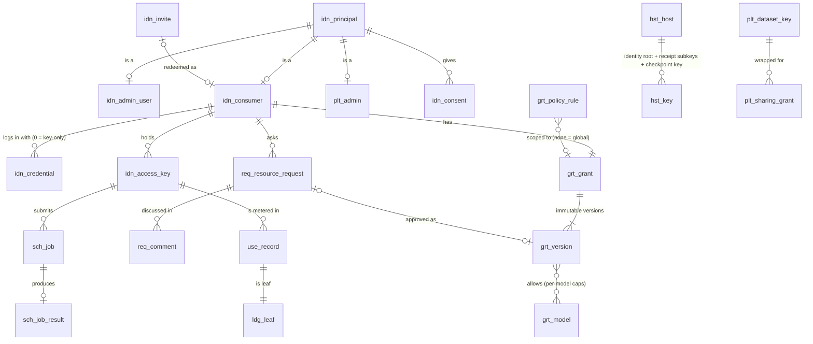
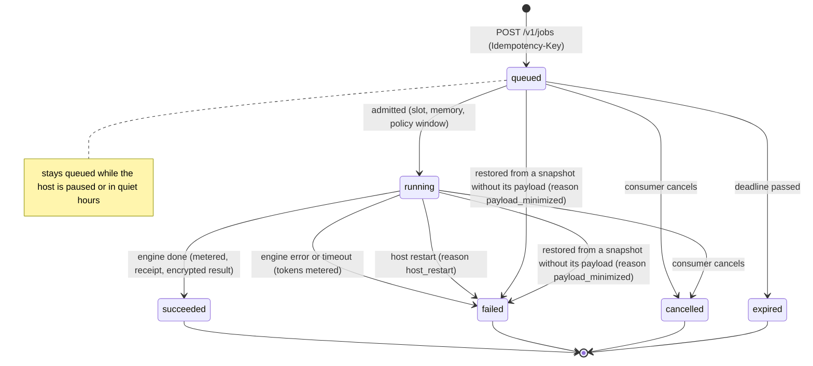
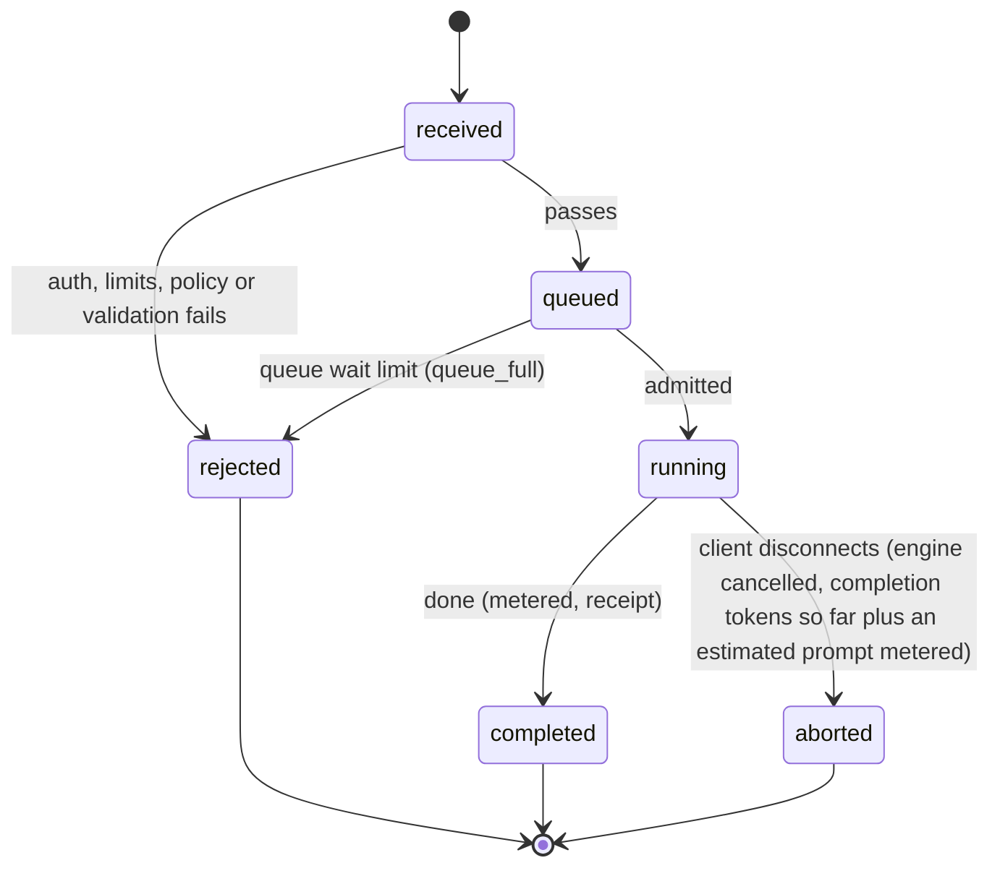
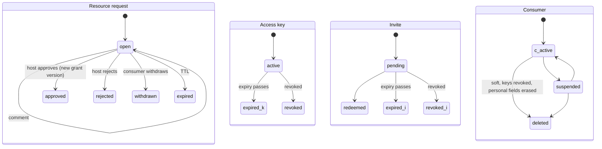
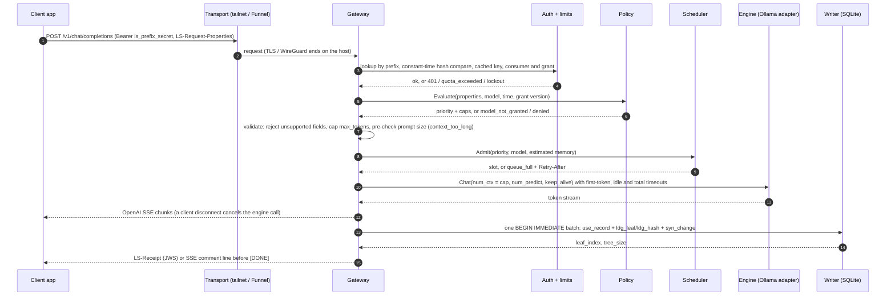
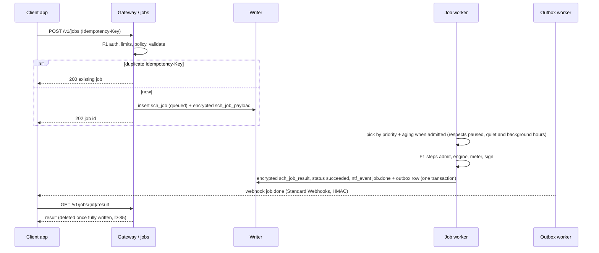
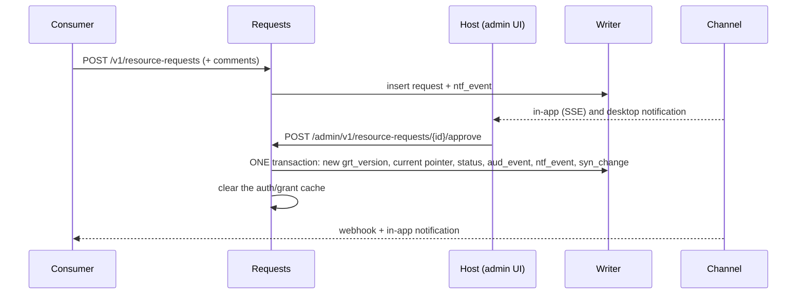
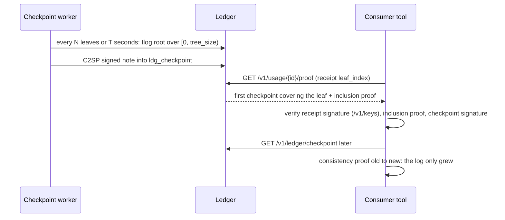
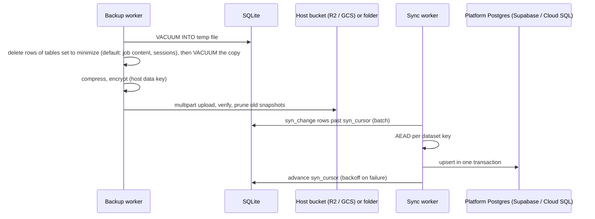
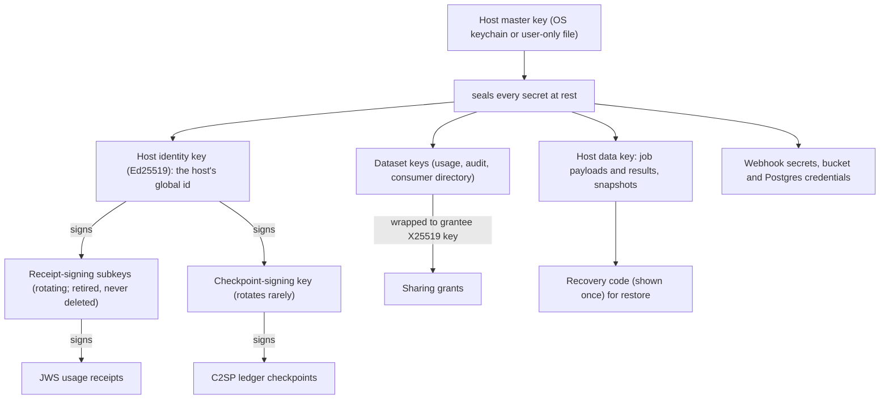

# local-server — low-level design

| | |
|---|---|
| **Status** | Design complete, implementation starting. Once code exists, the code, migrations and `api/openapi.yaml` are the source for anything they define, and this document is kept in step by the docs sync. |
| **Read first** | [High-level design](hld.md) |
| **Source of truth** | [`req_001.decisions.md`](../tracks/platform/phase_1/requirements/req_001.decisions.md) (`D-NN` rows). The LLD rows are D-39, D-40, D-42..D-44, D-48, D-51..D-55 and D-57..D-62. |
| **req_002 additions** | The *planned* subsections marked req_002 come from [`req_002.decisions.md`](../tracks/platform/phase_1/requirements/req_002.decisions.md), LLD rows D-26..D-30 ([ADR 0007](../adr/0007-req002-system-design.md)). They are built in phase 2 |
| **Labels** | **Judgement**, **Unsourced** and **Illustrative** (a sketch the implementing ticket settles) |

---

## 1. Module map

Each module owns its package, its tables (by prefix), and its port where it has one. Core modules import ports, never adapters (D-21). `tools/archcheck` (PLT-C-001) enforces the map in CI with forbidden-import checks: every package under `internal/` belongs to one module, an adapter is imported only by `cmd/` or from inside that adapter, drivers only in their owning module, no import cycles between modules, and nothing under `internal/` imports `cmd/` or `tools/`; a violation fails the build.

| Module | Package | Owns tables | Port it defines | Ticket |
|---|---|---|---|---|
| storage | `internal/storage/` | `ops_schema_migrations`, `ops_migration_run`, `ops_data_catalog` | repositories, unit of work | PLT-F-002 |
| settings | `internal/settings/` | `hst_setting` | settings owner model | PLT-F-004 |
| telemetry | `internal/telemetry/` | — | `Telemetry` | PLT-F-003 |
| host | `internal/hostkeys/`, `internal/hostmetrics/`, `internal/host/` | `hst_host`, `hst_key`, `hst_metric_minute` | `HostMetrics` | PLT-F-005, PLT-F-012, PLT-F-013 |
| engine | `internal/engine/` | — | `Engine` | PLT-F-006 |
| identity and grants | `internal/identity/`, `internal/grants/` | `idn_*`, `grt_*` | — | PLT-F-007 |
| audit | `internal/audit/` | `aud_event` | — | PLT-F-008 |
| events | `internal/notifier/events/` | `ntf_event` | domain events | PLT-F-009 |
| auth | `internal/auth/` | (`idn_access_key`, `idn_session` through identity) | — | PLT-F-010 |
| policy | `internal/policy/` | `grt_policy_rule` (through grants) | `Policy` | PLT-F-011 |
| scheduler, jobs | `internal/scheduler/`, `internal/jobs/` | `sch_job`, `sch_job_payload`, `sch_job_result` | — | PLT-F-014, PLT-F-022 |
| usage, ledger | `internal/usage/`, `internal/ledger/` | `use_*`, `ldg_*` | — | PLT-F-015, PLT-F-016, PLT-F-023 |
| limits | `internal/limits/` | — | — | PLT-F-017 |
| gateway | `internal/gateway/` | — | — | PLT-F-018, PLT-F-019 |
| requests | `internal/requests/` | `req_resource_request`, `req_comment` | — | PLT-F-028 |
| notifier | `internal/notifier/` | `ntf_notification`, `ntf_pref`, `ntf_webhook_endpoint`, `ntf_outbox_delivery` | `Channel` | PLT-F-029..F-031 |
| transport | `internal/transport/` | — | transport | PLT-F-038..F-040 |
| off-host | `internal/offhost/` | `syn_change`, `syn_cursor`, `plt_dataset_key` | `OffHostSync` | PLT-F-044..F-046 |
| admin | `internal/admin/` | — (writes through the owning modules) | — | PLT-F-024..F-026 |
| consumer auth | `internal/consumerauth/` | — (`idn_credential`, `idn_session`, `idn_consent` through identity) | auth adapter | PLT-F-027 |
| bundle | `internal/bundle/` | — | — | PLT-F-045 |
| sharing | `internal/sharing/` | `plt_admin`, `plt_sharing_grant` | — | PLT-F-047 |
| power, service | `internal/power/`, `internal/service/` | — | `Power`, service | PLT-F-041, PLT-F-042 |
| directory | `internal/directory/` | — | `directory` (no-op) | PLT-C-001 |
| api | `internal/api/` (generated by ogen) | — | server interfaces | PLT-F-001 |

## 2. Ports (Illustrative signatures)

The names come from the decisions. The exact Go signatures are settled by each port's ticket.

```go
// Engine — D-22. Ollama is the first adapter; llama.cpp and MLX come later.
type Engine interface {
    Chat(ctx context.Context, req ChatRequest) (ChatStream, error) // native /api/chat, num_ctx always set
    Embed(ctx context.Context, req EmbedRequest) (EmbedResult, error)
    ListModels(ctx context.Context) ([]Model, error)
    ModelInfo(ctx context.Context, name string) (ModelInfo, error)
    Load(ctx context.Context, name string, keepAlive time.Duration) error
    Unload(ctx context.Context, name string) error
    Loaded(ctx context.Context) ([]LoadedModel, error) // /api/ps: memory per loaded model
}

// Policy — D-25, D-39 step 3. Decides only; the gateway enforces.
type Policy interface {
    Evaluate(ctx context.Context, in Input) (Decision, error) // properties, model, time, grant version
}
type Decision struct {
    Priority PriorityClass // interactive | background
    Caps     Caps          // context, output, concurrency after narrowing
}

// Telemetry — D-31. slog + Prometheus by default; OpenTelemetry later.
type Telemetry interface {
    Logger() *slog.Logger
    Counter(name string, labels ...string) Counter
    Histogram(name string, labels ...string) Histogram
    StartSpan(ctx context.Context, name string) (context.Context, Span) // no-op by default
}

// OffHostSync — D-41, D-59, D-64. Snapshot targets: local folder, S3-compatible (R2, GCS).
// Platform sync: generic Postgres (Supabase, Cloud SQL, AlloyDB).
type OffHostSync interface {
    // SnapshotRef records which tables the snapshot minimized; RestoreReport lists them (D-64).
    Snapshot(ctx context.Context) (SnapshotRef, error)
    Restore(ctx context.Context, ref SnapshotRef, recoveryCode string) (RestoreReport, error)
}
```

`HostMetrics`, `Channel` (in-app, webhook, desktop; D-84), `Power` (sleep lock), the transport, and `directory` follow the same rule. Each is small, role-specific, and comes with a shared contract test suite that every adapter must pass (D-31).

## 3. Data model (D-37 as superseded by D-42 and D-44, plus D-53)

### 3.1 Conventions

- **Tables and keys:** `STRICT` tables, `PRAGMA foreign_keys=ON` and `busy_timeout` in every DSN.
- **Foreign keys:** `RESTRICT` from soft-deleted parents, `CASCADE` for owned children.
- **IDs and times:** ids are UUIDv7 as TEXT. Times are INTEGER Unix milliseconds, UTC.
- **Types:** only portable types (TEXT, INTEGER, REAL, BLOB), so a Postgres adapter maps one to one.
- **Prefixes:** each module's tables carry a short prefix: `hst_ idn_ grt_ req_ sch_ use_ ldg_ ntf_ aud_ syn_ plt_ ops_`.
- **Metadata:** every table and column has a plain-language comment, a classification (`public` | `internal` | `personal` | `sensitive` | `content`) and a `billable` flag. They are collected into `ops_data_catalog` at startup, and a generated schema reference stays in step with the migrations.
- **Migrations:** forward-only, per module (`internal/<module>/migrations/`). Destructive changes go expand → backfill → contract across two releases. Exports and sync rows carry the schema version, and import refuses unknown versions.

Table names below apply D-44's prefix mapping to D-37's tables. The migrations are the source once written.

### 3.2 Core relationships



| Table | Key facts |
|---|---|
| `idn_principal` | id, kind (`host_admin` \| `consumer` \| `platform_admin` \| future), category and segment tags, `plan_id` (null in Phase 1), status. It has **no** FK to the type tables, so a new user type never alters it (D-53). |
| `idn_consumer` | `principal_id` UNIQUE FK, kind `individual` \| `application`, personal fields erased on deletion, soft-deleted through `idn_principal.status` (D-42) |
| `idn_access_key` | `prefix` UNIQUE, secret hash, optional narrowing JSON, `expires_at`, `revoked_at`, `bound_node` |
| `grt_version` | Immutable. Quotas, concurrency, expiry, allowed properties, `on_context_overflow` (`refuse` \| `truncate`, D-48). `grt_grant.current_version_id` points at the live one. |
| `use_record` | Immutable. Token counts, model, latency, **copies** `consumer_id` and `grant_version_id`, so the hot path needs no joins |
| `ldg_leaf`, `ldg_hash`, `ldg_checkpoint` | `leaf_index` PK + leaf hash; tlog stored hashes; `tree_size` PK + root + signed note + signing key id |
| `sch_job_payload`, `sch_job_result` | The only content-bearing tables. Encrypted with the host data key, never synced, deleted at the terminal state, or once a fetch has written the whole result (D-85) |
| `syn_change`, `syn_cursor` | `seq` AUTOINCREMENT, dataset, table, pk, version, op, payload. Written **in the same transaction** as the change it records. The cursor tracks the last seq each target acknowledged Always captured; rows no target has acknowledged are pruned after `sync.change.retention` (default 30 d, D-77). |
| `plt_sharing_grant` | grantor and grantee principal, grantee public key, dataset, purpose, terms version, key version, wrapped key, expiry, `revoked_at` |
| `aud_event` | Append-only, kept forever |

Usage, the ledger and receipts refer to rows that are therefore only ever soft-deleted (D-42).

### 3.3 req_002 additions (planned): schema and relationships (D-29, D-30)

Planned, built in phase 2 ([ADR 0007](../adr/0007-req002-system-design.md)). Migrations only go forward; new tables are `STRICT` with the `--@table` and `--@column` annotations. A grant version and its child rows stay immutable, so changing a grant's options makes a new version.

| Migration | Change |
|---|---|
| `internal/grants/migrations/0004_options.sql` | New table `grt_version_model_option`: `version_id`, `model_id`, `option` (the neutral name, no CHECK list so a new option needs no migration), `mode` (`default` or `forced`), `value` (JSON text); primary key `(version_id, model_id, option)`; foreign key `(version_id, model_id)` to `grt_version_model` with `ON DELETE CASCADE`; the same no-update and no-delete triggers. `grt_version_model` gains `keep_alive_cap_seconds INTEGER` (at least 0, empty means no grant cap) and `thinking_allowed INTEGER` (0 or 1, empty means allowed). Its `context_cap` and `max_output_tokens` stay as the other two resource caps |
| `internal/usage/migrations/0005_task.sql` | `use_record` gains `task TEXT CHECK (task IS NULL OR task <> '')`. `use_rollup` is rebuilt, because SQLite cannot change a primary key: a new table with `task TEXT NOT NULL DEFAULT ''` in the key `(granularity, bucket_start, consumer_id, access_key_id, model, task)`, every old row copied with `task = ''`, the old table dropped, the new one renamed, the consumer index recreated with `task` last and the keyset cursor gaining `task` last. `use_rollup_state` and the retention rules stay. Extended by the AI-architecture stage ([ADR 0008](../adr/0008-req002-ai-architecture.md), D-32, D-37): `use_record` also gains a nullable `model_digest TEXT` (the full digest of the model that served the call) and a nullable `steps` JSON text column (the per-step trace, numbers and ids only); neither is in the canonical leaf or the receipt |

- **Per model:** options hang off `grt_version_model` because the caps already live per model, so a host can allow thinking for one model and not another. **Values** are validated in code by one option table in the engine port (name, type, bounds, resource or plain), read by `validateChat`, the admin API and the discovery builder.
- **Policy rules:** `caps` in `rule_v1.schema.json` gains optional `keep_alive_seconds` and `thinking` (boolean), smallest wins and any not-allowed wins, additive in format version 1. **Rules carry caps only**, not defaults or forced values. **Judgement:** forced values have no clean merge across rules. An older binary would refuse such a rule, which is acceptable because migrations only go forward.
- **Settings (host-owned, no migration):** `policy.task.max_length` (proposed default 64), `usage.task.max_per_window` (proposed default 50), `gateway.model_info_ttl` (proposed default 5m) and `scheduler.keep_alive_max` (proposed default 1h; the host's cap on a client's `keep_alive` when the grant sets none, which a grant or rule cap can only narrow). Access keys narrow only what they narrow today (`internal/auth/narrowing.go`).
- **Unchanged:** `ldg_*`, `use_request_counter`, `sch_job*` (the effective options go inside the sealed result).
- **Compatibility:** old grant versions have no option rows and no new caps and behave as today; old `use_record` rows have no task.

**Relationships (D-30)**

| Pair | Cardinality and key | On delete |
|---|---|---|
| `grt_version_model` to `grt_version_model_option` | 1 to 0..n, key `(version_id, model_id)`, at most one row per option name, owned by grants | cascade (never fires: versions are immutable and the triggers block DELETE) |
| option rows to `grt_model` | through the parent row only; a retired model keeps its rows and the gateway already skips retired models (`internal/gateway/pipeline.go`) | not applicable |
| `use_record.task` and `use_rollup.task` | **no foreign key**: copied labels, like `model` and the ids | records are never deleted; rollup rows are pruned by the existing retention settings |
| `use_record` to `use_rollup` | derived; the rollup's task equals the record's task, or `other` over the cap. **Invariant (a test):** per consumer, key, model and bucket, the sum over tasks equals the old per-bucket total | not applicable |
| a consumer's day to task names | at most `usage.task.max_per_window` named tasks plus `other` and the empty one; lowering the setting keeps the names already in that day's buckets | not applicable |
| stored option name to the code's option table | **no foreign key**: a name the code does not know is skipped with a log line and never fails a request | not applicable |

## 4. State machines (D-54)

Terminal states never reopen, so the audit and billing history stays linear. Every timeout and retry count is a setting.

### Job



### Interactive request (in memory)



### Resource request, access key, invite, consumer



### Host sharing, models, webhooks, sharing grants

| Entity | Transitions |
|---|---|
| Host sharing | sharing ↔ paused (manual), sharing ↔ quiet (schedule). While paused or quiet, interactive calls get `host_paused`, jobs wait, and the sleep lock is released |
| Model (from `/api/ps`) | unloaded → loading → loaded → unloading → unloaded. A failed load returns to unloaded (`load_failed`) |
| Webhook delivery | pending → delivering → delivered \| retry_scheduled → … \| failed. The endpoint is disabled after a `410` or N consecutive failures |
| Sharing grant | requested → active \| declined. active → expired \| revoked, and either one rotates the dataset key |
| Signing key | active → retired (kept for verifying old receipts) |
| Sync change | pending → acked → pruned |

### Chat stream and chunk reader, req_002 changes (planned, D-26)

Planned ([ADR 0007](../adr/0007-req002-system-design.md)). Two machines change and none is added.

| Machine | Change |
|---|---|
| Chat stream (`internal/gateway/stream/stream.go`) | The order stays opened, role chunk, deltas, finish chunk, optional usage chunk, `[DONE]`. A new event, a **reasoning chunk**, emits `delta{reasoning}` before the finish chunk and resets the idle timer |
| Ollama chunk reader (`internal/engine/ollama/stream.go`) | `engine.ChatChunk` gains a `Reasoning` text field, and `Recv` returns thinking-only chunks instead of dropping them, so the gateway's first-token and idle limits see a long think and an aborted call's completion count includes it |

- **Unchanged:** the job lifecycle (a queued job is decided again at admission, so its options are re-resolved then), and **model residency**: a client `keep_alive` within the host cap changes only the ticket's expiry value, and a **pinned model keeps `-1`**, so the client's value is ignored for it and the answer reports `-1`. Option resolution is a pure function and holds no state.
- **Why:** a request's `keep_alive` replaces a loaded model's unload timer in Ollama, so a client value would silently unpin a model the host keeps loaded. **Sources:** [Ollama scheduler](https://raw.githubusercontent.com/ollama/ollama/main/server/sched.go), [Ollama FAQ](https://docs.ollama.com/faq), [Ollama issue 11002](https://github.com/ollama/ollama/issues/11002). **Unsourced:** what Ollama does when a second request shortens `keep_alive` while the first is still running. Repo: `internal/scheduler/scheduler.go`.

## 5. Call flows (D-39)

### F1 — interactive chat or embeddings



Failure branches:
- **Engine down:** `503 engine_unavailable`.
- **Metering write keeps failing:** it is retried in memory first. If it still fails, the answer is returned with a signed receipt marked `unmetered` and no leaf index. The failure is logged, counted and emitted as `metering.failed` (D-51). If the unmetered receipt cannot be signed either, the call answers 500 and metering.failed is still emitted: no answer goes out without a receipt (D-16, D-51).
- **Context overflow:** with `on_context_overflow = refuse`, the adapter sends `truncate:false` and `shift:false`, and maps Ollama's error to `context_too_long` (D-48).

### F2 — async job



### F3 — resource request approval (one unit of work)



### F5 — checkpoint, and how a consumer verifies



### F6 — off-host backup and opt-in platform sync



Minimization (D-64) runs on the temp copy, never on the live database. The setting is one entry per table in `ops_data_catalog`, kept in `hst_setting` (PLT-F-004); the catalog itself is rebuilt at startup (D-44) and holds no settings. Deletes run with `foreign_keys=ON`. A table can be set to minimize only when every table that references it is also minimized (D-69), so a kept table never holds a dangling reference and a CASCADE never empties a table the host chose to keep. After the deletes commit, the copy is vacuumed, so freed pages keep no deleted rows. On restore, `Restore` marks every job that was queued or running in the snapshot and lost its `sch_job_payload` row `failed(payload_minimized)`, and its `RestoreReport` gives their count (D-68). Restore runs before the host next starts, so the start-up `host_restart` pass finds those jobs already terminal (D-72). Every backup run first re-checks D-69 over the current schema; if a migration broke it, the run fails, names the tables and notifies the host, and nothing is silently emptied (D-71).

### F4, F7, F8, F9

- **F4 webhooks:** due outbox rows → a Standard Webhooks POST (`webhook-id`, `webhook-timestamp`, `webhook-signature` HMAC-SHA256 `v1`) with a timeout → delivery status. Exponential backoff between attempts.
- **F7 sharing grant:** the grantee's tool writes a request row into the platform store → the host's sync pulls it → the host approves in the admin UI → the dataset key is wrapped to the grantee's X25519 key and pushed → the grantee decrypts locally. A host timer rotates the key at expiry or revocation.
- **F8 login:**
  - Password: argon2id (at or above OWASP's minimum) → session cookie (HttpOnly, Secure, SameSite=Strict).
  - Passkey: go-webauthn discoverable login.
  - Invite: the token creates the consumer and their first credential.
- **F9 startup:** migrations → keys → check Ollama and Tailscale → listeners → workers (scheduler, outbox, checkpoint, sync, retention, rollups, metrics sampler, sleep lock).

### F1 and F2 changes for req_002 (planned, D-27)

Planned ([ADR 0007](../adr/0007-req002-system-design.md)).

**Chat call (`CreateChatCompletion`), steps that change**

| # | Step | What changes |
|---|---|---|
| 2 | `policy.Evaluate`, sync | The `Decision` gains the grant's per-model option defaults and forced values, two resource caps (`keep_alive`, thinking allowed; smallest cap wins, any not-allowed wins) and the validated task from `LS-Request-Properties` (a bad value is `invalid_properties`) |
| 3 | `validateChat`, sync | Accepts `frequency_penalty`, `presence_penalty`, `response_format` (`json_object`, `json_schema`), `reasoning_effort` and the engine-options object (`top_k`, `min_p`, `repeat_penalty`, `context_size`, `keep_alive`): type and range checks only; an unknown key stays `unsupported_parameter` |
| 4 | `planChat`, sync | Each option resolves as forced value, else client value, else grant default, else unset (the model's own default); resource options clamp to the caps and are reported. A **client-sent option the model cannot carry is `unsupported_parameter`**; a **grant default or forced value it cannot carry is skipped and reported as not applied**. Model capabilities come from `ModelInfo` through a cache (`gateway.model_info_ttl`) |
| 5 | `scheduler.Admit`, sync | `scheduler.Request` gains `KeepAlive`; the ticket uses the effective value, a pinned model stays `-1`, and the default is the model's `keep_alive_seconds` when set (stored but unused today) else `scheduler.keep_alive` |
| 6 | engine port `Chat`, async | `engine.ChatRequest` gains `TopK`, `MinP`, `RepeatPenalty`, `FrequencyPenalty`, `PresencePenalty`, `Format`, `Think` |
| 7 | chunk reads, async | Reasoning chunks fill the message's `reasoning` field, or `reasoning` stream deltas |
| 8 | `meter` | Metering gets the task; an aborted call counts reasoning chunks; `reasoning_tokens` is omitted because Ollama gives no separate count |
| 9 | response | The effective-options header goes out on streamed and non-streamed answers, built at step 4 before the engine runs, in the RFC 9651 dictionary form of `LS-Request-Properties`. Each option gives the value that ran and `was` and `by` (`cap`, `forced`, `not_applied`) when it differs from the request. The exact header and key names are settled in the spec ticket |

- **Failure paths:** a wrong type or range is 400 `invalid_request_error` naming the field; over a cap is clamped and reported, never refused; a failed capability lookup returns the engine's own typed error; no new timeouts (thinking time falls under `gateway.engine_timeout` and the stream limits).
- **Thinking** is set by `reasoning_effort` alone (`none`, `low`, `medium`, `high`, proposed default); the options object has no `think`. `none` on a model without thinking sends nothing.
- **Jobs (F2):** steps 2 to 4 run at submission; the sealed payload also holds the options and the task; the job is decided again at admission, so options resolve then, and its result carries the same header from the admission-time resolution, stored inside the sealed result.
- **Discovery:** one builder yields the per-model support list for `planChat`, `GET /v1/capabilities` and the `supported_parameters` names on `GET /v1/models`. `/v1/capabilities` shows grant-level values after the key's narrowing and does not apply policy rules, so the header is the truth for one request.
- **Ollama mapping (adapter only):** `options.top_k`, `min_p`, `repeat_penalty`, `presence_penalty`, `frequency_penalty`; `context_size` becomes `num_ctx`; `keep_alive` is the top-level `keep_alive`; `json_object` becomes `format: "json"` and `json_schema` becomes `format` set to the schema; `reasoning_effort` `none` becomes `think: false`, and `low`, `medium` or `high` becomes the same level string for a model whose `/api/show` lists levels, else `think: true`. `ModelInfo` gains the model's thinking levels, and the capability check reads `thinking`.
- **Extended by the AI-architecture stage ([ADR 0008](../adr/0008-req002-ai-architecture.md)):** the answer and every stream chunk carry `system_fingerprint` built from the model's digest (D-32); the effective-options header also states the overflow policy in force, `refuse` or `truncate` (D-36); thinking tokens share the output cap and the library signals an empty, length-limited answer (D-38).
- **Sources:** [Ollama OpenAPI spec](https://docs.ollama.com/openapi.yaml), [structured outputs](https://docs.ollama.com/capabilities/structured-outputs), [thinking](https://docs.ollama.com/capabilities/thinking), [OpenAI compatibility](https://docs.ollama.com/api/openai-compatibility), [OpenAI layer source](https://raw.githubusercontent.com/ollama/ollama/main/openai/openai.go), [API types](https://raw.githubusercontent.com/ollama/ollama/main/api/types.go). **Unsourced:** whether `eval_count` includes thinking tokens, a live `/api/show` response listing `tools`, and Ollama's behaviour for `think: false` on a model without thinking (the gateway sends nothing then). Repo: `internal/gateway/chat.go`, `validate.go`, `pipeline.go`, `jobs.go`, `status.go`.

### Chat pipeline graph, req_002 (planned, D-37)

Planned ([ADR 0008](../adr/0008-req002-ai-architecture.md)). The chat pipeline becomes a **named-node graph in this repo**: a small pipeline package where nodes are named functions over one typed state, plus a runner that records steps. There is no external framework, `CGO_ENABLED=0` is unaffected, and it is a refactor of the steps that already run in this order (`internal/gateway/chat.go`), estimated M.

**State `CallState`** (in memory per request; **C** marks content, never logged or stored except in a consented checkpoint)

| Field | Type | Written by |
|---|---|---|
| `run_id` | usage id (UUID) | identify |
| `identity` | consumer, key, grant version | identify |
| `request` **C** | messages, options as sent, task | validate |
| `decision` | caps, defaults and forced values, priority, task | evaluate |
| `plan` | effective options, numCtx, numPredict, keep-alive, overflow policy, model support | plan |
| `ticket` | admitted, queue wait | admit |
| `result` **C** | reasoning text, content, finish reason, token counts | infer |
| `usage` | usage record, receipt, fingerprint | meter |
| `steps[]` | per node: id, start, end, outcome, error code | every node appends |

**Nodes**

| Id | Kind | Does | Tunables | Fallback |
|---|---|---|---|---|
| `identify` | deterministic | key or session to identity, rate and quota checks | `limits.*` | refuse |
| `evaluate` | deterministic | policy rules, windows, caps | rules, `policy.*` | refuse |
| `validate` | deterministic | fields, ranges, task | `limits.max_body_bytes`, `policy.task.max_length` | refuse |
| `plan` | deterministic | resolve options, capability check, header | grant defaults, forced values and caps, `gateway.model_info_ttl` | refuse, or skip and report (D-27) |
| `admit` | deterministic | queue, load model | `scheduler.*` | queue-full refusal |
| `infer` | **model call** | the engine call | the options object, `gateway.engine_timeout`, stream limits | none (D-35) |
| `meter` | deterministic | usage record, ledger, receipt | metering attempts, timeout, delay | unmetered signed receipt |

- **Edges:** linear. Any node's error goes to a typed error response. A client abort during `infer` goes to `meter` as `aborted` and a failed stream as `failed`, as today. A job runs `identify`, `evaluate`, `validate` and queues, and its worker runs `evaluate`, `plan`, `admit`, `infer`, `meter`, deciding again at admission. No interrupts. No retries of `infer`; metering retries stay as they are.
- **Per-step trace, always on, no content:** `meter` writes `steps` as numbers and ids only into `use_record.steps`, so the owner sees which step was slow or refused.
- **Checkpoints and replay, only for consented calls:** a checkpoint holds the state with content and is written only when the client consented to host persistence (the deferred mechanism, Q-25), and for a job only while its sealed payload exists. Replay re-runs from `plan` or `infer` with a changed tunable and compares with the original, as a new run with its own usage id flagged as a replay, so `meter` still writes one record per run. Replay is not the same answer unless a seed is set. The checkpoint store and the replay API are part of Q-25.

## 6. Concurrency model

| Goroutine(s) | Role | Communicates by |
|---|---|---|
| HTTP handlers (one per request, `net/http`) | F1 pipeline. Request `context.Context` cancellation reaches the engine call | function calls; `Admit` blocks with the request context |
| Scheduler | holds the priority queue (binary heap with aging) and the slot and memory accounting | admit requests and release signals |
| Writer (exactly one) | owns the only write connection, and batches queued units of work into `BEGIN IMMEDIATE` transactions | a channel of units of work, each with a result channel |
| Read pool | a few read-only connections (WAL lets readers run alongside the writer) | `database/sql` |
| Workers | outbox delivery, checkpoints, rollups, retention, off-host sync and snapshots, host-metrics sampler, sleep lock | tickers driven by settings, plus domain events |
| Cache invalidation | key → consumer → grant cache | change events cause eviction |

Rules:
- **Context everywhere:** every blocking call takes a context.
- **One writer:** no other goroutine writes to the database (D-28).
- **Disconnects cancel:** a client disconnect cancels the engine call through the context. Tokens already produced are still metered, with an estimated prompt count (the prompt's size in bytes over `gateway.chars_per_token`) that the receipt marks `prompt_tokens_estimated`.
- **Shutdown** (**Judgement**, settled in PLT-F-020): stop accepting, drain in-flight requests up to a setting, stop the workers, then flush the writer.
- **CI:** `go test -race` on Linux and macOS covers all of this (D-61).

## 7. Data paths (D-40)

| Data | Path | Kept |
|---|---|---|
| Prompt and response content | client → encrypted transport → gateway memory → Ollama on localhost → back | never on disk or in logs |
| Queued job content | `sch_job_payload`, encrypted | until the terminal state; never synced; left out of backups by default (D-64) |
| Job result | `sch_job_result`, encrypted, only to its consumer | until a fetch has written it whole (D-85), or 24 h; left out of backups by default (D-64) |
| Access key secret | generated and shown once; only the prefix and hash are stored | never synced |
| Credentials | argon2id hash or WebAuthn public key | never synced |
| Consumer personal data | `idn_consumer`; erased on deletion, the row stays | synced encrypted (consumer-directory dataset) |
| Usage metadata | `use_record` → ledger leaf → rollups (minute 7 d, hour 90 d, day forever) | records and ledger forever; usage dataset |
| Audit events | `aud_event` | forever; audit dataset |
| Host readings | sampler → `hst_metric_minute` → `/metrics` and the UI | 7 d; not synced |
| Logs | slog JSON → lumberjack-rotated files, redacted types | 14 d / 50 MB; not synced |
| Webhook payloads | event (no content) → outbox → receiver | delivered + 7 d |
| Domain events | `ntf_event` | 30 d (`events.retention`, D-83); outbox rows never outlive their event |
| Change feed | `syn_change` | unacknowledged rows 30 d (`sync.change.retention`, D-77) |
| Secret keys | sealed with a master key in the OS keychain, or a user-only file on headless Linux | never leave the host, except dataset keys wrapped for an approved grantee |

Every retention above is a setting with that default (D-54).

### req_002 data paths (planned, D-28)

Planned ([ADR 0007](../adr/0007-req002-system-design.md)).

- **Task tag:** client `LS-Request-Properties` `task=<token>`, then `policy.ParseProperties` (existing size and count limits), then a check (lowercase letters, digits, `.`, `_`, `-`; at most `policy.task.max_length` characters), then `Decision.Task`, `ledger.Usage.Task` and `use_record.task`, kept forever like the record. The **rollup worker** applies the cap: per consumer and UTC day bucket the first `usage.task.max_per_window` distinct tasks keep their name and later ones become `other`, in `use_record` rowid order, and the minute and hour buckets of that day use the same mapping. The task is **not** in the canonical leaf or the signed receipt, so `LeafVersion` and every leaf hash stay as they are. `checkAllowed` is unchanged: a grant whose `allowed_properties` omits `task` still refuses it, and discovery lists the allowed properties so the TypeScript library sends `task` only when allowed.
- **Option values:** not stored on `use_record`; they reach the client only in the effective-options header, and for a job inside the sealed result.
- **Reasoning text:** engine, memory, client; never logged or stored; a job's sealed result holds it with the content. Completion tokens stay the engine's final count, and an aborted call counts each reasoning chunk as one token.
- **Structured output:** a `json_schema` goes from the body to `engine.ChatRequest.Format` to Ollama `format`, never logged or stored, sealed in a job's payload, and bounded by `limits.max_body_bytes`.
- **Images:** this corrects F-06 of the log: the spec accepts image parts but `flattenMessage` refuses them. A `data:image/...;base64,` part is checked, the prefix is stripped and the base64 string goes into a new `engine.Message.Images`, which the adapter sends as the message's `images` array. Allowed only when the model's capabilities list `vision`, otherwise 400 `unsupported_parameter` on `messages`. Images are not counted in the prompt-size pre-check or the aborted-call estimate. A job's sealed payload gains the images. Sources: [Ollama chat API](https://docs.ollama.com/api/chat), [Ollama vision](https://docs.ollama.com/capabilities/vision). **Unsourced:** that the native chat endpoint needs no `data:` prefix on `images` (inferred from Ollama's examples; a contract test confirms it).
- **Capabilities:** `/api/show`, then an in-memory cache (`gateway.model_info_ttl`), then one builder for `planChat`, `/v1/capabilities` and `/v1/models`; the cache holds model facts only.
- **Usage by task, out:** `GET /v1/usage` and the consumer page gain a `task` filter and a `task` field on rows, `null` where no task was sent.

## 8. Key hierarchy



Checkpoints have their own signing key (D-65): stable, so verifiers and future witnesses can follow the log, and separate from the receipt subkeys, so a leaked receipt key cannot forge tree heads. The identity, receipt-signing and checkpoint-signing public keys, current and retired, are published at `/v1/keys`.

## 9. Error model

The OpenAI error envelope (`{"error": {"message", "type", "code"}}`) plus local-server's typed codes. The HTTP status of each code is fixed in `api/openapi.yaml` (PLT-F-001).

| Code | Meaning | Client action |
|---|---|---|
| `quota_exceeded` | Token quota for the window used up | Wait for `Retry-After`, or file a resource request |
| `queue_full` | Admission queue full | Retry after `Retry-After`, or fall back |
| `host_paused` | Host paused or in quiet hours | Fall back; background work waits |
| `model_not_granted` | Model not in the grant | Use `/v1/capabilities`, or file a resource request |
| `context_too_long` | Prompt exceeds the grant's context cap (overflow policy `refuse`) | Shorten the prompt |
| `engine_unavailable` | Ollama not reachable | Fall back |
| `over_budget` | The request can never fit the share budget (D-93) | Use a smaller model or context |
| `policy_denied` | A deny rule, or a request property the grant does not allow (D-79) | Change the request; the error names the rule and properties |
| `outside_time_window` | A policy rule's time window is closed (D-79) | Retry after `Retry-After`; jobs wait in the queue |
| `invalid_request_properties` | Malformed `LS-Request-Properties` header (D-79) | Fix the header |

## 10. Testing and verification

| Layer | What | Decision |
|---|---|---|
| Unit and table tests | per module, `go test ./...` on 3 OSes | D-31 |
| Port contract suites | every adapter of a port passes the same suite; a fake engine for the gateway | D-31 |
| Golden tests | OpenAI-compatible request and response shapes, byte for byte | D-32 |
| Fuzz targets | access-key header, request properties, policy rules, request decoding, checkpoint notes and receipts, import bundles; seeds run on every CI run, timed fuzzing on a schedule | D-60 |
| Race detector | `CGO_ENABLED=1 go test -race ./...` on Linux and macOS (the only cgo use) | D-61 |
| Vulnerabilities | `go tool govulncheck ./...` fails CI on a reachable known vulnerability | D-62 |
| Benchmarks | gateway overhead, admission latency, receipt signing on the fake engine → SLO targets the owner approves | D-55 |
| Architecture | `tools/archcheck` forbidden imports; every module has an architecture note | D-21 |
| Real services | Postgres and real R2/GCS bucket tests behind build tags, with credentials from the environment | D-59 |

## 11. Build and release

- **Builds:** `CGO_ENABLED=0` for darwin, linux and windows on amd64 and arm64. Both SPAs are built first and embedded with `go:embed`.
- **Darwin binaries:** never stripped or re-signed after the build. Go's linker ad-hoc signs darwin/arm64 binaries, and curl-installed binaries skip Gatekeeper (F-07).
- **Release artifacts:** `SHA256SUMS`, plus SLSA build provenance for every binary and for `SHA256SUMS` through GitHub artifact attestations (`gh attestation verify`, D-62).
- **Dev tools:** pinned as `tool` directives in `go.mod` and run as `go tool …`: ogen, vacuum and govulncheck (D-57, D-62).
