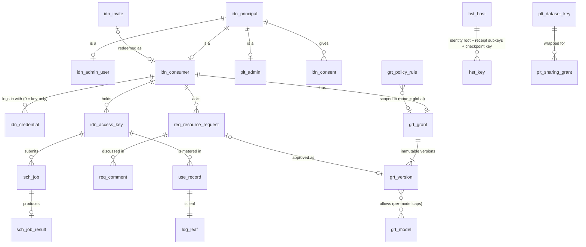
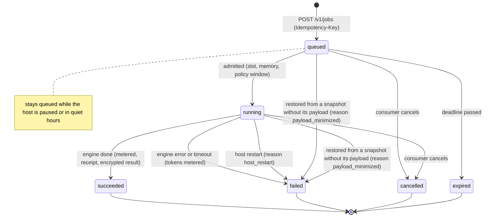
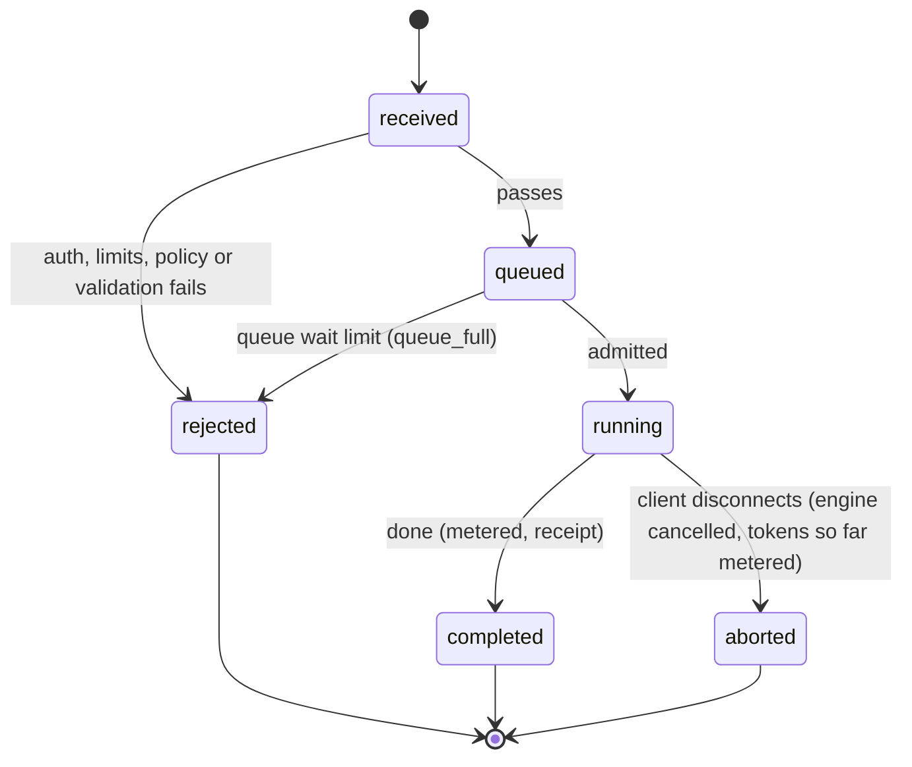
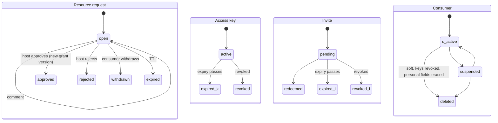
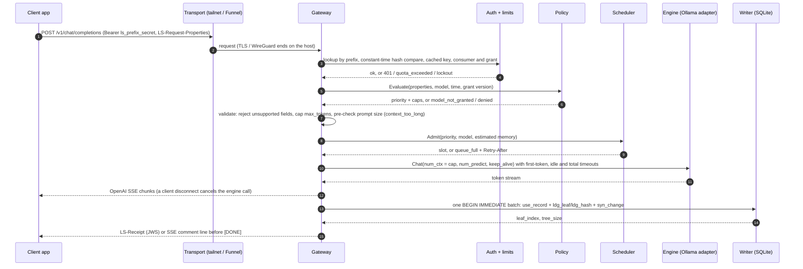
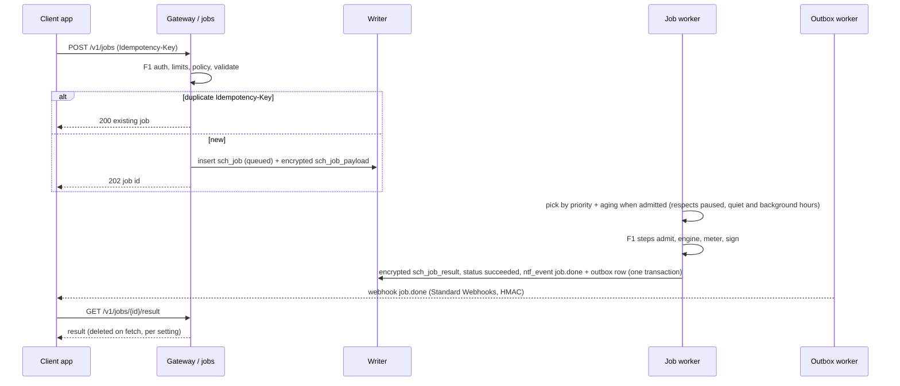
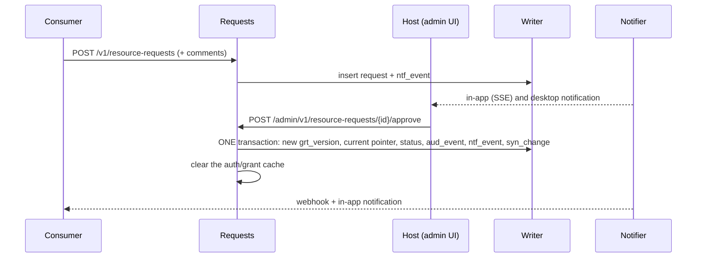
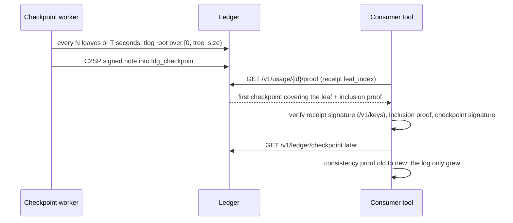
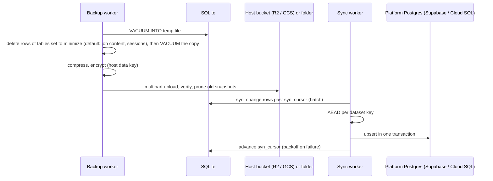
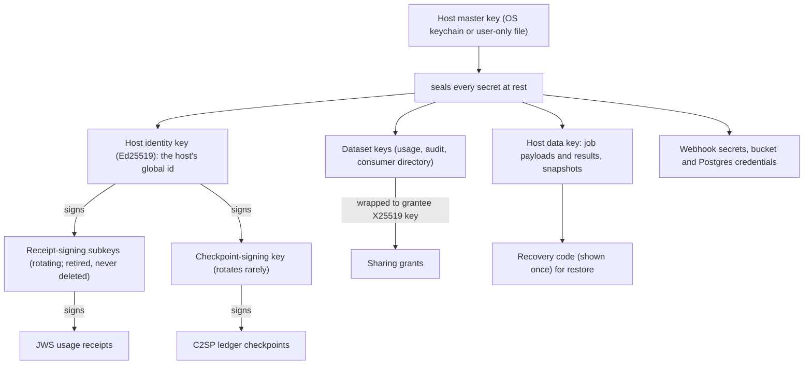

# local-server — low-level design

| | |
|---|---|
| **Status** | Design complete, implementation starting. Once code exists, the code, migrations and `api/openapi.yaml` are the source for anything they define, and this document is kept in step by the docs sync. |
| **Read first** | [High-level design](hld.md) |
| **Source of truth** | [`req_001.decisions.md`](../tracks/platform/phase_1/requirements/req_001.decisions.md) (`D-NN` rows). The LLD rows are D-39, D-40, D-42..D-44, D-48, D-51..D-55 and D-57..D-62. |
| **Labels** | **Judgement**, **Unsourced** and **Illustrative** (a sketch the implementing ticket settles) |

---

## 1. Module map

Each module owns its package, its tables (by prefix), and its port where it has one. Core modules import ports, never adapters (D-21). `tools/archcheck` (PLT-C-001) enforces the map in CI with forbidden-import checks: every package under `internal/` belongs to one module, an adapter is imported only by `cmd/` or from inside that adapter, drivers only in their owning module, no import cycles between modules, and nothing under `internal/` imports `cmd/` or `tools/`; a violation fails the build.

| Module | Package | Owns tables | Port it defines | Ticket |
|---|---|---|---|---|
| storage | `internal/storage/` | `ops_schema_migrations`, `ops_migration_run`, `ops_data_catalog` | repositories, unit of work | PLT-F-002 |
| settings | `internal/settings/` | `hst_setting` | settings owner model | PLT-F-004 |
| telemetry | `internal/telemetry/` | — | `Telemetry` | PLT-F-003 |
| host | `internal/hostkeys/`, `internal/hostmetrics/`, `internal/host/` | `hst_host`, `hst_key`, `hst_metric_minute` | `HostMetrics` | PLT-F-005, PLT-F-012, PLT-F-013 |
| engine | `internal/engine/` | — | `Engine` | PLT-F-006 |
| identity and grants | `internal/identity/`, `internal/grants/` | `idn_*`, `grt_*` | — | PLT-F-007 |
| audit | `internal/audit/` | `aud_event` | — | PLT-F-008 |
| events | `internal/notifier/events/` | `ntf_event` | domain events | PLT-F-009 |
| auth | `internal/auth/` | (`idn_access_key`, `idn_session` through identity) | — | PLT-F-010 |
| policy | `internal/policy/` | `grt_policy_rule` (through grants) | `Policy` | PLT-F-011 |
| scheduler, jobs | `internal/scheduler/`, `internal/jobs/` | `sch_job`, `sch_job_payload`, `sch_job_result` | — | PLT-F-014, PLT-F-022 |
| usage, ledger | `internal/usage/`, `internal/ledger/` | `use_*`, `ldg_*` | — | PLT-F-015, PLT-F-016, PLT-F-023 |
| limits | `internal/limits/` | — | — | PLT-F-017 |
| gateway | `internal/gateway/` | — | — | PLT-F-018, PLT-F-019 |
| requests | `internal/requests/` | `req_resource_request`, `req_comment` | — | PLT-F-028 |
| notifier | `internal/notifier/` | `ntf_notification`, `ntf_pref`, `ntf_webhook_endpoint`, `ntf_outbox_delivery` | `Notifier` | PLT-F-029..F-031 |
| transport | `internal/transport/` | — | transport | PLT-F-038..F-040 |
| off-host | `internal/offhost/` | `syn_change`, `syn_cursor`, `plt_dataset_key` | `OffHostSync` | PLT-F-044..F-046 |
| admin | `internal/admin/` | — (writes through the owning modules) | — | PLT-F-024..F-026 |
| consumer auth | `internal/consumerauth/` | — (`idn_credential`, `idn_session`, `idn_consent` through identity) | auth adapter | PLT-F-027 |
| bundle | `internal/bundle/` | — | — | PLT-F-045 |
| sharing | `internal/sharing/` | `plt_admin`, `plt_sharing_grant` | — | PLT-F-047 |
| power, service | `internal/power/`, `internal/service/` | — | `Power`, service | PLT-F-041, PLT-F-042 |
| directory | `internal/directory/` | — | `directory` (no-op) | PLT-C-001 |
| api | `internal/api/` (generated by ogen) | — | server interfaces | PLT-F-001 |

## 2. Ports (Illustrative signatures)

The names come from the decisions. The exact Go signatures are settled by each port's ticket.

```go
// Engine — D-22. Ollama is the first adapter; llama.cpp and MLX come later.
type Engine interface {
    Chat(ctx context.Context, req ChatRequest) (ChatStream, error) // native /api/chat, num_ctx always set
    Embed(ctx context.Context, req EmbedRequest) (EmbedResult, error)
    ListModels(ctx context.Context) ([]Model, error)
    ModelInfo(ctx context.Context, name string) (ModelInfo, error)
    Load(ctx context.Context, name string, keepAlive time.Duration) error
    Unload(ctx context.Context, name string) error
    Loaded(ctx context.Context) ([]LoadedModel, error) // /api/ps: memory per loaded model
}

// Policy — D-25, D-39 step 3. Decides only; the gateway enforces.
type Policy interface {
    Evaluate(ctx context.Context, in Input) (Decision, error) // properties, model, time, grant version
}
type Decision struct {
    Priority PriorityClass // interactive | background
    Caps     Caps          // context, output, concurrency after narrowing
}

// Telemetry — D-31. slog + Prometheus by default; OpenTelemetry later.
type Telemetry interface {
    Logger() *slog.Logger
    Counter(name string, labels ...string) Counter
    Histogram(name string, labels ...string) Histogram
    StartSpan(ctx context.Context, name string) (context.Context, Span) // no-op by default
}

// OffHostSync — D-41, D-59, D-64. Snapshot targets: local folder, S3-compatible (R2, GCS).
// Platform sync: generic Postgres (Supabase, Cloud SQL, AlloyDB).
type OffHostSync interface {
    // SnapshotRef records which tables the snapshot minimized; RestoreReport lists them (D-64).
    Snapshot(ctx context.Context) (SnapshotRef, error)
    Restore(ctx context.Context, ref SnapshotRef, recoveryCode string) (RestoreReport, error)
}
```

`HostMetrics`, `Notifier` (channels: in-app, webhook, desktop), `Power` (sleep lock), the transport, and `directory` follow the same rule. Each is small, role-specific, and comes with a shared contract test suite that every adapter must pass (D-31).

## 3. Data model (D-37 as superseded by D-42 and D-44, plus D-53)

### 3.1 Conventions

- **Tables and keys:** `STRICT` tables, `PRAGMA foreign_keys=ON` and `busy_timeout` in every DSN.
- **Foreign keys:** `RESTRICT` from soft-deleted parents, `CASCADE` for owned children.
- **IDs and times:** ids are UUIDv7 as TEXT. Times are INTEGER Unix milliseconds, UTC.
- **Types:** only portable types (TEXT, INTEGER, REAL, BLOB), so a Postgres adapter maps one to one.
- **Prefixes:** each module's tables carry a short prefix: `hst_ idn_ grt_ req_ sch_ use_ ldg_ ntf_ aud_ syn_ plt_ ops_`.
- **Metadata:** every table and column has a plain-language comment, a classification (`public` | `internal` | `personal` | `sensitive` | `content`) and a `billable` flag. They are collected into `ops_data_catalog` at startup, and a generated schema reference stays in step with the migrations.
- **Migrations:** forward-only, per module (`internal/<module>/migrations/`). Destructive changes go expand → backfill → contract across two releases. Exports and sync rows carry the schema version, and import refuses unknown versions.

Table names below apply D-44's prefix mapping to D-37's tables. The migrations are the source once written.

### 3.2 Core relationships



| Table | Key facts |
|---|---|
| `idn_principal` | id, kind (`host_admin` \| `consumer` \| `platform_admin` \| future), category and segment tags, `plan_id` (null in Phase 1), status. It has **no** FK to the type tables, so a new user type never alters it (D-53). |
| `idn_consumer` | `principal_id` UNIQUE FK, kind `individual` \| `application`, personal fields erased on deletion, soft-deleted through `idn_principal.status` (D-42) |
| `idn_access_key` | `prefix` UNIQUE, secret hash, optional narrowing JSON, `expires_at`, `revoked_at`, `bound_node` |
| `grt_version` | Immutable. Quotas, concurrency, expiry, allowed properties, `on_context_overflow` (`refuse` \| `truncate`, D-48). `grt_grant.current_version_id` points at the live one. |
| `use_record` | Immutable. Token counts, model, latency, **copies** `consumer_id` and `grant_version_id`, so the hot path needs no joins |
| `ldg_leaf`, `ldg_hash`, `ldg_checkpoint` | `leaf_index` PK + leaf hash; tlog stored hashes; `tree_size` PK + root + signed note + signing key id |
| `sch_job_payload`, `sch_job_result` | The only content-bearing tables. Encrypted with the host data key, never synced, deleted at the terminal state or on fetch |
| `syn_change`, `syn_cursor` | `seq` AUTOINCREMENT, dataset, table, pk, version, op, payload. Written **in the same transaction** as the change it records. The cursor tracks the last seq each target acknowledged |
| `plt_sharing_grant` | grantor and grantee principal, grantee public key, dataset, purpose, terms version, key version, wrapped key, expiry, `revoked_at` |
| `aud_event` | Append-only, kept forever |

Usage, the ledger and receipts refer to rows that are therefore only ever soft-deleted (D-42).

## 4. State machines (D-54)

Terminal states never reopen, so the audit and billing history stays linear. Every timeout and retry count is a setting.

### Job



### Interactive request (in memory)



### Resource request, access key, invite, consumer



### Host sharing, models, webhooks, sharing grants

| Entity | Transitions |
|---|---|
| Host sharing | sharing ↔ paused (manual), sharing ↔ quiet (schedule). While paused or quiet, interactive calls get `host_paused`, jobs wait, and the sleep lock is released |
| Model (from `/api/ps`) | unloaded → loading → loaded → unloading → unloaded. A failed load returns to unloaded (`load_failed`) |
| Webhook delivery | pending → delivering → delivered \| retry_scheduled → … \| failed. The endpoint is disabled after a `410` or N consecutive failures |
| Sharing grant | requested → active \| declined. active → expired \| revoked, and either one rotates the dataset key |
| Signing key | active → retired (kept for verifying old receipts) |
| Sync change | pending → acked → pruned |

## 5. Call flows (D-39)

### F1 — interactive chat or embeddings



Failure branches:
- **Engine down:** `503 engine_unavailable`.
- **Metering write keeps failing:** it is retried in memory first. If it still fails, the answer is returned with a signed receipt marked `unmetered` and no leaf index. The failure is logged, counted and emitted as `metering.failed` (D-51).
- **Context overflow:** with `on_context_overflow = refuse`, the adapter sends `truncate:false` and `shift:false`, and maps Ollama's error to `context_too_long` (D-48).

### F2 — async job



### F3 — resource request approval (one unit of work)



### F5 — checkpoint, and how a consumer verifies



### F6 — off-host backup and opt-in platform sync



Minimization (D-64) runs on the temp copy, never on the live database. The setting is one entry per table in `ops_data_catalog`, kept in `hst_setting` (PLT-F-004); the catalog itself is rebuilt at startup (D-44) and holds no settings. Deletes run with `foreign_keys=ON`. A table can be set to minimize only when every table that references it is also minimized (D-69), so a kept table never holds a dangling reference and a CASCADE never empties a table the host chose to keep. After the deletes commit, the copy is vacuumed, so freed pages keep no deleted rows. On restore, `Restore` marks every job that was queued or running in the snapshot and lost its `sch_job_payload` row `failed(payload_minimized)`, and its `RestoreReport` gives their count (D-68). Restore runs before the host next starts, so the start-up `host_restart` pass finds those jobs already terminal (D-72). Every backup run first re-checks D-69 over the current schema; if a migration broke it, the run fails, names the tables and notifies the host, and nothing is silently emptied (D-71).

### F4, F7, F8, F9

- **F4 webhooks:** due outbox rows → a Standard Webhooks POST (`webhook-id`, `webhook-timestamp`, `webhook-signature` HMAC-SHA256 `v1`) with a timeout → delivery status. Exponential backoff between attempts.
- **F7 sharing grant:** the grantee's tool writes a request row into the platform store → the host's sync pulls it → the host approves in the admin UI → the dataset key is wrapped to the grantee's X25519 key and pushed → the grantee decrypts locally. A host timer rotates the key at expiry or revocation.
- **F8 login:**
  - Password: argon2id (at or above OWASP's minimum) → session cookie (HttpOnly, Secure, SameSite=Strict).
  - Passkey: go-webauthn discoverable login.
  - Invite: the token creates the consumer and their first credential.
- **F9 startup:** migrations → keys → check Ollama and Tailscale → listeners → workers (scheduler, outbox, checkpoint, sync, retention, rollups, metrics sampler, sleep lock).

## 6. Concurrency model

| Goroutine(s) | Role | Communicates by |
|---|---|---|
| HTTP handlers (one per request, `net/http`) | F1 pipeline. Request `context.Context` cancellation reaches the engine call | function calls; `Admit` blocks with the request context |
| Scheduler | holds the priority queue (binary heap with aging) and the slot and memory accounting | admit requests and release signals |
| Writer (exactly one) | owns the only write connection, and batches queued units of work into `BEGIN IMMEDIATE` transactions | a channel of units of work, each with a result channel |
| Read pool | a few read-only connections (WAL lets readers run alongside the writer) | `database/sql` |
| Workers | outbox delivery, checkpoints, rollups, retention, off-host sync and snapshots, host-metrics sampler, sleep lock | tickers driven by settings, plus domain events |
| Cache invalidation | key → consumer → grant cache | change events cause eviction |

Rules:
- **Context everywhere:** every blocking call takes a context.
- **One writer:** no other goroutine writes to the database (D-28).
- **Disconnects cancel:** a client disconnect cancels the engine call through the context. Tokens already produced are still metered.
- **Shutdown** (**Judgement**, settled in PLT-F-020): stop accepting, drain in-flight requests up to a setting, stop the workers, then flush the writer.
- **CI:** `go test -race` on Linux and macOS covers all of this (D-61).

## 7. Data paths (D-40)

| Data | Path | Kept |
|---|---|---|
| Prompt and response content | client → encrypted transport → gateway memory → Ollama on localhost → back | never on disk or in logs |
| Queued job content | `sch_job_payload`, encrypted | until the terminal state; never synced; left out of backups by default (D-64) |
| Job result | `sch_job_result`, encrypted, only to its consumer | until fetched, or 24 h; left out of backups by default (D-64) |
| Access key secret | generated and shown once; only the prefix and hash are stored | never synced |
| Credentials | argon2id hash or WebAuthn public key | never synced |
| Consumer personal data | `idn_consumer`; erased on deletion, the row stays | synced encrypted (consumer-directory dataset) |
| Usage metadata | `use_record` → ledger leaf → rollups (minute 7 d, hour 90 d, day forever) | records and ledger forever; usage dataset |
| Audit events | `aud_event` | forever; audit dataset |
| Host readings | sampler → `hst_metric_minute` → `/metrics` and the UI | 7 d; not synced |
| Logs | slog JSON → lumberjack-rotated files, redacted types | 14 d / 50 MB; not synced |
| Webhook payloads | event (no content) → outbox → receiver | delivered + 7 d |
| Secret keys | sealed with a master key in the OS keychain, or a user-only file on headless Linux | never leave the host, except dataset keys wrapped for an approved grantee |

Every retention above is a setting with that default (D-54).

## 8. Key hierarchy



Checkpoints have their own signing key (D-65): stable, so verifiers and future witnesses can follow the log, and separate from the receipt subkeys, so a leaked receipt key cannot forge tree heads. The identity, receipt-signing and checkpoint-signing public keys, current and retired, are published at `/v1/keys`.

## 9. Error model

The OpenAI error envelope (`{"error": {"message", "type", "code"}}`) plus local-server's typed codes. The HTTP status of each code is fixed in `api/openapi.yaml` (PLT-F-001).

| Code | Meaning | Client action |
|---|---|---|
| `quota_exceeded` | Token quota for the window used up | Wait for `Retry-After`, or file a resource request |
| `queue_full` | Admission queue full | Retry after `Retry-After`, or fall back |
| `host_paused` | Host paused or in quiet hours | Fall back; background work waits |
| `model_not_granted` | Model not in the grant | Use `/v1/capabilities`, or file a resource request |
| `context_too_long` | Prompt exceeds the grant's context cap (overflow policy `refuse`) | Shorten the prompt |
| `engine_unavailable` | Ollama not reachable | Fall back |

## 10. Testing and verification

| Layer | What | Decision |
|---|---|---|
| Unit and table tests | per module, `go test ./...` on 3 OSes | D-31 |
| Port contract suites | every adapter of a port passes the same suite; a fake engine for the gateway | D-31 |
| Golden tests | OpenAI-compatible request and response shapes, byte for byte | D-32 |
| Fuzz targets | access-key header, request properties, policy rules, request decoding, checkpoint notes and receipts, import bundles; seeds run on every CI run, timed fuzzing on a schedule | D-60 |
| Race detector | `CGO_ENABLED=1 go test -race ./...` on Linux and macOS (the only cgo use) | D-61 |
| Vulnerabilities | `go tool govulncheck ./...` fails CI on a reachable known vulnerability | D-62 |
| Benchmarks | gateway overhead, admission latency, receipt signing on the fake engine → SLO targets the owner approves | D-55 |
| Architecture | `tools/archcheck` forbidden imports; every module has an architecture note | D-21 |
| Real services | Postgres and real R2/GCS bucket tests behind build tags, with credentials from the environment | D-59 |

## 11. Build and release

- **Builds:** `CGO_ENABLED=0` for darwin, linux and windows on amd64 and arm64. Both SPAs are built first and embedded with `go:embed`.
- **Darwin binaries:** never stripped or re-signed after the build. Go's linker ad-hoc signs darwin/arm64 binaries, and curl-installed binaries skip Gatekeeper (F-07).
- **Release artifacts:** `SHA256SUMS`, plus SLSA build provenance for every binary and for `SHA256SUMS` through GitHub artifact attestations (`gh attestation verify`, D-62).
- **Dev tools:** pinned as `tool` directives in `go.mod` and run as `go tool …`: ogen, vacuum and govulncheck (D-57, D-62).
